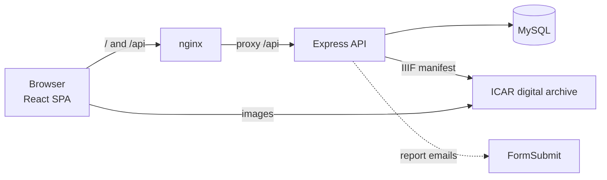

<div align="center">
  <h1>📜 Catasto Fiorentino 1427/30</h1>
  <h3>Digital archive and exploration system</h3>
  <p>A portal to browse, query and verify against the source the data of the <em>catasto</em> of the Republic of Florence of 1427/30.</p>
  <p>🇮🇹 <a href="readme.md">Italiano</a> · 🇬🇧 <strong>English</strong></p>

  <div style="display: flex; justify-content: center; gap: 10px; margin-top: 20px; margin-bottom: 20px;">
    
    
    
    
    
    
  </div>

  
</div>

---

| Field | Value |
|---|---|
| Identifier | `CAT-README` |
| Version | 2.0 |
| Date | 2026-10-29 |
| Status | Approved |
| Classification | Public |
| Owners | Antonio Orfitelli, Pasquale Ruotolo |
| Language | English (translation; the [Italian text](readme.md) prevails) |
| Applied standard | [CAT-DOC-00 Documentation standard](docs/standard-documentale.md) |

## 1. Overview

**Catasto Fiorentino 1427/30** makes the fiscal survey of the Republic of Florence of 1427/30 searchable, queryable and verifiable against the source (the slash indicates the span of the survey campaign, 1427–1430). For each *fuoco* (household, recorded under the name of its head) the portal shows the economic data in florins, the family composition and the territorial location, and opens the **original folio** of the *campione* digitised by the Archivio di Stato di Firenze (State Archives of Florence).

### 1.1 Source and data provenance

| Level (ISAD(G)) | Description |
|---|---|
| Repository | Archivio di Stato di Firenze (ASFi) |
| Fonds | Catasto |
| Archival series | *Campioni* (official registers compiled by the catasto officials) and *portate* (taxpayers' declarations) |
| Files and items | Volume of the *campione* and folio (recto/verso) given for each household |

| Provenance | Content |
|---|---|
| Source datum | About 61,000 households and 270,000 family members from the Herlihy–Klapisch-Zuber research, digitised by [ACRH](https://journals.openedition.org/acrh/7458) |
| Contributed datum | *Portata* shelfmark (form `ASFi, Catasto, …`), proposed by users and published only after editorial verification |
| Derived datum | Statistics, value translations, orderings computed by the portal |
| Images | IIIF service of the ICAR digital archive / ASFi |

Data missing from the source stay missing: the portal neither estimates nor reconstructs them.

### 1.2 Audience

- **scholars and researchers**, who build precise queries and verify each datum against the source;
- **students**, who explore the catasto without archival training;
- **editors**, who moderate user reports and publish verified shelfmarks.

## 2. Features

| | Feature | Description |
|---|---|---|
| 🔎 | **Simple search** | By person ("Nuto di Nardo"), place and volume; filters on occupation, livestock, immigration, house and particularities; cascading geography territorial series → quarter → *piviere* → *popolo*; ranges in florins on *fortune*, credit, credit in the Monte, taxable assets and deductions |
| 🧩 | **Advanced search** | Compound queries with AND/OR groups, exclusion and nesting, plain-language preview, 20 queryable fields, including age and particularities of family members |
| 🔗 | **Saved and shared queries** | Saved on the device and shareable links (`#q=…`) that reopen the same search |
| 👪 | **Household record** | Economic data, occupation, location and family composition (relationship, age, marital status) |
| 🖼️ | **Folio viewer** | Opens the IIIF volume at the household's folio (*campione* and, when known, *portata*), with zoom, drag and touch gestures |
| 📊 | **Statistics** | Totals, means, medians and quartiles of the economic data (missing values counted apart), distributions by occupation, quarter and territorial series, age pyramid, on the same search as the table |
| 📥 | **Export** | All rows of the search as CSV (UTF-8 with BOM) or Excel, with family members in long format and the query metadata |
| ⚖️ | **Comparison** | 2 to 5 households side by side, even from different searches, with the economic differences and a shareable link (`#confronta=…`) |
| 📖 | **Glossary and guide** | Hints next to technical terms, glossary page, guided tour on first visit, sample searches |
| ✍️ | **User reports** | Wrong datum, *portata* shelfmark or other, moderated by the editors through signed email links or the API |
| 🌓 | **Light and dark theme** | Targeting WCAG 2.1 AA accessibility |

## 3. Architecture at a glance



It is a monorepo with npm workspaces:

| Workspace | Content |
|---|---|
| [`frontend-catasto/`](frontend-catasto) | React 18, Vite 6, Tailwind v4, TanStack Query, React Router 7 |
| [`backend-catasto/`](backend-catasto) | Node 20, Express 4, mysql2, zod, helmet, rate limiting |
| [`packages/shared/`](packages/shared) | `@catasto/shared`: types, registry of queryable fields, query limits, shelfmark parser |

## 4. Quick start

You need **Node.js ≥ 20** and **MySQL 8**. The `Catasto.sql` dump is not in the repository and must be requested from the project maintainers.

```bash
git clone https://github.com/AntonioOrf/Catasto.git && cd Catasto
npm install
mysql -u root -p -e "CREATE DATABASE catasto CHARACTER SET utf8mb4"
mysql -u root -p catasto < init/Catasto.sql            # data dump
# create backend-catasto/.env with DB_HOST, DB_USER, DB_PASSWORD, DB_NAME (see the guide)
npm run db:migrate -w catasto-backend                  # application tables
npm run dev                                            # frontend :5173, API :3005
```

For production with Docker (port `1427`) follow the [installation guide](docs/en/installation.md).

## 5. Documentation

All documents follow the [CAT-DOC-00 documentation standard](docs/standard-documentale.md) and are available in Italian (reference text) and English.

| ID | Document | Italiano | Content |
|---|---|---|---|
| CAT-DOC-00 | [Documentation standard](docs/standard-documentale.md) | (bilingual) | Document structure, historical and archival conventions, terminology |
| CAT-DOC-01 | [Installation and deployment](docs/en/installation.md) | [IT](docs/guides.md) | Local development, Docker Compose, migrations, updates, troubleshooting |
| CAT-DOC-02 | [Architecture and data model](docs/en/architecture.md) | [IT](docs/architettura.md) | Components, ER diagram, glossary, deploy pipeline, security |
| CAT-DOC-03 | [Backend and API](docs/en/backend.md) | [IT](docs/backend.md) | Endpoints with examples, advanced query format, user reports and moderation, environment variables |
| CAT-DOC-04 | [Frontend](docs/en/frontend.md) | [IT](docs/frontend.md) | Pages, components, data flow, viewer, user reports, build |
| CAT-DOC-05 | [Use cases](docs/en/use-cases.md) | [IT](docs/casi-d-uso.md) | Eight real scenarios with sequence, state and flow diagrams |
| CAT-DOC-06 | [Code review](docs/en/code-review.md) | [IT](docs/revisione-codice.md) | Known issues by priority, test status |
| — | — | [Product brief](frontend-catasto/PRODUCT.md) | Users, principles and constraints of the product (Italian only) |

## 6. Contributing

1. Create a branch from `main`.
2. Before opening a PR run the CI checks: `npm run build`, `npm run lint`, `npx tsc --noEmit` in `backend-catasto/` and `frontend-catasto/`, `npm test` and, with a test MySQL, `npm run test:integration -w catasto-backend` (see [Backend](docs/en/backend.md)).
3. If you add tables, create a new numbered migration in `backend-catasto/migrations/`.
4. If you add a queryable field, declaring it in `packages/shared/src/fields.ts` is enough: frontend and backend both use it.
5. If you change a document, update in the same commit its English translation, version and change log (see [CAT-DOC-00](docs/standard-documentale.md)).

On every merge into `main` the CI publishes the Docker images automatically.

## 7. References and sources

- Herlihy, David, and Christiane Klapisch-Zuber. *Les Toscans et leurs familles. Une étude du catasto florentin de 1427*. Paris: Presses de la Fondation nationale des sciences politiques – Éditions de l'EHESS, 1978.
- Digitised data: ACRH, <https://journals.openedition.org/acrh/7458>.
- Images: Archivio di Stato di Firenze, ICAR digital archive, IIIF service.

## 8. Authors and licence

A project by **Antonio Orfitelli** and **Pasquale Ruotolo**. Code released under the [MIT licence](LICENSE). The catasto data and the archival images remain subject to the terms of their respective sources.

## 9. Change log

| Version | Date | Author | Description |
|---|---|---|---|
| 1.x | — | Antonio Orfitelli, Pasquale Ruotolo | Earlier versions, without log |
| 2.0 | 2026-10-29 | Pasquale Ruotolo | Rewrite according to CAT-DOC-00, source section, English translation |
