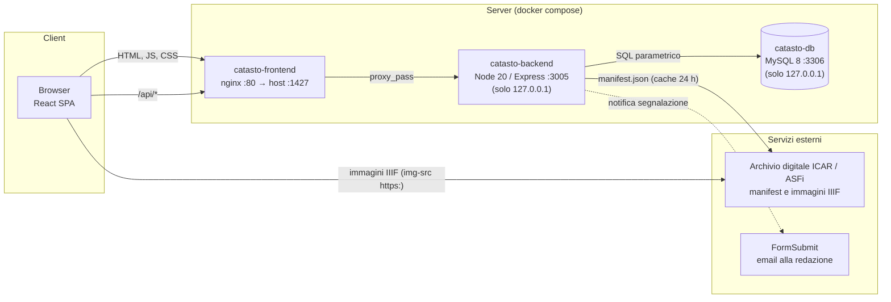
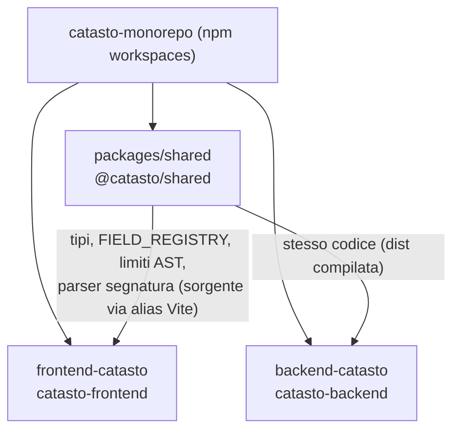
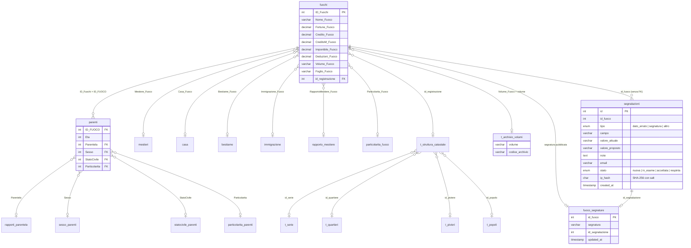
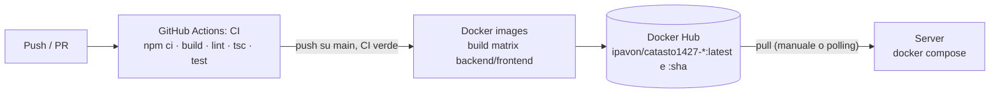

# Architettura e modello dati

🇮🇹 **Italiano** · 🇬🇧 [English](en/architecture.md)

| Campo | Valore |
|---|---|
| Identificativo | `CAT-DOC-02` |
| Versione | 2.0 |
| Data | 2026-10-29 |
| Stato | Approvato |
| Classificazione | Pubblico |
| Responsabili | Antonio Orfitelli, Pasquale Ruotolo |
| Lingua | Italiano (testo di riferimento) |
| Traduzione | [Architecture and data model](en/architecture.md) |
| Documenti collegati | [CAT-DOC-00 Standard documentale](standard-documentale.md) · [CAT-DOC-01 Installazione e deployment](guides.md) · [CAT-DOC-03 Backend e API](backend.md) · [CAT-DOC-04 Frontend](frontend.md) · [CAT-DOC-05 Casi d'uso](casi-d-uso.md) · [CAT-DOC-06 Revisione del codice](revisione-codice.md) · [Readme del repository](../readme.md) |

---

## 1. Scopo e destinatari

Il documento è rivolto a sviluppatori, amministratori di sistema e redazione. Descrive come sono collegati i componenti del portale del Catasto fiorentino del 1427/30, come sono organizzati i dati (con la loro provenienza e la loro collocazione nella fonte archivistica) e come il progetto viene distribuito. I dettagli delle API sono in [Backend e API](backend.md), quelli dell'interfaccia in [Frontend](frontend.md), la procedura di installazione in [Installazione e deployment](guides.md).

---

## 2. Vista d'insieme

### 2.1 Componenti e flussi

- Il browser comunica **solo con nginx**: sito e API hanno la stessa origine, quindi la CSP è `connect-src 'self'` e non ci sono problemi di CORS.
- Il backend scarica dall'Archivio di Stato di Firenze (ASFi) solo il **manifest** del volume; le **immagini** delle carte le carica direttamente il browser dal server IIIF.
- Backend e database sono esposti solo su loopback: dall'esterno si raggiunge unicamente la porta 1427, da porre dietro un terminatore TLS.

### 2.2 Monorepo

Il pacchetto condiviso garantisce che frontend e backend applichino le stesse regole: un campo aggiunto a `FIELD_REGISTRY` compare nel QueryBuilder e diventa interrogabile dal backend senza altre modifiche.

---

## 3. Modello dati

### 3.1 Provenienza dei dati

I dati seguono i tre livelli di provenienza dello [standard documentale](standard-documentale.md#56-provenienza-e-integrità-del-dato--provenance-and-data-integrity):

| Livello | Dove si trova | Contenuto |
|---|---|---|
| **Dato della fonte** | Dump `init/Catasto.sql`, **non incluso nel repository** | Trascrizione della ricerca Herlihy–Klapisch-Zuber, digitalizzata da ACRH: circa 61.000 fuochi e 270.000 parenti (tabelle `fuochi`, `parenti` e tabelle di lookup) |
| **Dato contribuito** | Tabelle applicative `segnalazioni` e `fuoco_segnature` | Correzioni e segnature della portata proposte dagli utenti; la segnatura è pubblicata solo dopo l'accettazione della redazione |
| **Dato derivato** | Calcolato dal backend | Statistiche, traduzioni dei valori, ordinamenti |

Le tabelle applicative sono create dalle [migrazioni](backend.md#8-migrazioni). Un dato assente nella fonte resta assente: il portale non lo stima né lo ricostruisce.

### 3.2 Collocazione dei dati nella fonte

| Livello ISAD(G) | Nel modello dati |
|---|---|
| Istituto conservatore | Archivio di Stato di Firenze (ASFi) |
| Fondo | Catasto |
| Serie archivistica | *Campioni* (registri ufficiali), a cui si riferiscono `Volume_Fuoco` e `Foglio_Fuoco`; *portate* (dichiarazioni), la cui segnatura sta in `fuoco_segnature` |
| Unità | Volume del campione: `Volume_Fuoco`, collegato a `t_archivio_volumi.volume` per ricavare il `codice_archivio` del manifest IIIF |
| Componente | Carta, recto/verso: `Foglio_Fuoco` |

Le segnature hanno la forma `ASFi, Catasto, <volume>, c. <n><r|v>`; il portale aggiunge in automatico il prefisso `ASFi, Catasto` alle segnature della portata raccolte con le segnalazioni.

> **Attenzione.** La tabella `t_serie` e il campo **Serie** indicano la **serie territoriale** (città, contado, distretto) a cui appartiene il fuoco, non una serie archivistica.

### 3.3 Diagramma entità-relazioni

I tipi delle colonne del dump sono indicativi (dedotti dalle query); fanno fede quelli di `Catasto.sql`. I valori economici (`Fortune_Fuoco`, `Credito_Fuoco`, `CreditoM_Fuoco`, `Imponibile_Fuoco`, `Deduzioni_Fuoco`) sono in fiorini (fl.), come nei dati di origine, e non vengono convertiti né arrotondati.

### 3.4 Glossario

Questa tabella è la fonte delle definizioni mostrate nel portale (suggerimenti accanto alle etichette e pagina `/glossario`, dati in `frontend-catasto/src/i18n/glossary.ts`): una modifica qui va riportata lì, e viceversa. Gli equivalenti inglesi sono fissati nella terminologia controllata dello [standard documentale](standard-documentale.md#6-terminologia-controllata--controlled-terminology).

| Termine | Significato |
|---|---|
| **Fuoco** | Nucleo familiare censito: l'unità del catasto, intestata al capofamiglia |
| **Portata** | Dichiarazione presentata dal contribuente; la sua segnatura non è nei dati ACRH e viene raccolta con le segnalazioni |
| **Campione** | Registro ufficiale redatto dagli ufficiali del catasto: `Volume_Fuoco` / `Foglio_Fuoco` si riferiscono a questo |
| **Carta (c.)** | Foglio del registro, con recto (`r`) e verso (`v`) |
| **Fortune / Credito / Credito ai Monti** | Componenti del patrimonio in fiorini (beni, crediti privati, crediti sul debito pubblico) |
| **Deduzioni** | Detrazioni (bocche a carico, debiti, abitazione) |
| **Imponibile** | Base tassabile risultante |
| **Serie** | Serie territoriale: città, contado o distretto |
| **Quartiere / Gonfalone** | Suddivisione urbana di Firenze (Santo Spirito, Santa Croce, Santa Maria Novella, San Giovanni) |
| **Piviere / Popolo** | Circoscrizioni ecclesiastiche usate come unità territoriali |
| **ASFi** | Archivio di Stato di Firenze |

---

## 4. Distribuzione (deploy)

### 4.1 Pipeline

### 4.2 Servizi

| Servizio | Immagine | Porta host | Note |
|---|---|---|---|
| `catasto-db` | `mysql:8.0` | `127.0.0.1:3306` | Dati in `./mysql_data` (bind mount), import iniziale da `./init/Catasto.sql` |
| `catasto-backend` | `ipavon/catasto1427-backend` | `127.0.0.1:3005` | Parte quando il DB è `healthy` |
| `catasto-frontend` | `ipavon/catasto1427-frontend` | `1427` | nginx: sito statico e proxy `/api` |

### 4.3 Sicurezza, in sintesi

- **SQL**: tutti i valori sono parametrizzati; colonne, join e ordinamenti provengono da whitelist.
- **Input**: validazione zod, body JSON max 64 kB, limiti sui valori della ricerca (lunghezza, numero di id, profondità dell'AST).
- **Abuso**: rate limit per IP su tutta l'API, sul manifest e sulle segnalazioni; honeypot nel modulo; IP salvati solo come hash con salt.
- **Moderazione**: token admin confrontato in tempo costante; link email firmati con HMAC, a scadenza, legati a id e azione; il `GET` non modifica nulla.
- **Header**: helmet sul backend, CSP restrittiva e `frame-ancestors 'none'` sul frontend; container con utente non privilegiato.

---

## 5. Riferimenti e fonti

- Herlihy, David, e Christiane Klapisch-Zuber. *Les Toscans et leurs familles. Une étude du catasto florentin de 1427*. Paris: Presses de la Fondation nationale des sciences politiques – Éditions de l'EHESS, 1978.
- Dati digitalizzati: ACRH, <https://journals.openedition.org/acrh/7458> (dump `init/Catasto.sql`).
- Immagini: Archivio di Stato di Firenze, Archivio digitale ICAR, servizio IIIF (manifest e immagini delle carte).

---

## 6. Registro delle modifiche

| Versione | Data | Autore | Descrizione |
|---|---|---|---|
| 1.x | — | — | Versioni precedenti, senza registro |
| 2.0 | 2026-10-29 | Pasquale Ruotolo | Riscrittura secondo CAT-DOC-00 e traduzione inglese |
