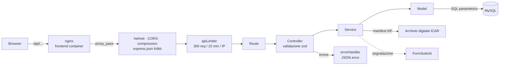
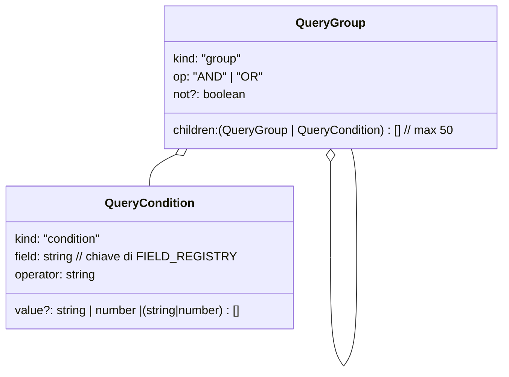
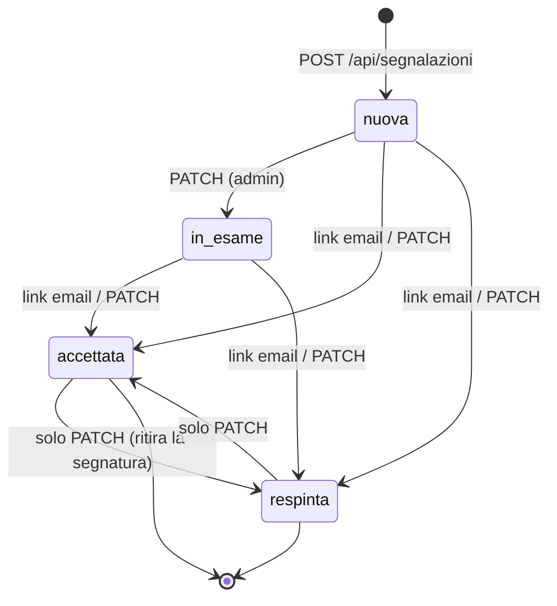
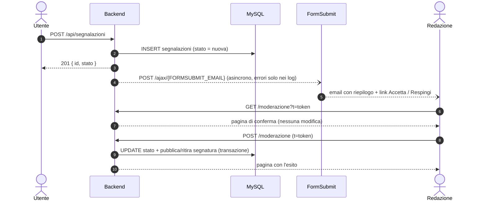

# Backend e API

🇮🇹 **Italiano** · 🇬🇧 [English](en/backend.md)

| Campo | Valore |
|---|---|
| Identificativo | `CAT-DOC-03` |
| Versione | 2.0 |
| Data | 2026-10-29 |
| Stato | Approvato |
| Classificazione | Pubblico |
| Responsabili | Antonio Orfitelli, Pasquale Ruotolo |
| Lingua | Italiano (testo di riferimento) |
| Traduzione | [Backend and API](en/backend.md) |
| Documenti collegati | [CAT-DOC-00 Standard documentale](standard-documentale.md) · [CAT-DOC-01 Installazione e deployment](guides.md) · [CAT-DOC-02 Architettura e modello dati](architettura.md) · [CAT-DOC-04 Frontend](frontend.md) · [CAT-DOC-05 Casi d'uso](casi-d-uso.md) · [CAT-DOC-06 Revisione del codice](revisione-codice.md) · [Readme del repository](../readme.md) |

---

## 1. Scopo e destinatari

Il documento è rivolto a sviluppatori, a chi integra le API del portale e agli amministratori che gestiscono la moderazione. Descrive il backend del portale del Catasto fiorentino del 1427/30: un'API REST in **TypeScript** su **Node.js 20 + Express 4**, con **MySQL 8** tramite `mysql2/promise` e validazione con **zod**. Il backend espone i dati del catasto (fuochi, parenti, località, mestieri), la ricerca avanzata a query composte, un proxy per i manifest IIIF dell'Archivio di Stato di Firenze e il sistema di segnalazioni con moderazione della redazione. Il modello dati è descritto in [Architettura e modello dati](architettura.md), l'installazione in [Installazione e deployment](guides.md), gli scenari d'uso in [Casi d'uso](casi-d-uso.md).

Contenuto:

2. [Struttura del codice](#2-struttura-del-codice)
3. [Pipeline di una richiesta](#3-pipeline-di-una-richiesta)
4. [Riferimento API](#4-riferimento-api)
5. [Ricerca avanzata: formato dell'AST](#5-ricerca-avanzata-formato-dellast)
6. [Segnalazioni e moderazione](#6-segnalazioni-e-moderazione)
7. [Traduzioni (`lang=en`)](#7-traduzioni-langen)
8. [Migrazioni](#8-migrazioni)
9. [Variabili d'ambiente](#9-variabili-dambiente)
10. [Script e test](#10-script-e-test)
11. [Limiti noti](#11-limiti-noti)

---

## 2. Struttura del codice

### 2.1 Backend

Pattern **route → controller → service → model**, con le regole di dominio condivise nel pacchetto `@catasto/shared`.

```
backend-catasto/
├── migrations/
│   ├── 001_segnalazioni.sql      # tabelle applicative (segnalazioni, fuoco_segnature)
│   ├── 002_traduzioni_lookup.sql # traduzioni delle etichette di lookup
│   ├── 003_traduzioni_lookup_seed.sql # traduzioni inglesi iniziali
│   └── 004_traduzioni_lookup_dump.sql # traduzioni delle etichette reali del dump (da db:export-traduzioni)
└── src/
    ├── server.ts                  # bootstrap Express: helmet, CORS, rate limit, rotte, /health
    ├── config/db.ts               # pool mysql2 (connectionLimit 50, TLS opzionale)
    ├── routes/
    │   ├── catasto.routes.ts      # /api/catasto (+ limiter dedicato al manifest)
    │   ├── filter.routes.ts       # /api/filters (+ invalidazione admin della cache)
    │   ├── parenti.routes.ts      # /api/parenti/:id
    │   ├── mestieri.routes.ts     # /api/mestieri (API pubblica, non usata dal frontend)
    │   └── segnalazione.routes.ts # /api/segnalazioni (pubblica, admin, moderazione)
    ├── controllers/
    │   ├── catasto.controller.ts  # fuochi, ricerca avanzata, manifest, parenti, mestieri
    │   ├── filter.controller.ts   # opzioni dei filtri
    │   └── segnalazione.controller.ts
    ├── services/
    │   ├── catasto.service.ts     # orchestrazione query + proxy/caching manifest IIIF
    │   ├── export.service.ts      # export CSV/XLSX in streaming, tetto di righe, metadati
    │   ├── stats.service.ts       # statistiche della ricerca (con cache breve)
    │   ├── segnalazione.service.ts# creazione, anti-abuso, cambi di stato transazionali
    │   └── notifica.service.ts    # inoltro email via FormSubmit con link firmati
    ├── models/
    │   ├── fuoco.model.ts         # SELECT sui fuochi, join, segnatura della portata
    │   ├── common.model.ts        # lookup, filtri (cache con TTL), parenti, mestieri
    │   ├── traduzioni.model.ts    # lingua (`lang`), traduzioni delle etichette (con cache)
    │   ├── stats.model.ts         # aggregati SQL: somme, quantili con window function, distribuzioni
    │   └── segnalazione.model.ts
    ├── middlewares/
    │   ├── admin.middleware.ts    # Bearer ADMIN_TOKEN, confronto timing-safe, adminLimiter
    │   ├── async-handler.ts       # inoltra gli errori async all'error handler
    │   └── error.middleware.ts    # 404 + gestione errori (maschera i 5xx in produzione)
    ├── utils/
    │   ├── validation.ts          # paginazione, id numerici, liste di id, HttpError
    │   ├── csv.ts, traduzioni-csv.ts # CSV (export dei risultati, export/import delle traduzioni)
    │   ├── export-columns.ts      # colonne e celle dei file esportati
    │   ├── export-writers.ts      # scrittura in streaming di CSV e XLSX
    │   ├── describe-filters.ts    # descrizione leggibile della ricerca semplice
    │   ├── query-builder.ts       # ricerca semplice (query string) → SQL parametrico
    │   ├── query-ast-builder.ts   # ricerca avanzata (AST) → SQL parametrico
    │   └── moderazione-token.ts   # token HMAC per i link Accetta/Respingi
    ├── views/moderazione.page.ts  # pagine HTML di conferma/esito della moderazione
    └── scripts/
        ├── migrate.ts             # runner delle migrazioni
        ├── export-traduzioni.ts   # CSV dei valori di lookup senza traduzione
        └── import-traduzioni.ts   # import del CSV compilato dalla redazione
```

### 2.2 Pacchetto condiviso

Il pacchetto **`packages/shared`** contiene ciò che frontend e backend devono vedere allo stesso modo:

| File | Contenuto |
|---|---|
| `fields.ts` | `FIELD_REGISTRY`: campi interrogabili, tipo, colonna SQL, operatori ammessi, join richiesti |
| `query-ast.ts` | Tipi `QueryGroup` / `QueryCondition` e limiti (`AST_MAX_DEPTH`, `AST_MAX_CONDITIONS`, …) |
| `index.ts` | Tipi delle risposte (`Fuoco`, `FilterOptions`, `CatastoStats`, …) |
| `labels.ts` | Etichette inglesi di campi e operatori, `describeQuery` (descrizione leggibile di una query, usata dall'anteprima e dagli export) |
| `segnalazioni.ts` | Tipi e stati delle segnalazioni |
| `segnatura.ts` | Parser della segnatura della portata (`ASFi, Catasto 81, c. 245r`) |

---

## 3. Pipeline di una richiesta



- **Nessun valore utente finisce nel testo SQL**: colonne, join e ordinamenti arrivano da whitelist (`FIELD_REGISTRY`, `buildOrderBy`); tutti i valori passano come placeholder `?`.
- Gli errori di validazione diventano `400 {"error": "..."}`; in produzione i 5xx rispondono `"Internal Server Error"` senza stack.

---

## 4. Riferimento API

### 4.1 Base URL e provenienza dei dati

Base URL: stessa origine del sito (`/api`, proxato da nginx) oppure `http://localhost:3005` in sviluppo.

Le risposte mescolano i tre livelli di provenienza dello [standard documentale](standard-documentale.md#56-provenienza-e-integrità-del-dato--provenance-and-data-integrity):

| Livello | Nelle risposte |
|---|---|
| **Dato della fonte** | Fuochi, parenti e etichette di lookup letti dal dump (ricerca Herlihy–Klapisch-Zuber, digitalizzata da ACRH); volume e carta del campione (`volume`, `foglio`) |
| **Dato contribuito** | `segnatura_portata`: proposta con una segnalazione e pubblicata solo dopo l'accettazione della redazione (tabella `fuoco_segnature`) |
| **Dato derivato** | Statistiche (`/stats`), traduzioni inglesi delle etichette (`lang=en`), ordinamenti, descrizioni leggibili delle query, codici d'archivio IIIF associati ai volumi |

I valori economici (fortune, credito, credito ai Monti, imponibile, deduzioni) sono in **fiorini** (fl.), come nei dati di origine, e non sono né convertiti né arrotondati. Un valore assente nella fonte resta assente (`null`, cella vuota nell'export), mai `0`.

> Il parametro e il campo **`serie`** indicano sempre la **serie territoriale** (città, contado, distretto) del fuoco, non una serie archivistica.

### 4.2 Riepilogo degli endpoint

| Metodo | Percorso | Accesso | Descrizione |
|---|---|---|---|
| GET | `/health` | pubblico | Stato del servizio e del database |
| GET | `/api/catasto` | pubblico | Ricerca semplice, vista tabella (paginata) |
| GET | `/api/catasto/fuochi?ids=` | pubblico | Fino a 50 fuochi per id, per la selezione e il confronto |
| GET | `/api/catasto/suggest?q=` | pubblico (600/15 min) | Fino a 8 fuochi per «Trova e aggiungi» del Banco di lavoro |
| GET | `/api/catasto/sidebar` | pubblico | Ricerca semplice, indice leggero per la sidebar |
| POST | `/api/catasto/query` | pubblico | Ricerca avanzata con AST |
| GET | `/api/catasto/stats` | pubblico, 150 req/15 min | Statistiche sulla ricerca semplice |
| POST | `/api/catasto/query/stats` | pubblico, 150 req/15 min | Statistiche sulla ricerca avanzata |
| GET | `/api/catasto/export` | pubblico, 20 req/15 min | Export CSV/XLSX della ricerca semplice, tutte le pagine |
| POST | `/api/catasto/query/export` | pubblico, 20 req/15 min | Export CSV/XLSX della ricerca avanzata |
| GET | `/api/catasto/manifest/:id` | pubblico, 30 req/15 min | Pagine del volume digitalizzato (IIIF) |
| GET | `/api/filters` | pubblico | Opzioni per i filtri |
| POST | `/api/filters/cache/invalidate` | admin | Svuota la cache delle opzioni dei filtri e delle traduzioni |
| GET | `/api/parenti/:id` | pubblico | Membri del fuoco |
| GET | `/api/mestieri` | pubblico (API) | Elenco grezzo dei mestieri, per chi usa l'API |
| POST | `/api/segnalazioni` | pubblico, 5 req/ora | Invia una segnalazione |
| GET | `/api/segnalazioni` | admin | Elenco segnalazioni |
| PATCH | `/api/segnalazioni/:id` | admin | Cambia lo stato di una segnalazione |
| GET | `/api/segnalazioni/moderazione?t=` | token firmato | Pagina di conferma (non modifica nulla) |
| POST | `/api/segnalazioni/moderazione` | token firmato | Applica la decisione |

Tutti gli endpoint di lettura accettano `?lang=en` (anche `POST /api/catasto/query`, nella query string): vedi [Traduzioni](#7-traduzioni-langen).

### 4.3 Limiti di frequenza

| Limiter | Ambito | Soglia |
|---|---|---|
| `apiLimiter` | tutto `/api` | 300 richieste / 15 min / IP |
| manifest | `/api/catasto/manifest/:id` | 30 richieste / 15 min / IP |
| `statsLimiter` | `GET /api/catasto/stats`, `POST /api/catasto/query/stats` | 150 richieste / 15 min / IP |
| `exportLimiter` | `GET /api/catasto/export`, `POST /api/catasto/query/export` | 20 richieste / 15 min / IP |
| `createLimiter` | `POST /api/segnalazioni` | 5 / ora / IP, più 10 / ora per hash IP salvato nel DB |
| `adminLimiter` | rotte admin e moderazione | 100 richieste **fallite** / 15 min / IP |

I contatori sono in memoria: valgono per processo e si azzerano al riavvio. Dietro un proxy impostare `TRUST_PROXY` (vedi [variabili](#9-variabili-dambiente)), altrimenti tutte le richieste risultano dallo stesso IP.

### 4.4 Paginazione e ordinamento

Valida per `/api/catasto`, `/api/catasto/sidebar` e `POST /api/catasto/query`. I valori non validi non danno errore: si usa il default.

| Parametro | Valori | Default |
|---|---|---|
| `page` | intero 1–100000 | `1` |
| `limit` | intero 1–2000 | `50` (`1000` su `GET /sidebar`) |
| `sort_by` | `fortune`, `credito`, `creditoM`, `imponibile`, `deduzioni`, `localita`; qualunque altro valore ordina per nome. A parità di valore decide l'id del fuoco, quindi le pagine non si sovrappongono | nome |
| `order` | `ASC` / `DESC` | `ASC` |

### 4.5 Ricerca semplice: `GET /api/catasto`

Tutti i filtri sono parametri di query **scalari** (`?x[]=` → 400), lunghi al massimo 200 caratteri. Le chiavi sconosciute vengono ignorate.

| Parametro | Semantica |
|---|---|
| `q_persona` | Parole del nome, in qualunque ordine; `di` viene ignorato. `?q_persona=nuto di nardo` → `Nome_Fuoco LIKE %nuto% AND LIKE %nardo%` |
| `q_localita` | Testo cercato in quartiere, popolo, piviere o serie territoriale |
| `volume` | Volume esatto del campione (`81`) |
| `mestiere`, `bestiame`, `immigrazione`, `rapporto`, `casa` | Id numerico della voce di lookup |
| `fortune_min` / `fortune_max` (e `credito_*`, `creditoM_*`, `imponibile_*`, `deduzioni_*`) | Intervalli in fiorini (`>=` / `<=`) |
| `serie`, `quartiere`, `piviere`, `popolo` | Lista di id separati da virgola (max 100): `?quartiere=3,7`. `serie` è la serie territoriale |
| `particolarita_parente` | Il fuoco ha almeno un parente con quella particolarità |
| `ids` | Fuochi scelti a mano: lista di id separati da virgola, al massimo `SELECTION_MAX_FUOCHI` (500). Serve all'export della selezione e alle raccolte del Banco di lavoro |

Esempio (valori illustrativi):

```http
GET /api/catasto?q_persona=nardo&quartiere=3,7&fortune_min=500&sort_by=fortune&order=DESC&limit=20
```

```json
{
  "data": [
    {
      "id": 1234,
      "nome": "NUTO NARDO",
      "imponibile": 120, "credito": 45, "credito_m": 0, "fortune": 800, "deduzioni": 200,
      "volume": "81", "foglio": "245",
      "particolarita_fuoco": null, "bestiame": "Bue", "immigrazione": null,
      "rapporto_mestiere": "Lavoratore", "mestiere": "Lanaiolo", "casa": "Propria",
      "quartiere": "San Giovanni (I)", "popolo": "San Lorenzo", "piviere": null, "serie": "Città",
      "codice_archivio": "…",
      "segnatura_portata": "ASFi, Catasto 125, c. 306",
      "codice_archivio_portata": "…"
    }
  ],
  "pagination": { "total": 37, "page": 1, "limit": 20, "totalPages": 2 }
}
```

- `volume` e `foglio` sono l'unità (volume) e la componente (carta) del **campione** in cui è registrato il fuoco (dato della fonte).
- `codice_archivio` identifica il volume digitalizzato del **campione** (da `t_archivio_volumi`): se presente, il visore delle carte può aprire la carta.
- `segnatura_portata` è la segnatura della **portata** pubblicata dalla redazione (da `fuoco_segnature`, dato contribuito); `codice_archivio_portata` è il volume corrispondente, se digitalizzato. La segnatura è restituita come è stata registrata: la forma di citazione normalizzata è `ASFi, Catasto, <volume>, c. <n><r|v>` (vedi lo [standard documentale](standard-documentale.md#53-segnature--shelfmarks)).

### 4.6 Indice per la sidebar: `GET /api/catasto/sidebar`

Stessi filtri. Risposta **senza wrapper**, pensata per un elenco lungo e leggero:

```json
[{ "id": 1234, "nome": "NUTO NARDO", "mestiere": "Lanaiolo" }]
```

### 4.7 Ricerca avanzata: `POST /api/catasto/query`

```json
{
  "ast": { "kind": "group", "op": "AND", "children": [ … ] },
  "view": "table",
  "page": 1, "limit": 50, "sort_by": "fortune", "order": "DESC"
}
```

`view` è `"table"` (risposta come `GET /api/catasto`), `"banco"` (come `"table"`, più `bocche` ed `eta_media` per ogni fuoco) o `"sidebar"` (risposta come `GET /sidebar`). Anche `GET /api/catasto` accetta `view=banco`: le bocche (parenti registrati, 0 se nessuno) e l'età media arrivano da una sola query raggruppata sui parenti dei fuochi della pagina. Un AST non valido → `400 {"error":"Query non valida: …"}`. Il formato è descritto [più sotto](#5-ricerca-avanzata-formato-dellast).

### 4.8 Fuochi per id: `GET /api/catasto/fuochi?ids=12,345,678`

Carica in una sola richiesta i fuochi della selezione (barra della selezione, vista di confronto), presi anche da pagine o ricerche diverse. `ids` è una lista di id numerici separati da virgola, al massimo `FUOCHI_BY_IDS_MAX` (50, in `@catasto/shared`; il client divide una selezione più grande in blocchi); i duplicati contano una volta. Qualunque altra forma (vuoto, non numerico, array, troppi id) → `400`.

Risposta: array di fuochi con gli stessi campi di `GET /api/catasto`, **nell'ordine degli id richiesti**; gli id inesistenti mancano senza errore (il client li confronta con quelli chiesti). Accetta `lang`.

### 4.9 Trova e aggiungi: `GET /api/catasto/suggest?q=…`

La casella «Trova e aggiungi» del Banco di lavoro: risponde mentre si scrive, separata dalla ricerca completa (non tocca la query del Banco). `q` si legge in tre modi (`utils/suggest-query.ts`):

- `#10342` o `10342`: il **numero del fuoco**;
- `vol. 79 c. 12` (anche `vol 79, c 12r`, `volume 79 carta 12v`, o solo `vol. 79`): la **carta del campione**; il volume si confronta come numero e una carta senza `r`/`v` trova recto e verso;
- altrimenti **parole**: ognuna deve comparire (LIKE, con escape) in capofamiglia, mestiere, popolo, quartiere o piviere; il «di» si scarta come nella ricerca per persona, le iniziali isolate («s.») contano solo se non c'è altro, al massimo 6 parole. Si cerca nei testi del dump, in italiano.

Risposta: `{ "data": [{ "id", "nome", "mestiere", "quartiere", "popolo", "imponibile", "volume", "foglio" }], "total": 23, "mode": "testo" }`, al massimo `SUGGEST_LIMIT` (8) fuochi in ordine di nome; `total` conta tutti quelli che corrispondono, `mode` è `id`, `carta` o `testo`. Il mestiere arriva tradotto con `lang`. `q` vuoto → nessun risultato; troppo lungo (oltre 200) o non testuale → `400`. Ha un limite proprio (600 richieste ogni 15 minuti) per non consumare quello della tabella.

### 4.10 Statistiche della ricerca: `GET /api/catasto/stats`

Aggregati (dati derivati) sugli **stessi fuochi della tabella**: accetta gli stessi filtri di `GET /api/catasto` (paginazione e ordinamento sono ignorati) e `lang`. `POST /api/catasto/query/stats` fa lo stesso con `{ "ast": … }` nel body. Il compilatore delle condizioni è lo stesso della ricerca, quindi `fuochi` coincide sempre con `pagination.total` della tabella.

```json
{
  "fuochi": 10,
  "parenti": 20,
  "economia": {
    "fortune": { "presenti": 9, "assenti": 1, "somma": 16630, "media": 1847.78, "mediana": 450,
                 "q1": 120, "q3": 1000, "min": 0, "max": 9000 },
    "credito": { … }, "credito_m": { … }, "imponibile": { … }, "deduzioni": { … }
  },
  "mestieri":  { "voci": [{ "label": "Lanaiolo", "n": 3 }], "altro": 0, "assenti": 3 },
  "quartieri": { "voci": [{ "label": "San Giovanni", "n": 5 }], "altro": 0, "assenti": 3 },
  "serie":     { "voci": [ … ], "altro": 0, "assenti": 1 },
  "membri": [{ "membri": 0, "fuochi": 1 }, { "membri": 1, "fuochi": 4 }],
  "eta": { "fasce": [{ "da": 0, "sesso": "Femmina", "n": 2 }], "assenti": 1 },
  "statoCivile": { "voci": [ … ], "altro": 0, "assenti": 3 },
  "fasceImponibile": { "fasce": [{ "da": 0, "n": 1 }, { "da": 1, "n": 2 }, …], "assenti": 0 }
}
```

- **Valori assenti**: per ogni misura economica `assenti` conta i fuochi senza valore; somma, media, minimo, massimo e quantili usano solo i presenti (coerente con R-13: assente non è 0). Senza valori presenti le misure sono `null`. Tutte le misure economiche sono in fiorini.
- **Mediana e quartili**: definizione "tipo 7" (interpolazione lineare, come R, numpy ed Excel `QUARTILE.INC`), calcolati in MySQL 8 con `ROW_NUMBER()` e `COUNT(*) OVER ()`: per ogni misura il DB restituisce al più sei righe, mai l'intera colonna.
- **Distribuzioni**: `mestieri` riporta le prime 10 voci, le altre sommate in `altro`; `quartieri` e `serie` (serie territoriali) uniscono le partizioni omonime come i filtri; `assenti` = etichetta non indicata.
- **Composizione**: `membri` = numero di fuochi per numero di parenti registrati (0 compreso); `eta` = parenti per fascia di 5 anni (`da`; 90 = 90 e oltre) e sesso, con le età assenti a parte; `statoCivile` = parenti per stato civile.
- **Fasce dell'imponibile**: fuochi per fascia (`da` = estremo inferiore, fasce `IMPONIBILE_BANDS` di `@catasto/shared`: 0, 1–50, 51–200, 201–500, 501–1.000, oltre, in fiorini), sempre tutte anche se vuote, con gli imponibili assenti a parte. Servono al grafico del Banco di lavoro.
- **Lingua**: con `lang=en` sono tradotte le etichette di mestieri, sesso e stato civile (luoghi esclusi, come nel resto dell'API).
- **Cache**: 60 secondi, chiave = SQL compilato + parametri + lingua (due ricerche equivalenti condividono il risultato), al massimo 200 voci; richieste contemporanee per la stessa chiave condividono il calcolo. Sull'intero dataset (61.000 fuochi, 270.000 parenti, MySQL 8 locale) una richiesta a freddo richiede circa un secondo.

### 4.11 Export della ricerca: `GET /api/catasto/export`

Restituisce **tutte** le righe della ricerca come file, nello stesso ordine della tabella. Accetta gli stessi filtri e lo stesso ordinamento di `GET /api/catasto` (la paginazione è ignorata), più:

| Parametro | Valori | Default | Effetto |
|---|---|---|---|
| `format` | `csv`, `xlsx` | `csv` | Formato del file |
| `parenti` | `true`/`false` (`1`/`0`) | `false` | CSV: restituisce il **file dei parenti** al posto di quello dei fuochi. XLSX: aggiunge il foglio "Parenti" |
| `sep` | `comma`, `semicolon` (o `,`/`;`) | `comma` | Separatore del CSV. Il punto e virgola serve a Excel in italiano |
| `lang` | `it`, `en` | `it` | Lingua di intestazioni, metadati ed etichette di lookup |

`POST /api/catasto/query/export` fa lo stesso con l'AST della ricerca avanzata; le opzioni stanno nel body accanto ad `ast`, `sort_by` e `order` (`lang` resta nella query string):

```json
{ "ast": { "kind": "group", "op": "AND", "children": [ … ] }, "sort_by": "fortune", "order": "DESC", "format": "xlsx", "parenti": true }
```

**Contenuto.**

- **Fuochi**: una riga per fuoco con id, nome, mestiere, rapporto di lavoro, bestiame, immigrazione, casa, particolarità, serie (territoriale), quartiere, piviere, popolo, fortune, credito, credito ai monti, imponibile, deduzioni (in fiorini), volume, carta, segnatura della portata e codice d'archivio del volume (IIIF).
- **Parenti** (formato lungo): id e nome del fuoco, parentela, sesso, età, stato civile, particolarità; una riga per parente.
- I valori assenti sono **celle vuote**, mai `0`; gli zeri restano zeri. I numeri sono numeri (anche nell'XLSX), le etichette di lookup sono tradotte con `lang=en`.
- **Metadati**: fonte (Klapisch-Zuber / ACRH), data dell'export, descrizione leggibile della query (la stessa dell'anteprima della ricerca avanzata), ordinamento, numero di fuochi. Nel CSV sono righe iniziali che cominciano con `#` (R: `comment.char = "#"`, pandas: `comment="#"`); nell'XLSX stanno nel foglio "Info".
- **CSV**: UTF-8 **con BOM** (Excel riconosce gli accenti), RFC 4180, righe terminate da CRLF.
- Nome del file in `Content-Disposition`: `catasto1427-fuochi-AAAA-MM-GG.csv`, `catasto1427-parenti-AAAA-MM-GG.csv` o `catasto1427-AAAA-MM-GG.xlsx` (data dell'export, ISO 8601). L'header `X-Export-Total` riporta il numero di fuochi.

**Streaming.** Le righe vengono lette dal DB e scritte man mano (stream di mysql2 con backpressure, `exceljs` in streaming per l'XLSX): l'export completo non viene mai tenuto in memoria. Lo stream di una query viene sempre letto fino in fondo, anche se il client chiude a metà, perché una connessione in pausa non tornerebbe più al pool.

**Limiti.** Prima di scrivere qualunque byte il backend conta i fuochi: oltre `EXPORT_MAX_ROWS` (default 100.000, più dell'intero dataset) risponde `400 {"error":"La ricerca restituisce N fuochi: l'export è limitato a M. Restringi i filtri e riprova."}`, mai un file troncato. Filtri, AST o opzioni non validi sono anch'essi `400`. Un errore del DB a export già iniziato chiude la connessione: il client vede un download fallito.

Esempio (dominio fittizio):

```bash
curl -o fuochi.csv "https://catasto.example.org/api/catasto/export?quartiere=1,2&sort_by=fortune&order=DESC&sep=semicolon"
```

### 4.12 Manifest IIIF: `GET /api/catasto/manifest/:id`

Proxy verso `https://archiviodigitale-icar.cultura.gov.it/metadata/{id}/manifest.json?type=archive` (Archivio di Stato di Firenze, Archivio digitale ICAR). Restituisce solo ciò che serve al visore delle carte:

```json
[
  { "label": "c. 1r", "image": "https://…/full/full/0/default.jpg" },
  { "label": "c. 1v", "image": "https://…/full/full/0/default.jpg" }
]
```

- Solo immagini `https`; `label` (la carta, recto/verso, come la indica il manifest) troncato a 200 caratteri.
- Cache in memoria di 24 h (max 500 volumi) e `Cache-Control: public, max-age=86400`; le richieste contemporanee per lo stesso volume sono unite in una sola chiamata.
- Errori: `400` id non numerico · `404` volume non trovato · `502` servizio esterno non disponibile o manifest oltre 10 MB (in produzione il 502 arriva come messaggio generico).

### 4.13 Opzioni dei filtri: `GET /api/filters`

Opzioni per i menu dei filtri. Parametri opzionali `serie` (serie territoriale), `quartiere`, `piviere` (liste di id) restringono i livelli geografici inferiori.

```json
{
  "mestieri":   [{ "id": 12, "label": "Lanaiolo" }],
  "quartieri":  [{ "id": "3,7", "label": "San Giovanni" }],
  "bestiame": [], "rapporto": [], "immigrazione": [], "serie": [],
  "pivieri": [], "popoli": [], "particolaritaParente": [], "casa": []
}
```

Per le partizioni geografiche le voci omonime che differiscono solo per il numero romano (`San Giovanni (I)`, `San Giovanni (II)`) sono **unite**: l'`id` è la lista `"3,7"`, da passare così com'è alla ricerca semplice. Le opzioni statiche restano in cache per tutta la vita del processo.

### 4.14 Membri del fuoco: `GET /api/parenti/:id`

Esempio (valori illustrativi):

```json
[
  { "eta": 40, "parentela_desc": "Capofamiglia", "sesso": "M", "stato_civile": "Coniugato", "particolarita": null },
  { "eta": 32, "parentela_desc": "Moglie",       "sesso": "F", "stato_civile": "Coniugata", "particolarita": null }
]
```

Un fuoco inesistente restituisce `[]`.

### 4.15 Invalidazione della cache: `POST /api/filters/cache/invalidate`

Rotta admin (header `Authorization: Bearer <ADMIN_TOKEN>`, stesso `adminLimiter` delle altre). Svuota la cache delle opzioni dei filtri e quella delle traduzioni: la richiesta successiva le rilegge dal DB. Serve dopo un reimport del dump o un import di traduzioni, per non aspettare la scadenza (`FILTERS_CACHE_TTL`, di default un'ora) né riavviare il backend.

```bash
curl -X POST -H "Authorization: Bearer $ADMIN_TOKEN" https://catasto.example.org/api/filters/cache/invalidate
# {"ok":true}
```

### 4.16 Mestieri: `GET /api/mestieri`

Righe grezze della tabella `mestieri`, ordinate per nome (per etichetta tradotta con `lang=en`). Il frontend non la usa (prende i mestieri da `/api/filters`): resta come **API pubblica** per chi estrae i dati, con la stessa forma delle colonne del dump. Va considerata stabile: cambiarla rompe i client esterni.

### 4.17 Stato del servizio: `GET /health`

`200 {"status":"ok","db":"up"}` oppure `503 {"status":"error","db":"down"}`. Non soggetto al rate limit: usarlo per healthcheck e monitoraggio.

---

## 5. Ricerca avanzata: formato dell'AST

### 5.1 Struttura e limiti



**Limiti** (superati → 400, mai troncamento): profondità 5, 50 condizioni totali, 100 valori per `in`/`not_in`, 200 caratteri per valore testuale.

### 5.2 Campi

| Chiave | Etichetta | Tipo | Note |
|---|---|---|---|
| `nome` | Nome fuoco | text | |
| `volume` | Volume | text | volume del campione |
| `foglio` | Foglio (carta) | text | carta del campione |
| `fortune`, `credito`, `credito_m`, `imponibile`, `deduzioni` | Dati economici | number | fiorini |
| `mestiere`, `bestiame`, `immigrazione`, `rapporto`, `casa` | Attributi | enum | id di lookup |
| `serie`, `quartiere`, `piviere`, `popolo` | Geografia | enum | join su `t_struttura_catastale`; `serie` = serie territoriale |
| `particolarita_parente` | Particolarità parente | enum | `EXISTS` sui parenti |
| `eta_parente` | Età parente | number | `EXISTS`: "almeno un parente con…" |
| `segnatura_portata` | Segnatura della portata | text | dato redazionale (dato contribuito) |

### 5.3 Operatori

| Tipo | Operatori |
|---|---|
| text | `contains`, `not_contains`, `starts_with`, `eq`, `neq`, `is_empty`, `is_not_empty` |
| number | `eq`, `neq`, `gt`, `gte`, `lt`, `lte`, `between` (`[min, max]`), `is_empty`, `is_not_empty` |
| enum | `eq`, `neq`, `in`, `not_in`, `is_empty`, `is_not_empty` |

Regole di traduzione in SQL:

- `neq`, `not_contains`, `not_in` includono anche i valori `NULL` (“diverso da X” comprende “non indicato”).
- Sui campi dei parenti le forme negative diventano `NOT EXISTS`: `eta_parente neq 0` = "nessun parente di età 0".
- `not: true` su un gruppo produce `NOT ( … )`; un gruppo vuoto vale `1=1`.
- Per `serie`, `quartiere`, `piviere` e `popolo` il valore può essere la lista di id restituita da `/api/filters` (`"3,7"`): `eq` diventa `IN (3, 7)`, `neq` `NOT IN`, e le liste dentro `in` / `not_in` vengono espanse.
- Un AST oltre i 5 livelli viene rifiutato con `400` prima della validazione completa, anche se annidato migliaia di volte.

### 5.4 Esempio

"Fuochi con nome che contiene *Nardo*, con fortune fra 100 e 500 fiorini **oppure** mestiere 12/15, e almeno un parente oltre i 60 anni" (valori illustrativi):

```json
{
  "ast": {
    "kind": "group", "op": "AND", "children": [
      { "kind": "condition", "field": "nome", "operator": "contains", "value": "nardo" },
      { "kind": "group", "op": "OR", "children": [
        { "kind": "condition", "field": "fortune",  "operator": "between", "value": [100, 500] },
        { "kind": "condition", "field": "mestiere", "operator": "in",      "value": [12, 15] }
      ]},
      { "kind": "condition", "field": "eta_parente", "operator": "gt", "value": 60 }
    ]
  },
  "view": "table", "page": 1, "limit": 50, "sort_by": "fortune", "order": "DESC"
}
```

SQL generato (semplificato):

```sql
WHERE ( f.Nome_Fuoco LIKE ? ESCAPE '!'
        AND ( f.Fortune_Fuoco BETWEEN ? AND ? OR f.Mestiere_Fuoco IN (?, ?) )
        AND EXISTS (SELECT 1 FROM parenti p_sub
                    WHERE p_sub.ID_FUOCO = f.ID_Fuochi AND p_sub.Eta > ?) )
-- parametri: ['%nardo%', 100, 500, 12, 15, 60]
```

---

## 6. Segnalazioni e moderazione

Le segnalazioni sono il canale dei **dati contribuiti**: una proposta dell'utente diventa visibile solo dopo la decisione della redazione.

### 6.1 Invio: `POST /api/segnalazioni`

| Campo | Regole |
|---|---|
| `id_fuoco` | intero > 0 o `null` (obbligatorio per `segnatura`); se presente deve esistere |
| `tipo` | `dato_errato` · `segnatura` · `altro` |
| `campo` | chiave di un campo segnalabile (obbligatorio per `dato_errato`) |
| `valore_attuale`, `valore_proposto` | max 500 caratteri (`valore_proposto` obbligatorio per `segnatura`) |
| `note` | max 2000 caratteri (per `altro` serve `valore_proposto` o `note`) |
| `email` | email valida o `null` (non stringa vuota) |
| `website` | honeypot: se compilato la richiesta viene scartata in silenzio |

Risposta: `201 {"id": 57, "stato": "nuova"}`. L'IP non viene salvato in chiaro ma come hash con `SEGNALAZIONI_SALT`.

### 6.2 Ciclo di vita



- I **link email** agiscono solo su segnalazioni `nuova` o `in_esame`; altrimenti rispondono `409`.
- La **PATCH admin** accetta qualunque transizione.
- Effetti per `tipo = segnatura`: diventando `accettata` la segnatura della portata è pubblicata in `fuoco_segnature`. Lasciando `accettata`, se era quella pubblicata, torna visibile l'ultima altra segnatura ancora accettata per lo stesso fuoco; se non ce ne sono, il fuoco resta senza. Tutto in transazione con `SELECT … FOR UPDATE`.
- Per `dato_errato` e `altro` cambia solo lo stato: la correzione del dato resta manuale.

### 6.3 Flusso email (FormSubmit)



Il **token** è `id.azione.scadenza.HMAC-SHA256(MODERAZIONE_SECRET)` in base64url, valido 14 giorni: firma id, azione e scadenza, quindi non si può riusare per un'altra segnalazione o per la decisione opposta. Il `GET` non modifica nulla perché i filtri antispam aprono da soli i link delle email.

Esiti della moderazione: `403` secret non configurato · `400` token non valido · `410` scaduto · `404` segnalazione inesistente · `409` già decisa.

**Configurazione.** Al primo invio FormSubmit manda un'email di attivazione all'indirizzo: va confermata una volta, poi si può usare l'alias casuale fornito. Diagnosi dai log del backend:

| Log | Significato |
|---|---|
| `⚠️ FORMSUBMIT_EMAIL non impostata` (all'avvio) | la variabile non arriva al container |
| `⚠️ FormSubmit: invio ... non riuscito` | FormSubmit ha rifiutato (es. form da attivare) |
| `📧 FormSubmit: segnalazione #N inoltrata` | accettata da FormSubmit: controllare lo spam |

> **Nota di sicurezza.** I link di moderazione transitano per FormSubmit e per la casella della redazione: chi vi ha accesso può decidere le segnalazioni aperte finché il token non scade. Proteggere la casella come si proteggerebbe `ADMIN_TOKEN`.

### 6.4 API admin

Header `Authorization: Bearer <ADMIN_TOKEN>` (prefisso `Bearer ` sensibile alle maiuscole). Senza `ADMIN_TOKEN` configurato le rotte rispondono `403`; token errato → `401`.

```bash
# Elenco delle segnalazioni nuove
curl -H "Authorization: Bearer $ADMIN_TOKEN" \
  "https://catasto.example.org/api/segnalazioni?stato=nuova&limit=20"

# Accetta la segnalazione 57
curl -X PATCH -H "Authorization: Bearer $ADMIN_TOKEN" -H "Content-Type: application/json" \
  -d '{"stato":"accettata"}' https://catasto.example.org/api/segnalazioni/57
```

---

## 7. Traduzioni (`lang=en`)

### 7.1 Ambito

Il sito ha una versione inglese: il frontend aggiunge `?lang=en` a ogni richiesta quando l'inglese è attivo (in italiano non manda nulla). È riconosciuto solo `en`; qualunque altro valore, o nessuno, vale italiano e non produce mai un errore.

**Cosa si traduce.** Solo le etichette delle tabelle di lookup del dump (le traduzioni sono dati derivati; il valore della fonte resta quello italiano). Id, filtri e semantica delle ricerche restano identici. Luoghi (serie territoriali, quartieri, pivieri, popoli) e nomi di persona sono nomi propri e restano in italiano, come i messaggi di errore.

| Endpoint | Campi tradotti |
|---|---|
| `GET /api/filters` | `bestiame`, `rapporto`, `immigrazione`, `mestieri`, `particolaritaParente`, `casa` (`mestieri`, `casa` e `particolaritaParente` riordinati per etichetta tradotta) |
| `GET /api/catasto`, `POST /api/catasto/query` | `mestiere`, `bestiame`, `immigrazione`, `rapporto_mestiere`, `casa`, `particolarita_fuoco` |
| `GET /api/catasto/export`, `POST /api/catasto/query/export` | come la tabella, più i campi dei parenti; anche intestazioni delle colonne e metadati |
| `GET /api/catasto/sidebar` | `mestiere` |
| `GET /api/parenti/:id` | `parentela_desc`, `sesso`, `stato_civile`, `particolarita` |
| `GET /api/mestieri` | `Mestiere` (riordinato) |

Un valore senza traduzione resta in italiano. L'ordinamento SQL della tabella (`sort_by=mestiere`) resta quello dell'etichetta italiana.

### 7.2 Tabella e migrazioni

**Tabella `traduzioni_lookup`** (migrazione `002`): `tabella` (nome della tabella del dump: `mestieri`, `bestiame`, `rapporto_mestiere`, `immigrazione`, `casa`, `particolarita_fuoco`, `particolarita_parenti`, `rapporti_parentela`, `sesso_parenti`, `statocivile_parenti`), `valore_it`, `lingua` (`en`), `valore`. La chiave è l'**etichetta italiana**, non l'id: la tabella sta fuori dal dump, sopravvive ai reimport e si popola senza conoscere gli id. Il confronto ignora maiuscole, accenti e spazi superflui (collation `utf8mb4_unicode_ci` nel DB, stessa normalizzazione nel backend).

**Seed** (migrazione `003`): circa 590 traduzioni di valori plausibili — sesso, stato civile, parentela, casa, rapporto di lavoro, bestiame, immigrazione, particolarità e circa 250 grafie di mestieri del vocabolario del Catasto fiorentino del 1427/30 (Herlihy e Klapisch-Zuber, *Les Toscans et leurs familles*). Le righe che non corrispondono a valori del dump sono innocue; `INSERT IGNORE` non sovrascrive traduzioni già corrette.

**Etichette reali** (migrazione `004`): il dump usa descrizioni lunghe ("arte della lana, lanaiolo, ritagliatore, …"), che il seed di `003` non intercettava. `004` traduce le 226 etichette esportate dal database di produzione con `db:export-traduzioni` (tutte le tabelle di lookup) e, a differenza di `003`, aggiorna le righe già presenti. Funziona uguale su MySQL e TiDB.

**Cache.** Le traduzioni restano in memoria 10 minuti per lingua (la copia italiana dei filtri in cache non viene mai modificata: la traduzione ne fa una copia). Se la tabella non esiste (migrazione non applicata) o il DB dà errore, le risposte restano in italiano invece di andare in 500.

### 7.3 Completare le traduzioni

La redazione lavora su un CSV `tabella,valore_it,valore_en`:

```bash
# valori distinti del dump ancora senza traduzione (--tutte: anche quelli tradotti)
npm run db:export-traduzioni -w catasto-backend -- mancanti.csv
# compilata la colonna valore_en, import (righe vuote ignorate, esistenti aggiornate)
npm run db:import-traduzioni -w catasto-backend -- mancanti.csv

# dalla build (container)
node backend-catasto/dist/scripts/export-traduzioni.js > mancanti.csv
node backend-catasto/dist/scripts/import-traduzioni.js mancanti.csv
```

Il CSV segue RFC 4180 (campi con virgole o apici fra doppi apici). L'import è transazionale e il backend vede le nuove traduzioni entro 10 minuti.

---

## 8. Migrazioni

Il dump dell'Archivio (`init/Catasto.sql`) contiene i dati storici (dati della fonte). Le tabelle applicative (`segnalazioni`, `fuoco_segnature`, `traduzioni_lookup`, `schema_migrations`) sono create dal runner in `src/scripts/migrate.ts`, che applica in ordine i file `migrations/*.sql` non ancora registrati.

La ricerca in tabella legge `fuoco_segnature`: senza migrazioni risponde 500.

- **Docker**: il container del backend applica le migrazioni mancanti a ogni avvio, prima di far partire il server. Se una migrazione fallisce il container si ferma (e il compose lo riavvia): l'errore è in `docker compose logs backend`.
- **Sviluppo**: vanno eseguite a mano.

```bash
# sviluppo (legge backend-catasto/.env)
npm run db:migrate -w catasto-backend

# container, a mano (di norma non serve)
docker compose exec backend node backend-catasto/dist/scripts/migrate.js
```

---

## 9. Variabili d'ambiente

| Variabile | Default | Uso |
|---|---|---|
| `PORT` | `3005` | Porta HTTP |
| `NODE_ENV` | — (`production` nell'immagine Docker) | In produzione maschera i 5xx e rende obbligatorio `SEGNALAZIONI_SALT` |
| `DB_HOST`, `DB_USER`, `DB_PASSWORD`, `DB_NAME` | — | Connessione MySQL |
| `DB_PORT` | `3306` | |
| `DB_SSL` | `false` | `true` attiva TLS ≥ 1.2 con verifica del certificato |
| `CORS_ORIGIN` | vuota = tutte le origini | Origini ammesse, separate da virgola |
| `TRUST_PROXY` | non impostata | Numero di proxy davanti al backend (`1` con nginx). Accetta anche `true`/`false` o nomi come `loopback`, ma `true` fa fidare di qualunque `X-Forwarded-For`: usare un numero |
| `SEGNALAZIONI_SALT` | obbligatoria in produzione | Salt dell'hash degli IP |
| `ADMIN_TOKEN` | vuota = area admin chiusa | Token Bearer della moderazione via API |
| `FORMSUBMIT_EMAIL` | vuota = nessuna email | Destinatario delle segnalazioni |
| `FORMSUBMIT_ORIGIN` | primo `CORS_ORIGIN` | Origin inviata a FormSubmit e base dei link |
| `MODERAZIONE_SECRET` | vuota = niente link | Chiave HMAC dei link Accetta/Respingi |
| `PUBLIC_API_URL` | origin del sito | Base di `/api` nei link, se diversa dal sito |
| `EXPORT_MAX_ROWS` | `100000` | Numero massimo di fuochi di un export; oltre, `400` con un messaggio |
| `FILTERS_CACHE_TTL` | `3600` | Durata in secondi della cache delle opzioni dei filtri; `0` = senza scadenza. Per svuotarla subito: `POST /api/filters/cache/invalidate` |

Esempio completo per la produzione, con valori fittizi: [`.env.prod.example`](../.env.prod.example).

---

## 10. Script e test

### 10.1 Comandi

| Comando (in `backend-catasto/`) | Effetto |
|---|---|
| `npm run dev` | `tsx watch src/server.ts` |
| `npm run build` | `tsup` → `dist/server.js` e `dist/scripts/*.js` (migrazioni, export/import traduzioni) |
| `npm start` | avvia `dist/server.js` |
| `npm run db:migrate` | migrazioni da sorgente (`tsx`) |
| `npm run db:migrate:prod` | migrazioni dalla build |
| `npm run db:export-traduzioni [-- file.csv]` | CSV dei valori di lookup senza traduzione inglese |
| `npm run db:import-traduzioni -- file.csv` | importa il CSV compilato in `traduzioni_lookup` |
| `npm run lint` | ESLint, con la configurazione condivisa `eslint.config.base.mjs` della root |
| `npm test` | test unitari (`vitest run`, database simulato) |
| `npm run test:integration` | test di integrazione su un MySQL vero (vedi sotto) |

### 10.2 Test unitari

I **test unitari** (vitest, database sempre simulato) coprono query builder semplice e AST (compresi liste geografiche, ordinamento stabile e AST troppo annidati), controller di ricerca, middleware (admin, errori), `validation.ts`, cache delle opzioni dei filtri, token di moderazione, servizio di notifica, cambi di stato delle segnalazioni (con il ripristino della segnatura precedente), validazione della creazione, rotte di moderazione, `TRUST_PROXY`, `toPages` del manifest, l'associazione portata→volume e le traduzioni (parsing di `lang`, normalizzazione, fallback, cache, CSV di export/import).

### 10.3 Test di integrazione

I **test di integrazione** (`test/integration/`) eseguono le query compilate su MySQL 8: il setup cancella tutte le tabelle del database indicato, carica il dump di prova `test/fixtures/catasto-fixture.sql` (pochi fuochi scelti per i casi limite) e applica le migrazioni con lo stesso runner della produzione. Il database si indica **solo** con variabili `TEST_DB_*`, mai con le `DB_*` del backend, e il nome deve contenere `test`:

```bash
# backend-catasto/.env.test (ignorato da git)
TEST_DB_HOST=127.0.0.1
TEST_DB_USER=catasto
TEST_DB_PASSWORD=catasto
TEST_DB_NAME=catasto_test

npm run test:integration -w catasto-backend
```

In CI girano in un job dedicato con il servizio `mysql:8.0` di GitHub Actions.

---

## 11. Limiti noti

I problemi emersi dalla revisione del codice di settembre 2026 sono stati corretti; lo storico è in [Revisione del codice](revisione-codice.md). Resta un comportamento da conoscere:

| Area | Descrizione |
|---|---|
| Rate limit | I contatori sono in memoria e per processo: con più istanze del backend i limiti valgono per istanza. |

---

## 12. Riferimenti e fonti

- Herlihy, David, e Christiane Klapisch-Zuber. *Les Toscans et leurs familles. Une étude du catasto florentin de 1427*. Paris: Presses de la Fondation nationale des sciences politiques – Éditions de l'EHESS, 1978.
- Dati digitalizzati: ACRH, <https://journals.openedition.org/acrh/7458> (dump `init/Catasto.sql`; fonte citata nei metadati degli export).
- Immagini: Archivio di Stato di Firenze, Archivio digitale ICAR, servizio IIIF (manifest restituiti da `GET /api/catasto/manifest/:id`).

---

## 13. Registro delle modifiche

| Versione | Data | Autore | Descrizione |
|---|---|---|---|
| 1.x | — | — | Versioni precedenti, senza registro |
| 2.0 | 2026-10-29 | Pasquale Ruotolo | Riscrittura secondo CAT-DOC-00 e traduzione inglese |
