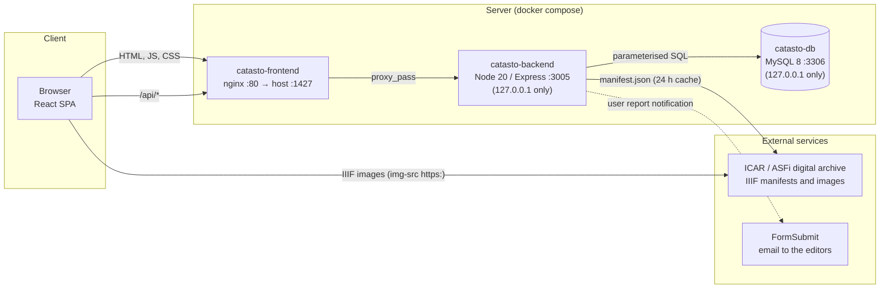
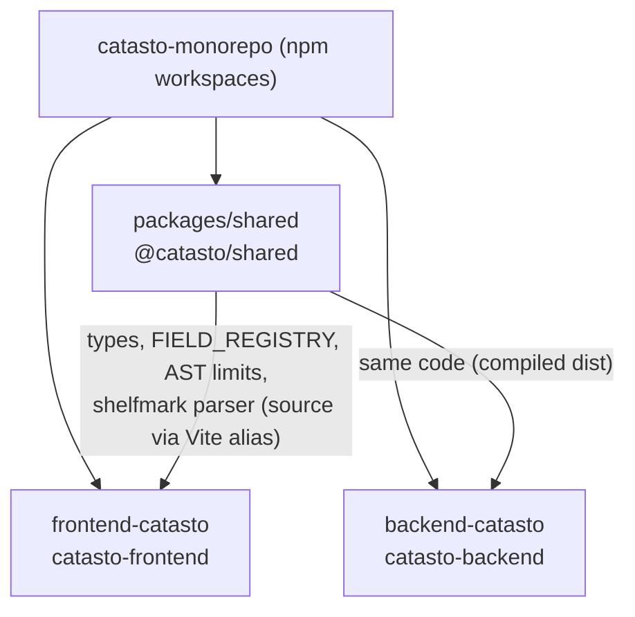
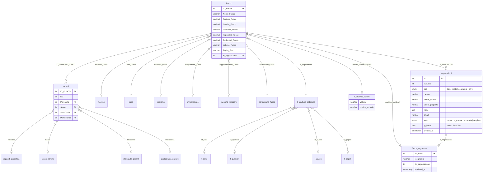
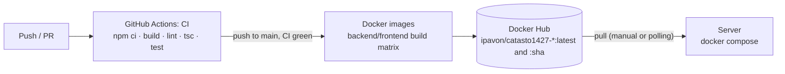

# Architecture and data model

🇮🇹 [Italiano](../architettura.md) · 🇬🇧 **English**

| Field | Value |
|---|---|
| Identifier | `CAT-DOC-02` |
| Version | 2.0 |
| Date | 2026-10-29 |
| Status | Approved |
| Classification | Public |
| Owners | Antonio Orfitelli, Pasquale Ruotolo |
| Language | English (translation; the Italian text prevails) |
| Reference text | [Architettura e modello dati](../architettura.md) |
| Related documents | [CAT-DOC-00 Documentation standard](../standard-documentale.md) · [CAT-DOC-01 Installation and deployment](installation.md) · [CAT-DOC-03 Backend and API](backend.md) · [CAT-DOC-04 Frontend](frontend.md) · [CAT-DOC-05 Use cases](use-cases.md) · [CAT-DOC-06 Code review](code-review.md) · [Repository readme](../../README.en.md) |

---

## 1. Purpose and audience

This document is for developers, system administrators and the editorial team. It describes how the components of the Florentine Catasto of 1427/30 portal are connected, how the data are organised (with their provenance and their place in the archival source) and how the project is deployed. API details are in [Backend and API](backend.md), interface details in [Frontend](frontend.md), and the installation procedure in [Installation and deployment](installation.md).

---

## 2. Overview

### 2.1 Components and flows

- The browser talks **only to nginx**: site and API share the same origin, so the CSP is `connect-src 'self'` and there are no CORS issues.
- The backend downloads only the volume **manifest** from the Archivio di Stato di Firenze (ASFi, the State Archive of Florence); the browser loads the folio **images** directly from the IIIF server.
- Backend and database are exposed on loopback only: from outside, only port 1427 is reachable, to be placed behind a TLS terminator.

### 2.2 Monorepo

The shared package ensures that frontend and backend apply the same rules: a field added to `FIELD_REGISTRY` appears in the QueryBuilder and becomes queryable by the backend with no other change.

---

## 3. Data model

### 3.1 Data provenance

The data follow the three provenance levels of the [documentation standard](../standard-documentale.md#56-provenienza-e-integrità-del-dato--provenance-and-data-integrity):

| Level | Where it lives | Content |
|---|---|---|
| **Source datum** | Dump `init/Catasto.sql`, **not included in the repository** | Transcription from the Herlihy–Klapisch-Zuber research, digitised by ACRH: about 61,000 *fuochi* (households) and 270,000 family members (tables `fuochi`, `parenti` and lookup tables) |
| **Contributed datum** | Application tables `segnalazioni` and `fuoco_segnature` | Corrections and *portata* (declaration) shelfmarks proposed by users; a shelfmark is published only after acceptance by the editors |
| **Derived datum** | Computed by the backend | Statistics, value translations, orderings |

The application tables are created by the [migrations](backend.md#8-migrations). A datum missing from the source stays missing: the portal neither estimates nor reconstructs it.

### 3.2 Placing the data in the source

| ISAD(G) level | In the data model |
|---|---|
| Repository | Archivio di Stato di Firenze (ASFi) |
| Fonds | Catasto |
| Archival series | *Campioni* (official registers), to which `Volume_Fuoco` and `Foglio_Fuoco` refer; *portate* (declarations), whose shelfmark is stored in `fuoco_segnature` |
| File | Volume of the *campione*: `Volume_Fuoco`, joined to `t_archivio_volumi.volume` to obtain the `codice_archivio` of the IIIF manifest |
| Item | Folio, recto/verso: `Foglio_Fuoco` |

Shelfmarks take the form `ASFi, Catasto, <volume>, c. <n><r|v>`; the portal automatically adds the prefix `ASFi, Catasto` to the *portata* shelfmarks collected through user reports.

> **Note.** The `t_serie` table and the **Serie** field denote the **territorial series** (city, *contado*, district) to which the household belongs, not an archival series.

### 3.3 Entity-relationship diagram

The dump column types are indicative (inferred from the queries); those in `Catasto.sql` are authoritative. Economic values (`Fortune_Fuoco`, `Credito_Fuoco`, `CreditoM_Fuoco`, `Imponibile_Fuoco`, `Deduzioni_Fuoco`) are in florins (fl.), as in the source data, and are neither converted nor rounded.

### 3.4 Glossary

The Italian version of this table is the source of the definitions shown in the portal (hints next to labels and the `/glossario` page, data in `frontend-catasto/src/i18n/glossary.ts`): a change there must be carried over to the glossary file, and vice versa. English equivalents are fixed by the controlled terminology of the [documentation standard](../standard-documentale.md#6-terminologia-controllata--controlled-terminology).

| Term | Meaning |
|---|---|
| ***Fuoco*** (household) | Registered family unit: the unit of the *catasto*, entered under the head of household |
| ***Portata*** (declaration) | Declaration submitted by the taxpayer; its shelfmark is not in the ACRH data and is collected through user reports |
| ***Campione*** (official register) | Official register compiled by the *catasto* officials: `Volume_Fuoco` / `Foglio_Fuoco` refer to it |
| **Folio (c.)** | Leaf of the register, with recto (`r`) and verso (`v`) |
| ***Fortune*** (property) **/ Credit / Credit in the Monte** | Components of wealth in florins (assets, private credits, credits on the public debt) |
| **Deductions** | Allowances (dependent *bocche*, i.e. dependants; debts; dwelling) |
| **Taxable assets** | Resulting tax base |
| **Territorial series** (*Serie*) | City, *contado* or district |
| **Quarter / *Gonfalone*** | Urban subdivision of Florence (Santo Spirito, Santa Croce, Santa Maria Novella, San Giovanni) |
| ***Piviere*** (pieve district) **/ *Popolo*** (parish) | Ecclesiastical districts used as territorial units |
| **ASFi** | Archivio di Stato di Firenze (State Archive of Florence) |

---

## 4. Deployment

### 4.1 Pipeline

### 4.2 Services

| Service | Image | Host port | Notes |
|---|---|---|---|
| `catasto-db` | `mysql:8.0` | `127.0.0.1:3306` | Data in `./mysql_data` (bind mount), initial import from `./init/Catasto.sql` |
| `catasto-backend` | `ipavon/catasto1427-backend` | `127.0.0.1:3005` | Starts when the DB is `healthy` |
| `catasto-frontend` | `ipavon/catasto1427-frontend` | `1427` | nginx: static site and `/api` proxy |

### 4.3 Security at a glance

- **SQL**: all values are parameterised; columns, joins and orderings come from whitelists.
- **Input**: zod validation, JSON body max 64 kB, limits on search values (length, number of ids, AST depth).
- **Abuse**: per-IP rate limits on the whole API, on the manifest and on user reports; honeypot in the form; IPs stored only as salted hashes.
- **Moderation**: admin token compared in constant time; email links signed with HMAC, expiring, bound to id and action; `GET` changes nothing.
- **Headers**: helmet on the backend, restrictive CSP and `frame-ancestors 'none'` on the frontend; containers run as an unprivileged user.

---

## 5. References and sources

- Herlihy, David, and Christiane Klapisch-Zuber. *Les Toscans et leurs familles. Une étude du catasto florentin de 1427*. Paris: Presses de la Fondation nationale des sciences politiques – Éditions de l'EHESS, 1978.
- Digitised data: ACRH, <https://journals.openedition.org/acrh/7458> (dump `init/Catasto.sql`).
- Images: Archivio di Stato di Firenze, ICAR digital archive, IIIF service (manifests and folio images).

---

## 6. Change log

| Version | Date | Author | Description |
|---|---|---|---|
| 1.x | — | — | Earlier versions, no change log |
| 2.0 | 2026-10-29 | Pasquale Ruotolo | Rewritten according to CAT-DOC-00; English translation |
