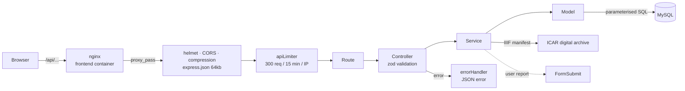
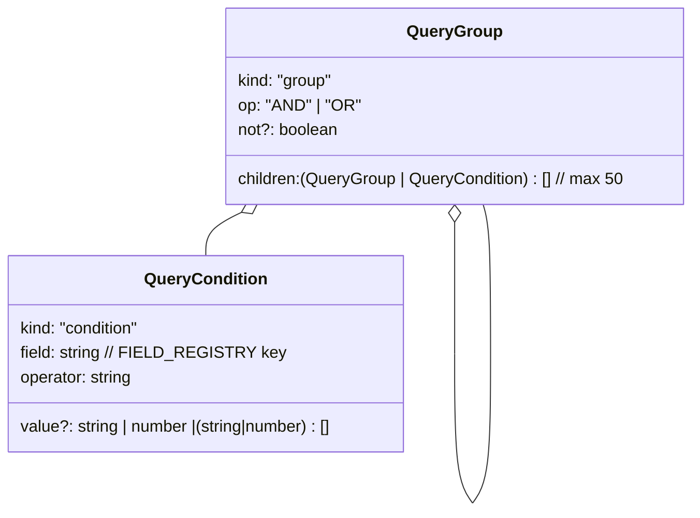
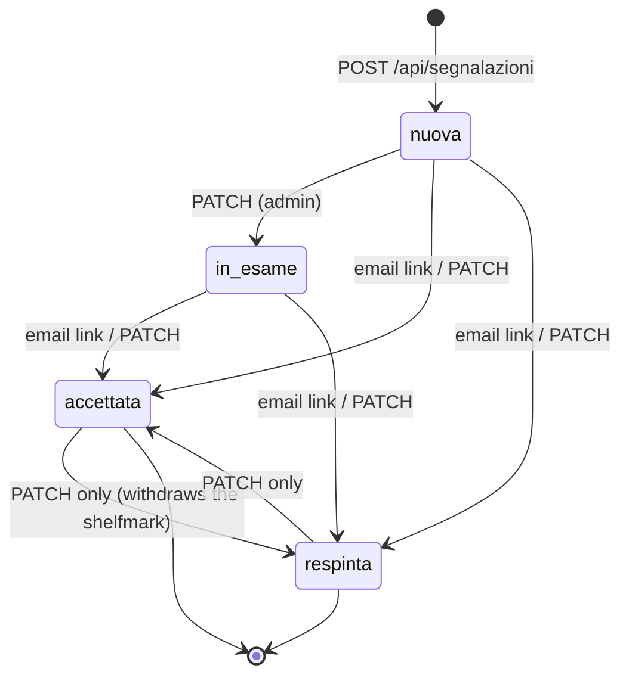
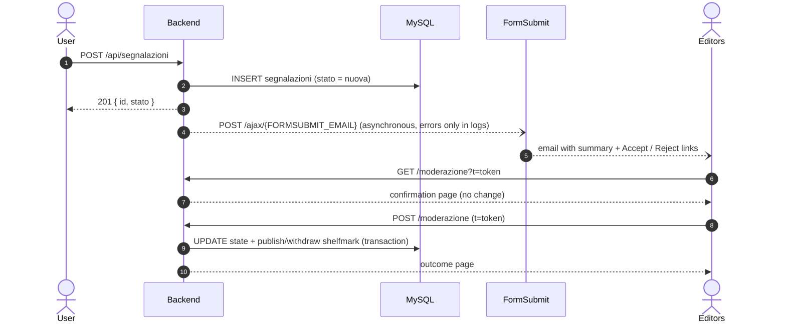

# Backend and API

🇮🇹 [Italiano](../backend.md) · 🇬🇧 **English**

| Field | Value |
|---|---|
| Identifier | `CAT-DOC-03` |
| Version | 2.0 |
| Date | 2026-10-29 |
| Status | Approved |
| Classification | Public |
| Owners | Antonio Orfitelli, Pasquale Ruotolo |
| Language | English (translation; the Italian text prevails) |
| Reference text | [Backend e API](../backend.md) |
| Related documents | [CAT-DOC-00 Documentation standard](../standard-documentale.md) · [CAT-DOC-01 Installation and deployment](installation.md) · [CAT-DOC-02 Architecture and data model](architecture.md) · [CAT-DOC-04 Frontend](frontend.md) · [CAT-DOC-05 Use cases](use-cases.md) · [CAT-DOC-06 Code review](code-review.md) · [Repository readme](../../README.en.md) |

---

## 1. Purpose and audience

This document is for developers, for anyone integrating the portal's API and for the administrators who handle moderation. It describes the backend of the Florentine Catasto of 1427/30 portal: a REST API written in **TypeScript** on **Node.js 20 + Express 4**, with **MySQL 8** through `mysql2/promise` and validation with **zod**. The backend exposes the *catasto* data (*fuochi* (households), family members, places, occupations), advanced search with composite queries, a proxy for the IIIF manifests of the Archivio di Stato di Firenze, and the user report system with moderation by the editorial team. The data model is described in [Architecture and data model](architecture.md), installation in [Installation and deployment](installation.md), usage scenarios in [Use cases](use-cases.md).

Contents:

2. [Code structure](#2-code-structure)
3. [Request pipeline](#3-request-pipeline)
4. [API reference](#4-api-reference)
5. [Advanced search: AST format](#5-advanced-search-ast-format)
6. [User reports and moderation](#6-user-reports-and-moderation)
7. [Translations (`lang=en`)](#7-translations-langen)
8. [Migrations](#8-migrations)
9. [Environment variables](#9-environment-variables)
10. [Scripts and tests](#10-scripts-and-tests)
11. [Known limitations](#11-known-limitations)

---

## 2. Code structure

### 2.1 Backend

**route → controller → service → model** pattern, with the domain rules shared through the `@catasto/shared` package.

```
backend-catasto/
├── migrations/
│   ├── 001_segnalazioni.sql      # application tables (segnalazioni, fuoco_segnature)
│   ├── 002_traduzioni_lookup.sql # translations of lookup labels
│   ├── 003_traduzioni_lookup_seed.sql # initial English translations
│   └── 004_traduzioni_lookup_dump.sql # translations of the dump's actual labels (from db:export-traduzioni)
└── src/
    ├── server.ts                  # Express bootstrap: helmet, CORS, rate limit, routes, /health
    ├── config/db.ts               # mysql2 pool (connectionLimit 50, optional TLS)
    ├── routes/
    │   ├── catasto.routes.ts      # /api/catasto (+ dedicated limiter for the manifest)
    │   ├── filter.routes.ts       # /api/filters (+ admin cache invalidation)
    │   ├── parenti.routes.ts      # /api/parenti/:id
    │   ├── mestieri.routes.ts     # /api/mestieri (public API, not used by the frontend)
    │   └── segnalazione.routes.ts # /api/segnalazioni (public, admin, moderation)
    ├── controllers/
    │   ├── catasto.controller.ts  # households, advanced search, manifest, family members, occupations
    │   ├── filter.controller.ts   # filter options
    │   └── segnalazione.controller.ts
    ├── services/
    │   ├── catasto.service.ts     # query orchestration + IIIF manifest proxy/caching
    │   ├── export.service.ts      # streaming CSV/XLSX export, row cap, metadata
    │   ├── stats.service.ts       # search statistics (with short-lived cache)
    │   ├── segnalazione.service.ts# creation, anti-abuse, transactional state changes
    │   └── notifica.service.ts    # email forwarding via FormSubmit with signed links
    ├── models/
    │   ├── fuoco.model.ts         # SELECTs on households, joins, portata shelfmark
    │   ├── common.model.ts        # lookups, filters (TTL cache), family members, occupations
    │   ├── traduzioni.model.ts    # language (`lang`), label translations (with cache)
    │   ├── stats.model.ts         # SQL aggregates: sums, quantiles with window functions, distributions
    │   └── segnalazione.model.ts
    ├── middlewares/
    │   ├── admin.middleware.ts    # Bearer ADMIN_TOKEN, timing-safe comparison, adminLimiter
    │   ├── async-handler.ts       # forwards async errors to the error handler
    │   └── error.middleware.ts    # 404 + error handling (masks 5xx in production)
    ├── utils/
    │   ├── validation.ts          # pagination, numeric ids, id lists, HttpError
    │   ├── csv.ts, traduzioni-csv.ts # CSV (results export, translations export/import)
    │   ├── export-columns.ts      # columns and cells of exported files
    │   ├── export-writers.ts      # streaming writers for CSV and XLSX
    │   ├── describe-filters.ts    # human-readable description of a simple search
    │   ├── query-builder.ts       # simple search (query string) → parameterised SQL
    │   ├── query-ast-builder.ts   # advanced search (AST) → parameterised SQL
    │   └── moderazione-token.ts   # HMAC tokens for the Accept/Reject links
    ├── views/moderazione.page.ts  # HTML confirmation/outcome pages for moderation
    └── scripts/
        ├── migrate.ts             # migration runner
        ├── export-traduzioni.ts   # CSV of lookup values without a translation
        └── import-traduzioni.ts   # import of the CSV filled in by the editors
```

### 2.2 Shared package

The **`packages/shared`** package holds what frontend and backend must see in the same way:

| File | Content |
|---|---|
| `fields.ts` | `FIELD_REGISTRY`: queryable fields, type, SQL column, allowed operators, required joins |
| `query-ast.ts` | `QueryGroup` / `QueryCondition` types and limits (`AST_MAX_DEPTH`, `AST_MAX_CONDITIONS`, …) |
| `index.ts` | Response types (`Fuoco`, `FilterOptions`, `CatastoStats`, …) |
| `labels.ts` | English labels of fields and operators, `describeQuery` (human-readable description of a query, used by the preview and by exports) |
| `segnalazioni.ts` | User report types and states |
| `segnatura.ts` | Parser for the *portata* (declaration) shelfmark (`ASFi, Catasto 81, c. 245r`) |

---

## 3. Request pipeline



- **No user value ever reaches the SQL text**: columns, joins and orderings come from whitelists (`FIELD_REGISTRY`, `buildOrderBy`); every value is passed as a `?` placeholder.
- Validation errors become `400 {"error": "..."}`; in production, 5xx responses return `"Internal Server Error"` with no stack trace.

---

## 4. API reference

### 4.1 Base URL and data provenance

Base URL: same origin as the site (`/api`, proxied by nginx), or `http://localhost:3005` in development.

Responses mix the three provenance levels of the [documentation standard](../standard-documentale.md#56-provenienza-e-integrità-del-dato--provenance-and-data-integrity):

| Level | In the responses |
|---|---|
| **Source datum** | Households, family members and lookup labels read from the dump (Herlihy–Klapisch-Zuber research, digitised by ACRH); volume and folio of the *campione* (official register) (`volume`, `foglio`) |
| **Contributed datum** | `segnatura_portata`: proposed through a user report and published only after acceptance by the editors (table `fuoco_segnature`) |
| **Derived datum** | Statistics (`/stats`), English translations of labels (`lang=en`), orderings, human-readable query descriptions, IIIF archive codes associated with volumes |

Economic values (*fortune* (property), credit, credit in the Monte, taxable assets, deductions) are in **florins** (fl.), as in the source data, and are neither converted nor rounded. A value missing from the source stays missing (`null`, an empty cell in exports), never `0`.

> The **`serie`** parameter and field always denote the household's **territorial series** (city, *contado*, district), not an archival series.

### 4.2 Endpoint summary

| Method | Path | Access | Description |
|---|---|---|---|
| GET | `/health` | public | Service and database status |
| GET | `/api/catasto` | public | Simple search, table view (paginated) |
| GET | `/api/catasto/fuochi?ids=` | public | Up to 50 households by id, for selection and comparison |
| GET | `/api/catasto/suggest?q=` | public (600/15 min) | Up to 8 households for the workbench's "Find and add" |
| GET | `/api/catasto/sidebar` | public | Simple search, lightweight index for the sidebar |
| POST | `/api/catasto/query` | public | Advanced search with AST |
| GET | `/api/catasto/stats` | public, 150 req/15 min | Statistics on the simple search |
| POST | `/api/catasto/query/stats` | public, 150 req/15 min | Statistics on the advanced search |
| GET | `/api/catasto/export` | public, 20 req/15 min | CSV/XLSX export of the simple search, all pages |
| POST | `/api/catasto/query/export` | public, 20 req/15 min | CSV/XLSX export of the advanced search |
| GET | `/api/catasto/manifest/:id` | public, 30 req/15 min | Pages of the digitised volume (IIIF) |
| GET | `/api/filters` | public | Filter options |
| POST | `/api/filters/cache/invalidate` | admin | Clears the filter options cache and the translations cache |
| GET | `/api/parenti/:id` | public | Members of the household |
| GET | `/api/mestieri` | public (API) | Raw list of occupations, for API users |
| POST | `/api/segnalazioni` | public, 5 req/hour | Submits a user report |
| GET | `/api/segnalazioni` | admin | List of user reports |
| PATCH | `/api/segnalazioni/:id` | admin | Changes the state of a user report |
| GET | `/api/segnalazioni/moderazione?t=` | signed token | Confirmation page (changes nothing) |
| POST | `/api/segnalazioni/moderazione` | signed token | Applies the decision |

Every read endpoint accepts `?lang=en` (including `POST /api/catasto/query`, in the query string): see [Translations](#7-translations-langen).

### 4.3 Rate limits

| Limiter | Scope | Threshold |
|---|---|---|
| `apiLimiter` | all of `/api` | 300 requests / 15 min / IP |
| manifest | `/api/catasto/manifest/:id` | 30 requests / 15 min / IP |
| `statsLimiter` | `GET /api/catasto/stats`, `POST /api/catasto/query/stats` | 150 requests / 15 min / IP |
| `exportLimiter` | `GET /api/catasto/export`, `POST /api/catasto/query/export` | 20 requests / 15 min / IP |
| `createLimiter` | `POST /api/segnalazioni` | 5 / hour / IP, plus 10 / hour per IP hash stored in the DB |
| `adminLimiter` | admin and moderation routes | 100 **failed** requests / 15 min / IP |

Counters are kept in memory: they apply per process and reset on restart. Behind a proxy, set `TRUST_PROXY` (see [variables](#9-environment-variables)), otherwise all requests appear to come from the same IP.

### 4.4 Pagination and sorting

Applies to `/api/catasto`, `/api/catasto/sidebar` and `POST /api/catasto/query`. Invalid values do not raise an error: the default is used.

| Parameter | Values | Default |
|---|---|---|
| `page` | integer 1–100000 | `1` |
| `limit` | integer 1–2000 | `50` (`1000` on `GET /sidebar`) |
| `sort_by` | `fortune`, `credito`, `creditoM`, `imponibile`, `deduzioni`, `localita`; any other value sorts by name. Ties are broken by household id, so pages never overlap | name |
| `order` | `ASC` / `DESC` | `ASC` |

### 4.5 Simple search: `GET /api/catasto`

All filters are **scalar** query parameters (`?x[]=` → 400), at most 200 characters long. Unknown keys are ignored.

| Parameter | Semantics |
|---|---|
| `q_persona` | Words of the name, in any order; `di` is ignored. `?q_persona=nuto di nardo` → `Nome_Fuoco LIKE %nuto% AND LIKE %nardo%` |
| `q_localita` | Text searched in quarter, *popolo* (parish), *piviere* (pieve district) or territorial series |
| `volume` | Exact volume of the *campione* (`81`) |
| `mestiere`, `bestiame`, `immigrazione`, `rapporto`, `casa` | Numeric id of the lookup entry |
| `fortune_min` / `fortune_max` (and `credito_*`, `creditoM_*`, `imponibile_*`, `deduzioni_*`) | Ranges in florins (`>=` / `<=`) |
| `serie`, `quartiere`, `piviere`, `popolo` | Comma-separated list of ids (max 100): `?quartiere=3,7`. `serie` is the territorial series |
| `particolarita_parente` | The household has at least one family member with that particularity |
| `ids` | Hand-picked households: comma-separated list of ids, at most `SELECTION_MAX_FUOCHI` (500). Used by the selection export and by workbench collections |

Example (illustrative values):

```http
GET /api/catasto?q_persona=nardo&quartiere=3,7&fortune_min=500&sort_by=fortune&order=DESC&limit=20
```

```json
{
  "data": [
    {
      "id": 1234,
      "nome": "NUTO NARDO",
      "imponibile": 120, "credito": 45, "credito_m": 0, "fortune": 800, "deduzioni": 200,
      "volume": "81", "foglio": "245",
      "particolarita_fuoco": null, "bestiame": "Bue", "immigrazione": null,
      "rapporto_mestiere": "Lavoratore", "mestiere": "Lanaiolo", "casa": "Propria",
      "quartiere": "San Giovanni (I)", "popolo": "San Lorenzo", "piviere": null, "serie": "Città",
      "codice_archivio": "…",
      "segnatura_portata": "ASFi, Catasto 125, c. 306",
      "codice_archivio_portata": "…"
    }
  ],
  "pagination": { "total": 37, "page": 1, "limit": 20, "totalPages": 2 }
}
```

- `volume` and `foglio` are the file (volume) and item (folio) of the **campione** in which the household is recorded (source datum).
- `codice_archivio` identifies the digitised volume of the **campione** (from `t_archivio_volumi`): when present, the folio viewer can open the folio.
- `segnatura_portata` is the shelfmark of the **portata** published by the editors (from `fuoco_segnature`, contributed datum); `codice_archivio_portata` is the matching volume, if digitised. The shelfmark is returned as recorded: the normalised citation form is `ASFi, Catasto, <volume>, c. <n><r|v>` (see the [documentation standard](../standard-documentale.md#53-segnature--shelfmarks)).

### 4.6 Sidebar index: `GET /api/catasto/sidebar`

Same filters. The response has **no wrapper** and is designed for a long, lightweight list:

```json
[{ "id": 1234, "nome": "NUTO NARDO", "mestiere": "Lanaiolo" }]
```

### 4.7 Advanced search: `POST /api/catasto/query`

```json
{
  "ast": { "kind": "group", "op": "AND", "children": [ … ] },
  "view": "table",
  "page": 1, "limit": 50, "sort_by": "fortune", "order": "DESC"
}
```

`view` is `"table"` (response as for `GET /api/catasto`), `"banco"` (as `"table"`, plus `bocche` and `eta_media` for each household) or `"sidebar"` (response as for `GET /sidebar`). `GET /api/catasto` also accepts `view=banco`: the *bocche* (dependants; registered family members, 0 if none) and the mean age come from a single grouped query on the family members of the households on the page. An invalid AST → `400 {"error":"Query non valida: …"}`. The format is described [below](#5-advanced-search-ast-format).

### 4.8 Households by id: `GET /api/catasto/fuochi?ids=12,345,678`

Loads the selected households in a single request (selection bar, comparison view), even when they come from different pages or searches. `ids` is a comma-separated list of numeric ids, at most `FUOCHI_BY_IDS_MAX` (50, in `@catasto/shared`; the client splits a larger selection into chunks); duplicates count once. Any other form (empty, non-numeric, array, too many ids) → `400`.

Response: an array of households with the same fields as `GET /api/catasto`, **in the order of the requested ids**; non-existent ids are silently missing (the client compares them with those requested). Accepts `lang`.

### 4.9 Find and add: `GET /api/catasto/suggest?q=…`

The workbench's "Find and add" box: it answers while the user types, separately from the full search (it does not touch the workbench query). `q` is read in three ways (`utils/suggest-query.ts`):

- `#10342` or `10342`: the **household number**;
- `vol. 79 c. 12` (also `vol 79, c 12r`, `volume 79 carta 12v`, or just `vol. 79`): the **folio of the campione**; the volume is compared as a number, and a folio without `r`/`v` matches both recto and verso;
- otherwise **words**: each must appear (LIKE, escaped) in head of household, occupation, *popolo*, quarter or *piviere*; "di" is dropped as in the person search, isolated initials ("s.") count only if there is nothing else, at most 6 words. The search runs on the dump's text, in Italian.

Response: `{ "data": [{ "id", "nome", "mestiere", "quartiere", "popolo", "imponibile", "volume", "foglio" }], "total": 23, "mode": "testo" }`, at most `SUGGEST_LIMIT` (8) households sorted by name; `total` counts all matches, `mode` is `id`, `carta` or `testo`. The occupation is translated with `lang`. Empty `q` → no results; too long (over 200) or non-textual → `400`. It has its own limit (600 requests every 15 minutes) so as not to consume the table's.

### 4.10 Search statistics: `GET /api/catasto/stats`

Aggregates (derived data) over the **same households as the table**: accepts the same filters as `GET /api/catasto` (pagination and sorting are ignored) and `lang`. `POST /api/catasto/query/stats` does the same with `{ "ast": … }` in the body. The condition compiler is the same as the search's, so `fuochi` always equals the table's `pagination.total`.

```json
{
  "fuochi": 10,
  "parenti": 20,
  "economia": {
    "fortune": { "presenti": 9, "assenti": 1, "somma": 16630, "media": 1847.78, "mediana": 450,
                 "q1": 120, "q3": 1000, "min": 0, "max": 9000 },
    "credito": { … }, "credito_m": { … }, "imponibile": { … }, "deduzioni": { … }
  },
  "mestieri":  { "voci": [{ "label": "Lanaiolo", "n": 3 }], "altro": 0, "assenti": 3 },
  "quartieri": { "voci": [{ "label": "San Giovanni", "n": 5 }], "altro": 0, "assenti": 3 },
  "serie":     { "voci": [ … ], "altro": 0, "assenti": 1 },
  "membri": [{ "membri": 0, "fuochi": 1 }, { "membri": 1, "fuochi": 4 }],
  "eta": { "fasce": [{ "da": 0, "sesso": "Femmina", "n": 2 }], "assenti": 1 },
  "statoCivile": { "voci": [ … ], "altro": 0, "assenti": 3 },
  "fasceImponibile": { "fasce": [{ "da": 0, "n": 1 }, { "da": 1, "n": 2 }, …], "assenti": 0 }
}
```

- **Missing values**: for each economic measure, `assenti` counts the households with no value; sum, mean, minimum, maximum and quantiles use only the values present (consistent with R-13: missing is not 0). With no values present, the measures are `null`. All economic measures are in florins.
- **Median and quartiles**: "type 7" definition (linear interpolation, as in R, numpy and Excel `QUARTILE.INC`), computed in MySQL 8 with `ROW_NUMBER()` and `COUNT(*) OVER ()`: for each measure the DB returns at most six rows, never the whole column.
- **Distributions**: `mestieri` lists the top 10 entries, the rest summed in `altro`; `quartieri` and `serie` (territorial series) merge same-name partitions as the filters do; `assenti` = label not given.
- **Composition**: `membri` = number of households per number of registered family members (0 included); `eta` = family members per 5-year age band (`da`; 90 = 90 and over) and sex, with missing ages counted separately; `statoCivile` = family members per marital status.
- **Taxable assets bands**: households per band (`da` = lower bound, `IMPONIBILE_BANDS` bands from `@catasto/shared`: 0, 1–50, 51–200, 201–500, 501–1,000, above, in florins), always all of them even when empty, with missing taxable assets counted separately. They feed the workbench chart.
- **Language**: with `lang=en`, the labels of occupations, sex and marital status are translated (places excluded, as in the rest of the API).
- **Cache**: 60 seconds, key = compiled SQL + parameters + language (two equivalent searches share the result), at most 200 entries; concurrent requests for the same key share the computation. On the full dataset (61,000 households, 270,000 family members, local MySQL 8) a cold request takes about one second.

### 4.11 Search export: `GET /api/catasto/export`

Returns **all** the rows of the search as a file, in the same order as the table. Accepts the same filters and sorting as `GET /api/catasto` (pagination is ignored), plus:

| Parameter | Values | Default | Effect |
|---|---|---|---|
| `format` | `csv`, `xlsx` | `csv` | File format |
| `parenti` | `true`/`false` (`1`/`0`) | `false` | CSV: returns the **family members file** instead of the households file. XLSX: adds the "Parenti" sheet |
| `sep` | `comma`, `semicolon` (or `,`/`;`) | `comma` | CSV separator. The semicolon is needed by Excel in Italian locale |
| `lang` | `it`, `en` | `it` | Language of headers, metadata and lookup labels |

`POST /api/catasto/query/export` does the same with the advanced search AST; the options go in the body alongside `ast`, `sort_by` and `order` (`lang` stays in the query string):

```json
{ "ast": { "kind": "group", "op": "AND", "children": [ … ] }, "sort_by": "fortune", "order": "DESC", "format": "xlsx", "parenti": true }
```

**Content.**

- **Households**: one row per household with id, name, occupation, employment relation, livestock, immigration, house, particularity, territorial series, quarter, *piviere*, *popolo*, *fortune*, credit, credit in the Monte, taxable assets, deductions (in florins), volume, folio, *portata* shelfmark and archive code of the volume (IIIF).
- **Family members** (long format): household id and name, kinship, sex, age, marital status, particularity; one row per family member.
- Missing values are **empty cells**, never `0`; zeros stay zeros. Numbers are numbers (in XLSX too); lookup labels are translated with `lang=en`.
- **Metadata**: source (Klapisch-Zuber / ACRH), export date, human-readable description of the query (the same as the advanced search preview), sorting, number of households. In the CSV they are leading lines starting with `#` (R: `comment.char = "#"`, pandas: `comment="#"`); in the XLSX they are in the "Info" sheet.
- **CSV**: UTF-8 **with BOM** (so Excel recognises accented characters), RFC 4180, lines terminated by CRLF.
- File name in `Content-Disposition`: `catasto1427-fuochi-AAAA-MM-GG.csv`, `catasto1427-parenti-AAAA-MM-GG.csv` or `catasto1427-AAAA-MM-GG.xlsx` (`AAAA-MM-GG` = export date, ISO 8601 `YYYY-MM-DD`). The `X-Export-Total` header reports the number of households.

**Streaming.** Rows are read from the DB and written as they arrive (mysql2 stream with backpressure, streaming `exceljs` for XLSX): the full export is never held in memory. A query stream is always read to the end, even if the client disconnects midway, because a paused connection would never return to the pool.

**Limits.** Before writing any byte the backend counts the households: above `EXPORT_MAX_ROWS` (default 100,000, more than the whole dataset) it responds `400 {"error":"La ricerca restituisce N fuochi: l'export è limitato a M. Restringi i filtri e riprova."}` ("The search returns N households: export is limited to M. Narrow the filters and try again."), never a truncated file. Invalid filters, AST or options are also `400`. A DB error after the export has started closes the connection: the client sees a failed download.

Example (fictitious domain):

```bash
curl -o fuochi.csv "https://catasto.example.org/api/catasto/export?quartiere=1,2&sort_by=fortune&order=DESC&sep=semicolon"
```

### 4.12 IIIF manifest: `GET /api/catasto/manifest/:id`

Proxy to `https://archiviodigitale-icar.cultura.gov.it/metadata/{id}/manifest.json?type=archive` (Archivio di Stato di Firenze, ICAR digital archive). Returns only what the folio viewer needs:

```json
[
  { "label": "c. 1r", "image": "https://…/full/full/0/default.jpg" },
  { "label": "c. 1v", "image": "https://…/full/full/0/default.jpg" }
]
```

- `https` images only; `label` (the folio, recto/verso, as given by the manifest) truncated to 200 characters.
- 24 h in-memory cache (max 500 volumes) and `Cache-Control: public, max-age=86400`; concurrent requests for the same volume are merged into a single call.
- Errors: `400` non-numeric id · `404` volume not found · `502` external service unavailable or manifest over 10 MB (in production the 502 comes as a generic message).

### 4.13 Filter options: `GET /api/filters`

Options for the filter menus. The optional parameters `serie` (territorial series), `quartiere`, `piviere` (id lists) narrow the lower geographical levels.

```json
{
  "mestieri":   [{ "id": 12, "label": "Lanaiolo" }],
  "quartieri":  [{ "id": "3,7", "label": "San Giovanni" }],
  "bestiame": [], "rapporto": [], "immigrazione": [], "serie": [],
  "pivieri": [], "popoli": [], "particolaritaParente": [], "casa": []
}
```

For geographical partitions, same-name entries differing only by Roman numeral (`San Giovanni (I)`, `San Giovanni (II)`) are **merged**: the `id` is the list `"3,7"`, to be passed as is to the simple search. Static options stay cached for the lifetime of the process.

### 4.14 Household members: `GET /api/parenti/:id`

Example (illustrative values):

```json
[
  { "eta": 40, "parentela_desc": "Capofamiglia", "sesso": "M", "stato_civile": "Coniugato", "particolarita": null },
  { "eta": 32, "parentela_desc": "Moglie",       "sesso": "F", "stato_civile": "Coniugata", "particolarita": null }
]
```

A non-existent household returns `[]`.

### 4.15 Cache invalidation: `POST /api/filters/cache/invalidate`

Admin route (header `Authorization: Bearer <ADMIN_TOKEN>`, same `adminLimiter` as the others). Clears the filter options cache and the translations cache: the next request reloads them from the DB. Use it after re-importing the dump or importing translations, so as not to wait for expiry (`FILTERS_CACHE_TTL`, one hour by default) or restart the backend.

```bash
curl -X POST -H "Authorization: Bearer $ADMIN_TOKEN" https://catasto.example.org/api/filters/cache/invalidate
# {"ok":true}
```

### 4.16 Occupations: `GET /api/mestieri`

Raw rows of the `mestieri` table, sorted by name (by translated label with `lang=en`). The frontend does not use it (it takes occupations from `/api/filters`): it remains as a **public API** for those extracting the data, with the same shape as the dump's columns. Consider it stable: changing it breaks external clients.

### 4.17 Service status: `GET /health`

`200 {"status":"ok","db":"up"}` or `503 {"status":"error","db":"down"}`. Not subject to rate limiting: use it for health checks and monitoring.

---

## 5. Advanced search: AST format

### 5.1 Structure and limits



**Limits** (exceeded → 400, never truncation): depth 5, 50 conditions in total, 100 values for `in`/`not_in`, 200 characters per text value.

### 5.2 Fields

| Key | Label | Type | Notes |
|---|---|---|---|
| `nome` | Household name | text | |
| `volume` | Volume | text | volume of the *campione* |
| `foglio` | Folio (c.) | text | folio of the *campione* |
| `fortune`, `credito`, `credito_m`, `imponibile`, `deduzioni` | Economic data | number | florins |
| `mestiere`, `bestiame`, `immigrazione`, `rapporto`, `casa` | Attributes | enum | lookup id |
| `serie`, `quartiere`, `piviere`, `popolo` | Geography | enum | join on `t_struttura_catastale`; `serie` = territorial series |
| `particolarita_parente` | Family member particularity | enum | `EXISTS` on family members |
| `eta_parente` | Family member age | number | `EXISTS`: "at least one family member with…" |
| `segnatura_portata` | *Portata* shelfmark | text | editorial datum (contributed datum) |

### 5.3 Operators

| Type | Operators |
|---|---|
| text | `contains`, `not_contains`, `starts_with`, `eq`, `neq`, `is_empty`, `is_not_empty` |
| number | `eq`, `neq`, `gt`, `gte`, `lt`, `lte`, `between` (`[min, max]`), `is_empty`, `is_not_empty` |
| enum | `eq`, `neq`, `in`, `not_in`, `is_empty`, `is_not_empty` |

Rules for translation into SQL:

- `neq`, `not_contains`, `not_in` also include `NULL` values ("different from X" includes "not given").
- On family member fields, negative forms become `NOT EXISTS`: `eta_parente neq 0` = "no family member aged 0".
- `not: true` on a group produces `NOT ( … )`; an empty group evaluates to `1=1`.
- For `serie`, `quartiere`, `piviere` and `popolo` the value may be the id list returned by `/api/filters` (`"3,7"`): `eq` becomes `IN (3, 7)`, `neq` `NOT IN`, and lists inside `in` / `not_in` are expanded.
- An AST deeper than 5 levels is rejected with `400` before full validation, even when nested thousands of times.

### 5.4 Example

"Households whose name contains *Nardo*, with *fortune* between 100 and 500 florins **or** occupation 12/15, and at least one family member over 60" (illustrative values):

```json
{
  "ast": {
    "kind": "group", "op": "AND", "children": [
      { "kind": "condition", "field": "nome", "operator": "contains", "value": "nardo" },
      { "kind": "group", "op": "OR", "children": [
        { "kind": "condition", "field": "fortune",  "operator": "between", "value": [100, 500] },
        { "kind": "condition", "field": "mestiere", "operator": "in",      "value": [12, 15] }
      ]},
      { "kind": "condition", "field": "eta_parente", "operator": "gt", "value": 60 }
    ]
  },
  "view": "table", "page": 1, "limit": 50, "sort_by": "fortune", "order": "DESC"
}
```

Generated SQL (simplified):

```sql
WHERE ( f.Nome_Fuoco LIKE ? ESCAPE '!'
        AND ( f.Fortune_Fuoco BETWEEN ? AND ? OR f.Mestiere_Fuoco IN (?, ?) )
        AND EXISTS (SELECT 1 FROM parenti p_sub
                    WHERE p_sub.ID_FUOCO = f.ID_Fuochi AND p_sub.Eta > ?) )
-- parameters: ['%nardo%', 100, 500, 12, 15, 60]
```

---

## 6. User reports and moderation

User reports are the channel for **contributed data**: a user's proposal becomes visible only after the editors' decision.

### 6.1 Submission: `POST /api/segnalazioni`

| Field | Rules |
|---|---|
| `id_fuoco` | integer > 0 or `null` (required for `segnatura`); if present it must exist |
| `tipo` | `dato_errato` · `segnatura` · `altro` |
| `campo` | key of a reportable field (required for `dato_errato`) |
| `valore_attuale`, `valore_proposto` | max 500 characters (`valore_proposto` required for `segnatura`) |
| `note` | max 2000 characters (for `altro`, `valore_proposto` or `note` is required) |
| `email` | valid email or `null` (not an empty string) |
| `website` | honeypot: if filled in, the request is silently discarded |

Response: `201 {"id": 57, "stato": "nuova"}`. The IP is not stored in clear but as a hash with `SEGNALAZIONI_SALT`.

### 6.2 Lifecycle



State values: `nuova` (new), `in_esame` (under review), `accettata` (accepted), `respinta` (rejected).

- **Email links** act only on reports in state `nuova` or `in_esame`; otherwise they respond `409`.
- The **admin PATCH** accepts any transition.
- Effects for `tipo = segnatura`: on becoming `accettata`, the *portata* shelfmark is published in `fuoco_segnature`. On leaving `accettata`, if it was the published one, the latest other shelfmark still accepted for the same household becomes visible again; if there is none, the household is left without one. All of this runs in a transaction with `SELECT … FOR UPDATE`.
- For `dato_errato` and `altro` only the state changes: correcting the datum remains a manual task.

### 6.3 Email flow (FormSubmit)



The **token** is `id.azione.scadenza.HMAC-SHA256(MODERAZIONE_SECRET)` (id, action, expiry) in base64url, valid for 14 days: it signs id, action and expiry, so it cannot be reused for another report or for the opposite decision. The `GET` changes nothing because spam filters open email links on their own.

Moderation outcomes: `403` secret not configured · `400` invalid token · `410` expired · `404` report does not exist · `409` already decided.

**Configuration.** On the first submission FormSubmit sends an activation email to the address: it must be confirmed once, after which the random alias it provides can be used. Diagnosis from the backend logs (messages are logged in Italian):

| Log | Meaning |
|---|---|
| `⚠️ FORMSUBMIT_EMAIL non impostata` (at startup) | the variable does not reach the container |
| `⚠️ FormSubmit: invio ... non riuscito` | FormSubmit refused (e.g. form still to be activated) |
| `📧 FormSubmit: segnalazione #N inoltrata` | accepted by FormSubmit: check the spam folder |

> **Security note.** Moderation links pass through FormSubmit and the editors' mailbox: anyone with access to them can decide open reports until the token expires. Protect the mailbox as you would protect `ADMIN_TOKEN`.

### 6.4 Admin API

Header `Authorization: Bearer <ADMIN_TOKEN>` (the `Bearer ` prefix is case-sensitive). Without a configured `ADMIN_TOKEN` the routes respond `403`; wrong token → `401`.

```bash
# List new user reports
curl -H "Authorization: Bearer $ADMIN_TOKEN" \
  "https://catasto.example.org/api/segnalazioni?stato=nuova&limit=20"

# Accept report 57
curl -X PATCH -H "Authorization: Bearer $ADMIN_TOKEN" -H "Content-Type: application/json" \
  -d '{"stato":"accettata"}' https://catasto.example.org/api/segnalazioni/57
```

---

## 7. Translations (`lang=en`)

### 7.1 Scope

The site has an English version: the frontend adds `?lang=en` to every request when English is active (in Italian it sends nothing). Only `en` is recognised; any other value, or none, means Italian and never causes an error.

**What is translated.** Only the labels of the dump's lookup tables (translations are derived data; the source value remains the Italian one). Ids, filters and search semantics stay identical. Places (territorial series, quarters, *pivieri*, *popoli*) and personal names are proper names and stay in Italian, as do error messages.

| Endpoint | Translated fields |
|---|---|
| `GET /api/filters` | `bestiame`, `rapporto`, `immigrazione`, `mestieri`, `particolaritaParente`, `casa` (`mestieri`, `casa` and `particolaritaParente` re-sorted by translated label) |
| `GET /api/catasto`, `POST /api/catasto/query` | `mestiere`, `bestiame`, `immigrazione`, `rapporto_mestiere`, `casa`, `particolarita_fuoco` |
| `GET /api/catasto/export`, `POST /api/catasto/query/export` | as for the table, plus the family member fields; column headers and metadata too |
| `GET /api/catasto/sidebar` | `mestiere` |
| `GET /api/parenti/:id` | `parentela_desc`, `sesso`, `stato_civile`, `particolarita` |
| `GET /api/mestieri` | `Mestiere` (re-sorted) |

A value with no translation stays in Italian. The table's SQL sorting (`sort_by=mestiere`) still follows the Italian label.

### 7.2 Table and migrations

**`traduzioni_lookup` table** (migration `002`): `tabella` (name of the dump table: `mestieri`, `bestiame`, `rapporto_mestiere`, `immigrazione`, `casa`, `particolarita_fuoco`, `particolarita_parenti`, `rapporti_parentela`, `sesso_parenti`, `statocivile_parenti`), `valore_it`, `lingua` (`en`), `valore`. The key is the **Italian label**, not the id: the table lives outside the dump, survives re-imports and can be filled without knowing the ids. Matching ignores case, accents and extra spaces (collation `utf8mb4_unicode_ci` in the DB, the same normalisation in the backend).

**Seed** (migration `003`): about 590 translations of plausible values — sex, marital status, kinship, house, employment relation, livestock, immigration, particularities, and about 250 spellings of occupations from the vocabulary of the Florentine Catasto of 1427/30 (Herlihy and Klapisch-Zuber, *Les Toscans et leurs familles*). Rows that do not match dump values are harmless; `INSERT IGNORE` does not overwrite translations already corrected.

**Actual labels** (migration `004`): the dump uses long descriptions ("arte della lana, lanaiolo, ritagliatore, …"), which the `003` seed did not catch. `004` translates the 226 labels exported from the production database with `db:export-traduzioni` (all lookup tables) and, unlike `003`, updates rows already present. It works the same on MySQL and TiDB.

**Cache.** Translations are kept in memory for 10 minutes per language (the cached Italian copy of the filters is never modified: translation works on a copy). If the table does not exist (migration not applied) or the DB returns an error, responses stay in Italian instead of failing with a 500.

### 7.3 Completing the translations

The editors work on a `tabella,valore_it,valore_en` CSV:

```bash
# distinct dump values still without a translation (--tutte: translated ones too)
npm run db:export-traduzioni -w catasto-backend -- mancanti.csv
# once the valore_en column is filled in, import (empty rows ignored, existing ones updated)
npm run db:import-traduzioni -w catasto-backend -- mancanti.csv

# from the build (container)
node backend-catasto/dist/scripts/export-traduzioni.js > mancanti.csv
node backend-catasto/dist/scripts/import-traduzioni.js mancanti.csv
```

The CSV follows RFC 4180 (fields with commas or quotes enclosed in double quotes). The import is transactional, and the backend sees the new translations within 10 minutes.

---

## 8. Migrations

The Archive dump (`init/Catasto.sql`) contains the historical data (source data). The application tables (`segnalazioni`, `fuoco_segnature`, `traduzioni_lookup`, `schema_migrations`) are created by the runner in `src/scripts/migrate.ts`, which applies, in order, the `migrations/*.sql` files not yet recorded.

The table search reads `fuoco_segnature`: without migrations it responds 500.

- **Docker**: the backend container applies any missing migrations at every start, before launching the server. If a migration fails the container stops (and compose restarts it): the error is in `docker compose logs backend`.
- **Development**: run them by hand.

```bash
# development (reads backend-catasto/.env)
npm run db:migrate -w catasto-backend

# container, by hand (not normally needed)
docker compose exec backend node backend-catasto/dist/scripts/migrate.js
```

---

## 9. Environment variables

| Variable | Default | Use |
|---|---|---|
| `PORT` | `3005` | HTTP port |
| `NODE_ENV` | — (`production` in the Docker image) | In production, masks 5xx errors and makes `SEGNALAZIONI_SALT` mandatory |
| `DB_HOST`, `DB_USER`, `DB_PASSWORD`, `DB_NAME` | — | MySQL connection |
| `DB_PORT` | `3306` | |
| `DB_SSL` | `false` | `true` enables TLS ≥ 1.2 with certificate verification |
| `CORS_ORIGIN` | empty = all origins | Allowed origins, comma-separated |
| `TRUST_PROXY` | not set | Number of proxies in front of the backend (`1` with nginx). Also accepts `true`/`false` or names such as `loopback`, but `true` trusts any `X-Forwarded-For`: use a number |
| `SEGNALAZIONI_SALT` | mandatory in production | Salt for the IP hash |
| `ADMIN_TOKEN` | empty = admin area closed | Bearer token for moderation via API |
| `FORMSUBMIT_EMAIL` | empty = no email | Recipient of user reports |
| `FORMSUBMIT_ORIGIN` | first `CORS_ORIGIN` | Origin sent to FormSubmit and base of the links |
| `MODERAZIONE_SECRET` | empty = no links | HMAC key for the Accept/Reject links |
| `PUBLIC_API_URL` | site origin | Base of `/api` in links, if different from the site |
| `EXPORT_MAX_ROWS` | `100000` | Maximum number of households in an export; above it, `400` with a message |
| `FILTERS_CACHE_TTL` | `3600` | Lifetime in seconds of the filter options cache; `0` = no expiry. To clear it at once: `POST /api/filters/cache/invalidate` |

Full production example, with fictitious values: [`.env.prod.example`](../../.env.prod.example).

---

## 10. Scripts and tests

### 10.1 Commands

| Command (in `backend-catasto/`) | Effect |
|---|---|
| `npm run dev` | `tsx watch src/server.ts` |
| `npm run build` | `tsup` → `dist/server.js` and `dist/scripts/*.js` (migrations, translations export/import) |
| `npm start` | starts `dist/server.js` |
| `npm run db:migrate` | migrations from source (`tsx`) |
| `npm run db:migrate:prod` | migrations from the build |
| `npm run db:export-traduzioni [-- file.csv]` | CSV of lookup values without an English translation |
| `npm run db:import-traduzioni -- file.csv` | imports the filled-in CSV into `traduzioni_lookup` |
| `npm run lint` | ESLint, with the shared `eslint.config.base.mjs` configuration at the root |
| `npm test` | unit tests (`vitest run`, mocked database) |
| `npm run test:integration` | integration tests on a real MySQL (see below) |

### 10.2 Unit tests

The **unit tests** (vitest, database always mocked) cover the simple and AST query builders (including geographical lists, stable sorting and over-nested ASTs), search controllers, middleware (admin, errors), `validation.ts`, the filter options cache, moderation tokens, the notification service, user report state changes (with restoration of the previous shelfmark), creation validation, moderation routes, `TRUST_PROXY`, the manifest's `toPages`, the *portata*→volume association and translations (`lang` parsing, normalisation, fallback, cache, export/import CSV).

### 10.3 Integration tests

The **integration tests** (`test/integration/`) run the compiled queries on MySQL 8: the setup drops all the tables of the given database, loads the test dump `test/fixtures/catasto-fixture.sql` (a few households chosen for edge cases) and applies the migrations with the same runner as production. The database is given **only** through `TEST_DB_*` variables, never the backend's `DB_*` ones, and its name must contain `test`:

```bash
# backend-catasto/.env.test (ignored by git)
TEST_DB_HOST=127.0.0.1
TEST_DB_USER=catasto
TEST_DB_PASSWORD=catasto
TEST_DB_NAME=catasto_test

npm run test:integration -w catasto-backend
```

In CI they run in a dedicated job with the GitHub Actions `mysql:8.0` service.

---

## 11. Known limitations

The issues raised by the September 2026 code review have been fixed; the history is in [Code review](code-review.md). One behaviour remains worth knowing:

| Area | Description |
|---|---|
| Rate limit | Counters are in memory and per process: with several backend instances, the limits apply per instance. |

---

## 12. References and sources

- Herlihy, David, and Christiane Klapisch-Zuber. *Les Toscans et leurs familles. Une étude du catasto florentin de 1427*. Paris: Presses de la Fondation nationale des sciences politiques – Éditions de l'EHESS, 1978.
- Digitised data: ACRH, <https://journals.openedition.org/acrh/7458> (dump `init/Catasto.sql`; source cited in export metadata).
- Images: Archivio di Stato di Firenze, ICAR digital archive, IIIF service (manifests returned by `GET /api/catasto/manifest/:id`).

---

## 13. Change log

| Version | Date | Author | Description |
|---|---|---|---|
| 1.x | — | — | Earlier versions, no change log |
| 2.0 | 2026-10-29 | Pasquale Ruotolo | Rewritten according to CAT-DOC-00; English translation |
