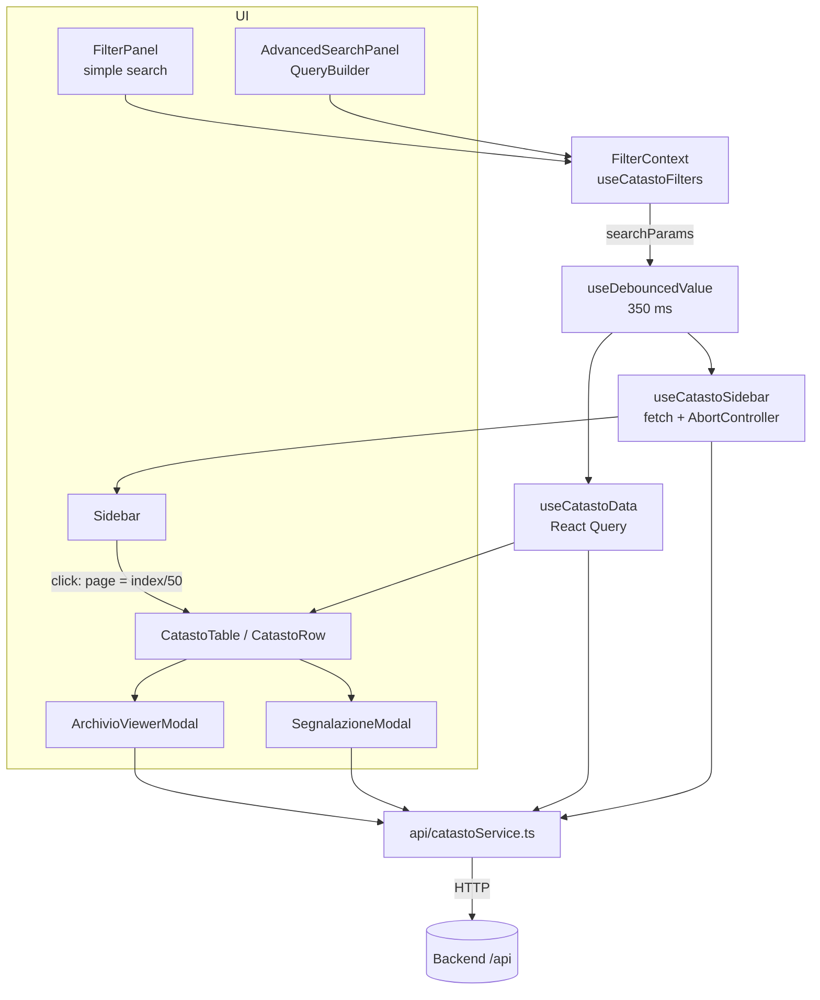
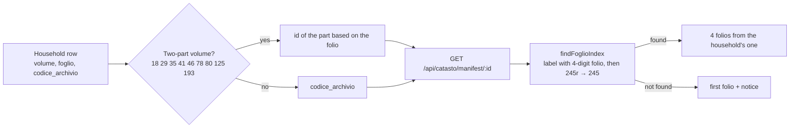

# Frontend

🇮🇹 [Italiano](../frontend.md) · 🇬🇧 **English**

| Field | Value |
|---|---|
| Identifier | `CAT-DOC-04` |
| Version | 2.0 |
| Date | 2026-10-29 |
| Status | Approved |
| Classification | Public |
| Owners | Antonio Orfitelli, Pasquale Ruotolo |
| Language | English (translation; the Italian text prevails) |
| Reference text | [Frontend](../frontend.md) |
| Related documents | [CAT-DOC-00 Documentation standard](../standard-documentale.md) · [CAT-DOC-01 Installation and deployment](installation.md) · [CAT-DOC-02 Architecture and data model](architecture.md) · [CAT-DOC-03 Backend and API](backend.md) · [CAT-DOC-05 Use cases](use-cases.md) · [CAT-DOC-06 Code review](code-review.md) · [Repository readme](../../README.en.md) |

---

## 1. Purpose and audience

This document is for developers working on the interface of the Florentine Catasto of 1427/30 portal (`frontend-catasto/`) and for those who configure and deploy it. It describes pages, code structure, data flow, features, language, theme, build, deployment, tests and known limitations. The APIs used by the interface are described in [Backend and API](backend.md), the overall picture and the data model in [Architecture and data model](architecture.md), the users' journeys in [Use cases](use-cases.md).

---

## 2. Overview

### 2.1 Technologies

A **React 18 + TypeScript** application built with **Vite 6**, styled with **Tailwind CSS v4**, with data through **TanStack Query 5** and routing with **React Router 7**. Interface in Italian and English (§7), light and dark theme (§8), accessibility target WCAG 2.1 AA.

### 2.2 Provenance of the data shown

In line with the [documentation standard](../standard-documentale.md) (§5.6), the interface shows data at three levels of provenance:

| Level | In the interface |
|---|---|
| **Source datum** | Fields of the *fuochi* (households) and of the family members (Herlihy–Klapisch-Zuber research, ACRH digitisation), reference to the *campione* (official register: volume and folio), folio images from the IIIF service of the Archivio di Stato di Firenze |
| **Contributed datum** | *Portata* (declaration) shelfmark, shown only after verification by the editorial team (§6.4, §6.11) |
| **Derived datum** | Statistics, means and medians, differences in the comparison, English translations of values (supplied by the backend), orderings |

A datum missing from the source stays missing in the interface too: it does not become 0, produces no difference in the comparison and appears as "—" in the statistics (§6.6, §6.8, §10.2). Economic values are in florins (fl.), as in the source data.

---

## 3. Pages

| Path | Component | Content |
|---|---|---|
| `/` | `pages/HomePage.tsx` | Main application (Browse): side index, simple/advanced search, table and statistics, pagination, folio viewer, user reports, export, comparison |
| `/banco` | `pages/BancoPage.tsx` | Workbench: query as a sentence, chosen columns, charts on the results, collections, dense table (lazy) |
| `/informazioni` | `pages/InfoPage.tsx` | Project description and credits (lazy-loaded) |
| `/glossario` | `pages/GlossarioPage.tsx` | Terms of the *catasto* with their definitions, one anchor per entry (lazy) |
| `/contatti` | `pages/ContattiPage.tsx` | Email addresses and link to the repository (lazy) |
| `/mappa` | `pages/MappaPage.tsx` | "Under development" placeholder, not linked from the menu (lazy) |

`FilterProvider` wraps the router: filters stay set when moving from one page to another. `CompareProvider` (the selection of *fuochi*) and the comparison view sit in `App.tsx` above the routes: a selection made in Browse also applies in the Workbench.

---

## 4. Code structure

```
frontend-catasto/
├── index.html                 # lang="it", loads public/theme-init.js before paint
├── public/theme-init.js       # applies the saved theme (separate file: the CSP forbids inline scripts)
├── nginx.conf                 # SPA + proxy /api → backend:3005
├── security-headers.conf      # CSP and security headers
├── vercel.json                # static deployment alternative
└── src/
    ├── main.tsx · App.tsx     # bootstrap, routes, lazy loading
    ├── providers/Providers.tsx# QueryClient (retry 1, no refetch on focus)
    ├── context/FilterContext.tsx
    ├── api/
    │   ├── client.ts          # apiRequest, apiDownload, base URL, user-facing error messages
    │   └── catastoService.ts  # all backend calls
    ├── hooks/
    │   ├── useCatastoFilters.ts   # filter state, AST, sorting, shared links
    │   ├── useCatastoData.ts      # paginated table + family members of the open row
    │   ├── useCatastoSidebar.ts   # progressively loaded index
    │   ├── useDebouncedValue.ts · useDarkMode.ts · useMediaQuery.ts · useModal.ts
    ├── components/
    │   ├── layout/            # Header, Footer, Sidebar (virtualised list)
    │   └── common/            # CustomAutocomplete, CustomNumberInput, Spinner
    ├── features/
    │   ├── catasto/
    │   │   ├── components/    # FilterPanel, AdvancedSearchPanel, QueryBuilder,
    │   │   │                  # CatastoTable, CatastoRow, Pagination, ArchivioViewerModal,
    │   │   │                  # ExportMenu
    │   │   └── lib/           # pure, tested logic
    │   │       ├── simple-filters.ts   # simple filters → query parameters
    │   │       ├── query-ast-utils.ts  # pruneAst: removes incomplete conditions
    │   │       ├── query-describe.ts   # AST → readable sentence (describeQuery from @catasto/shared)
    │   │       ├── download.ts         # saves a Blob as a file
    │   │       ├── query-share.ts      # AST ⇄ #q=… link
    │   │       ├── saved-queries.ts    # queries saved in localStorage
    │   │       ├── archivio.ts         # two-part volumes, folio lookup, IIIF URLs
    │   │       └── segnatura.ts        # shelfmark parser (from @catasto/shared)
    │   └── segnalazioni/
    │       ├── components/SegnalazioneModal.tsx
    │       └── api/create-segnalazione.ts
    └── pages/
```

Shared rules and types (queryable fields, operators, AST limits, shelfmark parser) come from `@catasto/shared`, which Vite imports directly from source (`packages/shared/src`).

Other modules mentioned in this document: `features/glossary`, `features/tour`, `features/compare`, `features/banco`, `components/common/Tabs.tsx`, `api/fuochi-by-ids.ts`, `src/i18n/`.

---

## 5. State and data flow

### 5.1 Diagram



### 5.2 Rules

- **`useCatastoFilters`** holds the simple filters, the sorting, the advanced mode, the AST being edited and the "pruned" AST (`queryAst`, without incomplete conditions). It produces a single `searchParams` object.
- **Debounce**: the whole `searchParams` is delayed by 350 ms, so typing, menus and sorting produce a single request.
- **Exclusive modes**: in advanced search the AST *replaces* the simple filters (it does not combine with them).
- **Table** (`useCatastoData`): React Query key `["catastoData", search, page]`, 50 rows per page, `keepPreviousData` while changing page. Only one row open at a time; family members are loaded only when the row is opened (10 min cache).
- **Index** (`useCatastoSidebar`): blocks of 1000 entries with infinite scroll; each new search cancels the previous one.
- **URL**: the only state in the URL is the `#q=` (shared search) and `#confronta=` (shared comparison) fragments, read once at start-up and then removed.

### 5.3 Backend calls

| Function | Endpoint | When |
|---|---|---|
| `fetchFuochi(search, "table")` | `GET /api/catasto` or `POST /api/catasto/query` | simple / advanced search |
| `fetchFuochi(search, "sidebar")` | `GET /api/catasto/sidebar` or `POST /api/catasto/query` (`view: "sidebar"`) | index |
| `fetchParenti(id)` | `GET /api/parenti/:id` | opening a row |
| `fetchFilterOptions(geo)` | `GET /api/filters?serie=&quartiere=&piviere=` | start-up and change of geographic level |
| `fetchManifest(id)` | `GET /api/catasto/manifest/:id` | opening the folio viewer |
| `createSegnalazione(body)` | `POST /api/segnalazioni` | sending a user report |
| `fetchFuochiByIds(ids)` | `GET /api/catasto/fuochi?ids=` | comparison selection (`api/fuochi-by-ids.ts` splits long lists into blocks) |
| `fetchSuggest(q)` | `GET /api/catasto/suggest?q=` | "Find and add" in the Workbench |
| `fetchStats(search)` | `GET /api/catasto/stats` or `POST /api/catasto/query/stats` | **Statistics** tab open |
| `downloadExport(search, opzioni)` | `GET /api/catasto/export` or `POST /api/catasto/query/export` | **Export** button |

`api/client.ts` uses `VITE_API_URL`; if it is missing, in production it calls the same origin (`/api`, proxied by nginx), in development `http://localhost:3005`. 4xx errors show the backend's message, all others a generic message in Italian.

---

## 6. Features

### 6.1 Simple search (`FilterPanel`)

- At the top, the **Simple search | Advanced search** switch and, on the right, **Clear filters**.
- On a single line: **Search person**, **Search place**, **Volume**, and the **More filters** and **Refresh** buttons.
- **More filters** panel (with a counter of active filters):
  - attributes chosen with autocompletion: occupation, employment relation, livestock, immigration, family member's particularity, house;
  - cascading geography **territorial series → quarter → *piviere* (pieve district) → *popolo* (parish)** (changing a level clears the levels below and narrows the options). Here *Serie* is the territorial series (city, *contado*, district), not an archival series;
  - min/max ranges in florins (fl.): *fortune* (property), credit, credit in the Monte, taxable assets, deductions.
- **Clear filters** resets filters, sorting and AST.
- `CustomAutocomplete` is a full ARIA combobox (arrows, Home/End, Enter, Esc, Delete) and shows at most 100 entries at a time.

### 6.2 Advanced search (`AdvancedSearchPanel`, `QueryBuilder`)

- **All** (AND) / **At least one** (OR) groups, with **Exclude** (NOT) and nesting up to 5 levels.
- Each condition: field → operator compatible with the type → value (text, number, range, single or multiple choice).
- Natural-language **preview**, for example (illustrative): *Show households where Occupation equals "Lanaiolo" and (Fortune greater than 1000 or House equals "Propria")*.
- **Saved filters**: in `localStorage` (`catasto.savedQueries.v1`, max 50, name max 60 characters); same name = overwrite. They stay on the device; entries with an invalid structure are discarded.
- **Share link**: copies `https://…/#q=<base64url of the AST JSON>` (max 2000 characters). The `#` fragment never reaches server logs. Whoever opens the link lands directly in advanced search; a link with a malformed query is ignored.

### 6.3 Side index (`Sidebar`)

Virtualised list (name + occupation) of the *fuochi* in the current search. Clicking an entry moves the table to the matching page (`indice / 50 + 1`). Open by default on desktop, overlaid on mobile.

### 6.4 Table and household record (`CatastoTable`, `CatastoRow`)

- Desktop (≥ 1024 px): table with the columns **Head of household**, **Place**, **Summary data**, **References**, sortable (except References) with `aria-sort`. Mobile: cards.
- **References**:
  - ***Campione*** "Vol. X c. Y" (volume and folio of the *campione*, a source datum; as a shelfmark `ASFi, Catasto, <volume>, c. <n><r|v>`): opens the folio viewer if the volume is digitised;
  - ***Portata***: appears when the editorial team has published the shelfmark (contributed datum); opens the folio viewer if that volume is digitised too.
- **Open row**:
  - *Economic details*: credit, credit in the Monte, *fortune*, deductions, taxable assets in florins; livestock, immigration, employment relation, particularities;
  - *Household composition*: kinship, sex, age, marital status, particularities of each member;
  - **Report an error** action and, if the *portata* is missing, **contribute** its shelfmark.

### 6.5 Glossary and contextual help (`features/glossary`, `features/tour`)

- **Glossary as a single source of truth**: `src/i18n/glossary.ts` (term, short and, where needed, extended definition, in Italian and English). The definitions follow the glossary in [Architecture and data model](architecture.md) and must be reviewed by the authors before entries are added: a term without a verified definition does not go in. `FIELD_TERMS` states, for **every** field of `FIELD_REGISTRY`, which entry explains it (`null` = no technical term or no verified definition); a test fails if a new field has no decision. The same glossary is aligned with the controlled terminology of the [documentation standard](../standard-documentale.md) (§6).
- **Hints** (`GlossaryTerm`): an "i" button next to labels in the table (Head of household → *fuoco*, References → *campione*), in the household record (economic data), in the filters (volume, territorial series, quarter, *piviere*, *popolo*, ranges in florins), in the QueryBuilder (chosen field) and in the statistics table. It opens on mouse hover, focus and tap; Esc closes it and returns focus; the definition is always linked through `aria-describedby`; the popover (in a portal, so the table does not clip it) contains the **Read more in the glossary** link to the glossary entry. It sits next to the controls, never inside another button or a `<label>`.
- **`/glossario` page**: all entries in alphabetical order, each with the anchor `#termine-<id>` (scrolled into view and focused on arrival) and an initial index. Linked from the footer.
- **Guided tour** (`GuidedTour`): five steps (search, household record, folio viewer, user report, comparison/export/statistics) in a modal window. It opens by itself on the first visit to the home page, but not over a shared link; closing it in any way (Skip, Esc, Got it) marks it as seen in `localStorage` (`catasto.tour.v1`); the **Guide** button in the header reopens it.

### 6.6 Selecting and comparing households (`features/compare`)

- A small, text-less **Select** checkbox on every row and card, in Browse and in the Workbench: up to `SELECTION_MAX_FUOCHI` (500) *fuochi* can be chosen, even from different pages or searches. The selected row has a lightly tinted background and a rule on the left.
- **Selection bar** at the bottom, with only a top rule. It starts **collapsed** to a thin line, "N households selected ▴ · Export selected · Compare side by side", so ticking a row does not cover the page; the count (a button with `aria-expanded`) opens it: "N households selected ▾ Name ×, Name ×, and N more · Add to a collection · Export selected · Deselect · Compare side by side". **Compare side by side** is active for 2 to 5 *fuochi* (`COMPARE_MIN_FUOCHI`/`COMPARE_MAX_FUOCHI`); **Export selected** downloads a CSV with the `ids` filter; **Add to a collection** opens a small panel with the existing collections and the name of a new one. A spacer keeps the bar from covering the bottom of the page.
- **Comparison view** (modal window with `useModal`: Esc, focus trapped and returned): on desktop a table with one column per *fuoco* and row and column headers; on mobile side-by-side cards to scroll. Rows: occupation, employment relation, place, house; *fortune*, credit, credit in the Monte, taxable assets and deductions (in florins) with the difference from the first *fuoco* written in words and with ▲/▼ (never colour alone; with a missing datum, no difference); recorded members, ages and marital status of the family members; reference to the *campione* with **Open the folio** in the folio viewer.
- **State**: the selection (ids) is kept in `sessionStorage` (`catasto.compare.v1`) and lasts for the session, together with a copy of the rows chosen from the table (`catasto.compare.rows.v1`). *Fuochi* without a copy (shared link, collection put into the selection) are requested once from `GET /api/catasto/fuochi?ids=` in blocks of 50 and become copies; while the view is open the same *fuochi* are reloaded in the active language. If the endpoint does not respond (for example a frontend preview connected to a backend not yet updated) the copies are enough, and the error appears only for *fuochi* that have neither source.
- **Shared link** `#confronta=12,345,678` (illustrative ids; **Copy link** button in the view): reopens the same selection, and the comparison if there are 2 to 5 *fuochi*. Invalid or repeated ids are discarded without errors; non-existent ones are removed after the server responds, with a notice in the bar and in the live region. On load the parameter is removed from the fragment, leaving the rest (e.g. `#q=`).

### 6.7 Workbench (`pages/BancoPage.tsx`, `features/banco`)

- **Query**: the same AST as the advanced search in Browse (`FilterContext`), hence the same results for the same query. It reads as a sentence ("Households where territorial series is City and occupation is lanaiolo", from `describeNode`; illustrative example), with "+ condition", "Edit as AND/OR groups" (opens `QueryBuilder`), "Save the query" (`saved-queries.ts`) and "Copy link" (`#q=`). Editing it here also switches Browse to advanced search.
- **Find and add** (`FinderPanel`): to put *fuochi* into a collection or into the selection without changing the query. The **Search** tab is a box (ARIA combobox) that queries `GET /api/catasto/suggest` while typing (200 ms pause): head of household, occupation, *popolo*, quarter, *piviere*, `#numero` or `vol. 79 c. 12`. `/` from anywhere on the page moves to the box, ↑↓ scroll, Enter adds (and never removes), Esc closes; a click on an entry already in removes it. The **Paste a list** tab reads numbers from any text (`paste-ids.ts`), checks them with `fetchFuochiByIds` and states, before adding, how many are new, already in, repeated, over the limit or non-existent. **Destination** chooses between the selection, a collection or "+ new collection…" (`add-target.ts`, same operations for both); opening a collection makes it the destination. Every addition and removal made here has **Undo**, which also restores the previous order.
- **Dense table** (`BancoTable`): 32 px rows, tabular figures right-aligned with thousands separators, lightly tinted alternate rows, sorting from the headers (the columns the backend can sort); at the bottom, the **mean** and **median** of all results, from the statistics (the *bocche*, dependants, from the distribution of members). 25, 50 (default), 100 or 200 rows per page. The "Vol., c." reference opens `ArchivioViewerModal`. The checkbox on the left follows the "Find and add" destination: with the selection it is the usual checkbox, with a collection it adds the *fuoco* to and removes it from that collection; a row that is in it has the tinted background and the rule. Data come from the `banco` view (`fetchFuochi(search, "banco", …)`), which adds *bocche* and mean age.
- **Columns** (`columns.ts`, `ColumnsMenu`): the list comes from `FIELD_REGISTRY` plus four derived columns (*campione*, quarter » *popolo*, *bocche*, mean age); family-member fields remain filters. Each column can be switched on or off and dragged; the ↑↓ arrows do the same from the keyboard. The choice is kept in `localStorage` (`catasto.banco.colonne.v1`), cleaned on read (unknown keys dropped, new columns appended); "reset" returns to the starting set. The head of household cannot be switched off.
- **Charts** (`BancoCharts`, `charts.ts`): taxable assets by band, *fuochi* by number of *bocche* and most frequent occupations, from `GET /api/catasto/stats` over the whole query. The item containing the active row (under the mouse or focus) is in the second colour and stated in words; every chart has its own data table.
- **Collections** (`collections.ts`, `CollectionsPanel`): sets of *fuochi* picked by hand, in `localStorage` (`catasto.raccolte.v1`, at most 50). They open in the Workbench (search with the `ids` filter), become the destination with "Add here", are renamed in place (`renameCollection`: no empty or already used names, case-insensitive; Enter saves, Esc cancels), are put into the selection to compare or export them, and are shared with a `/banco#raccolta=<nome>:<id,…>` link that, when opened, saves the collection on the device. Changes go through a `catasto:raccolte` event, so bar and page stay in sync even without `localStorage`.
- **Phone**: a notice says the page is designed for a computer; it remains usable, with the table scrolling sideways.

### 6.8 Statistics (`StatsPanel`)

- **Table** / **Statistics** tabs above the results (ARIA tabs pattern, `components/common/Tabs.tsx`: arrows, Home, End). Statistics load only while their tab is open (`useCatastoStats`, key `["catastoStats", lang, ricerca senza ordinamento]`, i.e. the search without sorting, 60 s) and follow the filters like the table. A click in the side index returns to the table.
- A `404` from the endpoint (backend not yet updated) shows "Statistics not available yet" instead of the generic error; other errors remain with **Retry**. `apiRequest` throws `ApiError` with the HTTP status.
- Content (derived datum): *fuochi*, family members and mean members per *fuoco*; a table of economic measures in florins (present, missing, sum, mean, median, quartiles, minimum, maximum) with an explanation of the measures for students; bars by occupation, quarter, territorial series, number of members and marital status; age pyramid by sex.
- Charts in HTML, without libraries: one data series = one colour (`--chart-1`); the pyramid uses `--chart-1` and `--chart-2` with a legend and headers for both sides. The colour pair is validated (lightness, chroma, colour-blind separation and contrast) on both the light and the dark theme. Each bar shows its value and share alongside; "Other" and "Not stated" have a striped pattern, not just a colour; every chart has its own **data table** in a `<details>`. Measures that cannot be computed show "—" with a text for screen readers.

### 6.9 Export (`ExportMenu`)

- **Export** button next to the number of results: opens a panel (Esc or a click outside closes it) with **CSV** or **Excel (XLSX)** format, CSV separator (semicolon for Excel in Italian, the default in Italian; comma for R, Python and Excel in English) and **Include relatives**.
- The export contains all pages of the search shown in the table (the same `search`, simple or advanced), in the same order. CSV with family members = two files downloaded one after the other (*fuochi* and family members); XLSX = one file with the Info, Fuochi and Parenti sheets.
- The file arrives through `fetch` and is saved with a temporary URL (`lib/download.ts`): this way a `400` (for example beyond the server's row cap) becomes a message in the panel, not an error page. The status ("Preparing the file…", files downloaded) is in a live region.

### 6.10 Folio viewer (`ArchivioViewerModal`)

The folio viewer shows the folios of the *campione* (file: volume; item: folio, recto/verso) from the IIIF images of the Archivio di Stato di Firenze.



- IIIF images at 1600 px, at full resolution above 120% zoom; neighbouring folios are preloaded.
- Zoom 20–500% (wheel, buttons, `+`/`-` keys), dragging, pinch and swipe on touch, arrows to change folio, **Fit** to reset.
- Link to the **Original Site** of the digital archive and **Report shelfmark** button.
- `useModal` handles Esc, focus trap, focus restoration, scroll lock and stacked modals.

### 6.11 User reports (`SegnalazioneModal`)

| Type | Fields | Notes |
|---|---|---|
| **Wrong data** | wrong field (required), correct value | the current value is attached automatically |
| ***Portata* shelfmark** | shelfmark (required) | implicit prefix `ASFi, Catasto`; "other fonds" checkbox to remove it |
| **Other** | proposed value or notes | |
| *all* | notes (max 2000), optional email | hidden `website` field as a honeypot |

After sending, the confirmation "checked by the editorial team" appears: nothing is published without moderation. A proposed shelfmark becomes a contributed datum only after this verification; until then it is not cited as certain.

---

## 7. Interface language

The **EN/IT** button in the header switches the site language; the choice is kept in `localStorage` (`lang`) and, on the first visit, follows the browser language (Italian if the browser is Italian, English otherwise).

- Core in `src/i18n/`: `LanguageProvider` (in `Providers`), `useLanguage()`, `useT(messages)`; outside React, `translate()` and `getLang()`.
- Each component keeps its texts in an `X.messages.ts` file next to the code, with `defineMessages({ it, en })`: TypeScript flags missing English keys.
- Labels of registry fields and operators (`@catasto/shared`, which stays in Italian) are shown through `fieldLabel()` / `operatorLabel()`.
- Values of the lookup tables (occupations, house, livestock, ...) are translated by the backend: `apiRequest` adds `?lang=en` and the TanStack Query cache is invalidated when the language changes. Places and personal names are not translated. See [Backend and API](backend.md), Translations section.

---

## 8. Theme and style

- Colour tokens defined in `src/index.css` (`:root` and `.dark`) and exposed to Tailwind v4 with `@theme`; `dark` variant based on the `.dark` class on `<html>`.
- `useDarkMode` reads `localStorage.theme`, otherwise `prefers-color-scheme`; `public/theme-init.js` applies the class before the first paint to avoid flashes.
- Typeface: **Source Serif 4** for the whole interface.
- `prefers-reduced-motion` is honoured globally.

---

## 9. Configuration, build and deployment

### 9.1 Commands

| Command (in `frontend-catasto/`) | Effect |
|---|---|
| `npm run dev` | Vite server on `http://localhost:5173` |
| `npm run build` | bundle in `dist/` |
| `npm run preview` | serves the build |
| `npm run lint` | ESLint, with the shared `eslint.config.base.mjs` configuration at the root, zero warnings allowed |
| `npm test` | Vitest (node environment; jsdom in component and hook tests) |

### 9.2 Variables

Only `VITE_API_URL` (optional, read at build time).

### 9.3 nginx

Docker image: SPA fallback to `index.html`, `/assets/` with a one-year immutable cache, `/api` proxied to `http://backend:3005` with `X-Forwarded-For` set to the client IP, gzip, body max 128 kB.

### 9.4 Security headers

`security-headers.conf`: CSP `default-src 'self'; script-src 'self'; img-src 'self' data: https:; connect-src 'self'; frame-ancestors 'none'…`, `X-Frame-Options: DENY`, `nosniff`, `Referrer-Policy`, `Permissions-Policy`, COOP. HSTS must be configured on the TLS terminator.

### 9.5 Vercel

`vercel.json`: same headers with `connect-src 'self' https:`; there is no proxy for `/api`, so `VITE_API_URL` must be set to point to the backend.

---

## 10. Tests

### 10.1 Unit tests

Unit tests on the pure logic in `features/catasto/lib/`:

- `archivio.test.ts`: choice of the volume part, folio lookup, IIIF URLs;
- `segnatura.test.ts`: parsing of *portata* shelfmarks;
- `simple-filters.test.ts`: conversion of filters into parameters;
- `formato.test.ts`: florins, ages and places with missing data;
- `query-ast-validate.test.ts`: structural validation of shared links, depth limits, tolerant `pruneAst`;
- `saved-queries.test.ts`: id generation even outside HTTPS.

### 10.2 Component and hook tests

With Testing Library, in jsdom (declared at the top of the file with `// @vitest-environment jsdom`; `src/test/setup.ts` sets the Italian language and unmounts the DOM after each test, `src/test/render.tsx` provides the app's providers):

- `CatastoRow.test.tsx`: the row is not focusable, it opens from the button with `aria-expanded`/`aria-controls`, the folio viewer does not expand the row, missing values do not become 0;
- `Pagination.test.tsx`: controls disabled at the edges and while loading, page change only on Enter;
- `useCatastoFilters.test.tsx`: geographic cascade, sorting, executable AST, opening from a `#q=` link;
- `glossary.test.ts`: one glossary decision for every registry field, complete IT/EN entries;
- `GlossaryTerm.test.tsx`: description always linked, opening on focus, Esc with focus returned, tap without propagating the click to the row;
- `GuidedTour.test.tsx`: opening on the first visit, full tour, Skip and Esc remembered, reopening from the button;
- `GlossarioPage.test.tsx`: one anchor per entry and the index;
- `compare-selection.test.ts` and `compare-format.test.ts`: serialisation and parsing of the `#confronta=` link, invalid ids, limit of five, tampered `sessionStorage`, differences with missing data;
- `Compare.test.tsx`: checkboxes and bar, opening from two *fuochi*, columns and differences, links with non-existent ids, limit of five, Esc and Clear;
- `StatsPanel.test.tsx`: "Other" and "Not stated" bars, grouping of large *fuochi*, economic table with non-computable values, data tables, error with Retry;
- `Tabs.test.tsx`: a single tabbable tab, arrows, Home and End;
- `ExportMenu.test.tsx`: opening and closing with Esc, two files for CSV with family members, one file for XLSX, server message beyond the cap.

### 10.3 API client

`api/client.test.ts` checks the file name from `Content-Disposition` and the errors of `apiDownload`.

---

## 11. Known limitations

The issues raised by the September 2026 review have been fixed (history in [Code review](code-review.md)). Two accessibility improvements remain open:

- table rows are focusable and contain buttons (nested interactive elements);
- some icons next to a visible label lack `aria-hidden`.

---

## 12. References and sources

- Herlihy, David, and Christiane Klapisch-Zuber. *Les Toscans et leurs familles. Une étude du catasto florentin de 1427*. Paris: Presses de la Fondation nationale des sciences politiques – Éditions de l'EHESS, 1978.
- Digitised data: ACRH, <https://journals.openedition.org/acrh/7458>.
- Images: Archivio di Stato di Firenze, ICAR digital archive, IIIF service (folio viewer, §6.10).
- W3C, *Web Content Accessibility Guidelines (WCAG) 2.1*, level AA (§2.1).

---

## 13. Change log

| Version | Date | Author | Description |
|---|---|---|---|
| 1.x | — | — | Earlier versions, without a change log |
| 2.0 | 2026-10-29 | Pasquale Ruotolo | Rewrite according to CAT-DOC-00 and English translation |
