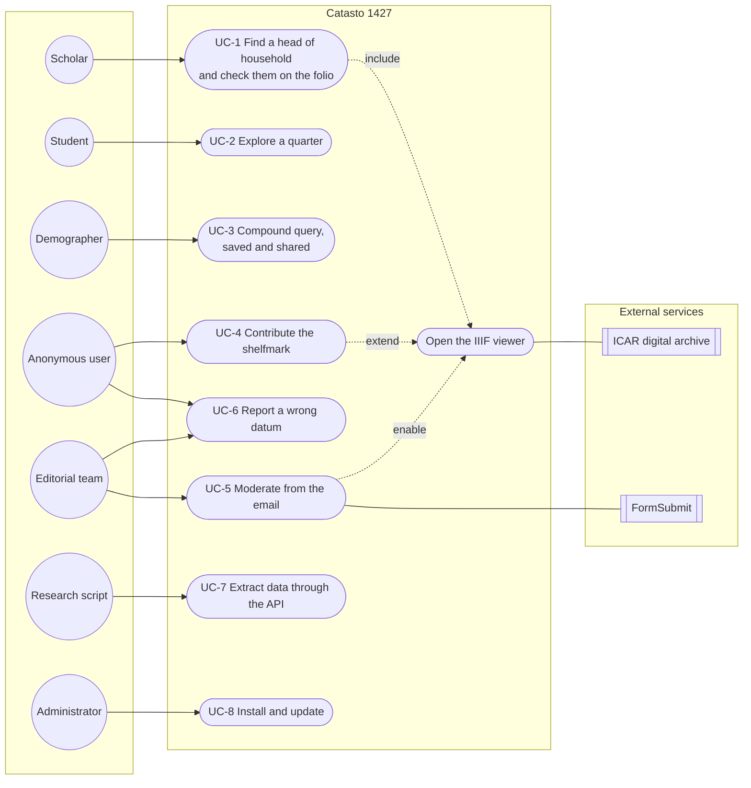
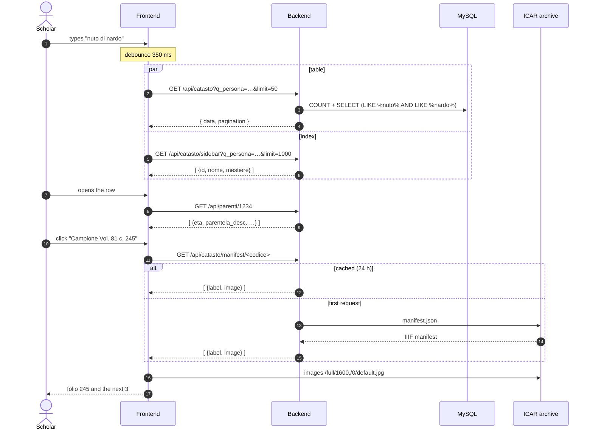
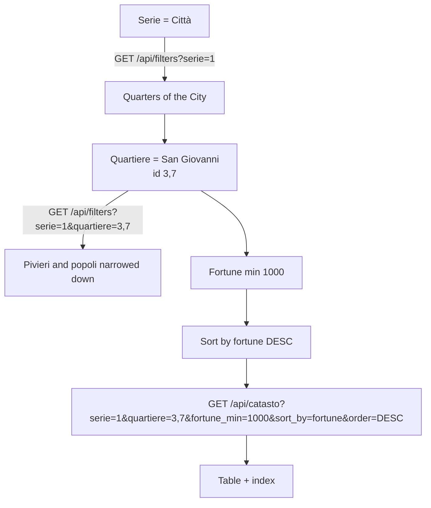
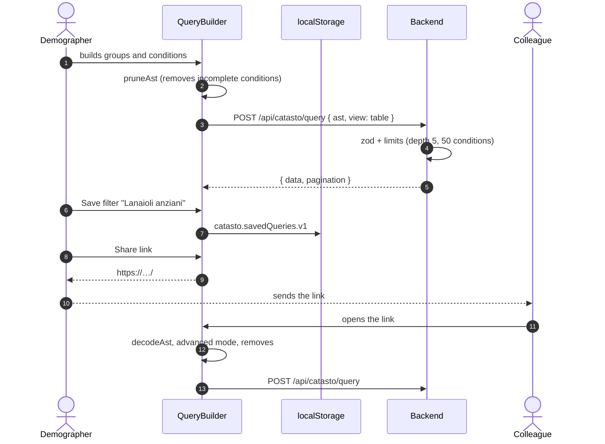
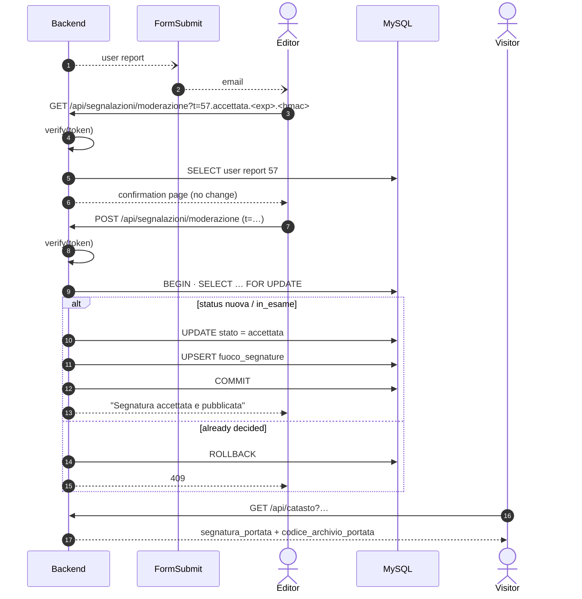
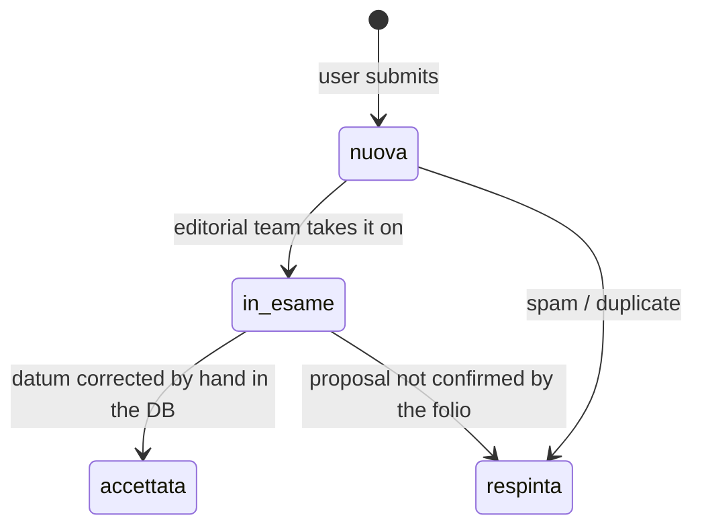
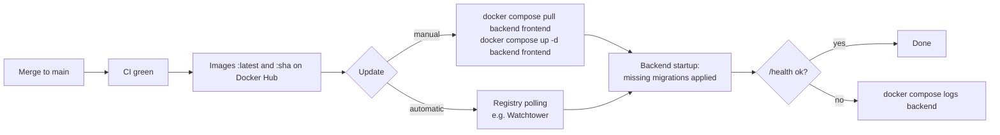

# Use cases

🇮🇹 [Italiano](../casi-d-uso.md) · 🇬🇧 **English**

| Field | Value |
|---|---|
| Identifier | `CAT-DOC-05` |
| Version | 2.0 |
| Date | 2026-10-29 |
| Status | Approved |
| Classification | Public |
| Owners | Antonio Orfitelli, Pasquale Ruotolo |
| Language | English (translation; the Italian text prevails) |
| Reference text | [Casi d'uso](../casi-d-uso.md) |
| Related documents | [CAT-DOC-00 Documentation standard](../standard-documentale.md) · [CAT-DOC-01 Installation and deployment](installation.md) · [CAT-DOC-02 Architecture and data model](architecture.md) · [CAT-DOC-03 Backend and API](backend.md) · [CAT-DOC-04 Frontend](frontend.md) · [CAT-DOC-06 Code review](code-review.md) · [Repository readme](../../README.en.md) |

---

## 1. Purpose and audience

This document is for the editorial team, developers, system administrators and interface designers. It describes real usage scenarios of the Florentine Catasto of 1427/30 portal, from the point of view of the user and of what happens in the system. Each case states actors, preconditions, main flow, variants and the API calls involved. API details are in [Backend and API](backend.md), interface details in [Frontend](frontend.md).

> Names, ids, shelfmarks and values in the examples are **illustrative**: they show the format and do not reproduce *catasto* data.

**Conventions.** In these use cases "Serie" (city, *contado*, district) always means the **territorial series**, i.e. a division of the *fuochi* (households) in the data model, not an archival series (see [Documentation standard, §5.2](../standard-documentale.md#52-livelli-di-descrizione--levels-of-description)). Volume and folio correspond to the ISAD(G) levels *file* and *item* of the Catasto fonds of the Archivio di Stato di Firenze (ASFi). Economic values are in florins (fl.), as in the source data. Interface labels are quoted as they appear in the Italian interface.

---

## 2. Overview

### 2.1 Index of use cases

| # | Use case | Primary actor |
|---|---|---|
| [UC-1](#3-uc-1--find-a-head-of-household-and-check-them-on-the-folio) | Find a head of household and check them on the folio | Scholar |
| [UC-2](#4-uc-2--explore-a-quarter-by-wealth) | Explore a quarter by wealth | Student |
| [UC-3](#5-uc-3--build-save-and-share-a-compound-query) | Build, save and share a compound query | Demographer |
| [UC-4](#6-uc-4--contribute-the-portata-shelfmark) | Contribute the *portata* shelfmark | Anonymous user |
| [UC-5](#7-uc-5--moderate-a-user-report-from-the-email) | Moderate a user report from the email | Editorial team |
| [UC-6](#8-uc-6--report-and-correct-a-wrong-datum) | Report and correct a wrong datum | User + Editorial team |
| [UC-7](#9-uc-7--extract-data-through-the-api-for-an-analysis) | Extract data through the API for an analysis | Researcher (script) |
| [UC-8](#10-uc-8--install-and-update-the-portal) | Install and update the portal | System administrator |

### 2.2 Use case diagram



---

## 3. UC-1 — Find a head of household and check them on the folio

**Actor**: scholar · **Goal**: find the *fuoco* (household) of a person known from another source and check the transcription against the original folio of the *campione* (official register).

**Preconditions**: the *campione* volume has been digitised (`codice_archivio` is present).

**Main flow**

1. In the **Cerca Persona** (search person) box, type `nuto di nardo`.
2. After 350 ms the frontend calls `GET /api/catasto?q_persona=nuto di nardo&sort_by=nome&order=ASC&page=1&limit=50`; the backend drops "di" (in the database first name and patronymic are a single field, "NUTO NARDO") and searches for households whose name contains both *nuto* and *nardo*, in any order.
3. The table shows the results; the side index shows the same list.
4. The scholar opens the row: they see the economic data and, loaded with `GET /api/parenti/:id`, the family composition.
5. Click **Campione — Vol. 81 c. 245** (file: volume 81 of the *campione*; item: folio 245): the viewer calls `GET /api/catasto/manifest/:id`, locates folio 245 and shows the 4 folios starting from there.
6. Compare the folio with the transcribed data (source datum), zooming with the mouse wheel or by pinching.

**Variants**

- *5a. Volume digitised in two parts* (e.g. vol. 125): the viewer picks the part according to the folio.
- *5b. Folio not located*: the viewer opens the first folio of the volume and says so; the **Sito originale** (original site) link remains available.
- *5c. Archive unreachable*: the backend answers 502, the viewer shows an error message.
- *6a. The transcription does not match*: continue with [UC-6](#8-uc-6--report-and-correct-a-wrong-datum).



---

## 4. UC-2 — Explore a quarter by wealth

**Actor**: student · **Goal**: see which were the wealthiest households of a quarter and what their occupations were.

**Main flow**

1. Open **Altri filtri** (more filters) and choose **Serie = Città** (territorial series = city), then **Quartiere = San Giovanni** (quarter; the options of the lower levels narrow down via `GET /api/filters?serie=…`).
2. Set **Fortune min = 1000** (florins; *fortune*, property).
3. Click the **Dati sintetici** (summary data) header twice to sort by descending *fortune*.
4. The frontend calls `GET /api/catasto?serie=1&quartiere=3,7&fortune_min=1000&sort_by=fortune&order=DESC&page=1&limit=50`.
5. Browse the pages with the pagination or jump to a specific page.
6. To understand the terms (*fortune*, taxable assets, *piviere*) consult the **Informazioni** (information) page or the [glossary](architecture.md#34-glossary).

**Variants**

- *1a. No results*: the table offers **Azzera i filtri** (reset filters).
- *4a. The quarter merges several partitions* (`San Giovanni (I)` and `(II)`): the id `"3,7"` is expanded to `IN (3, 7)`.



---

## 5. UC-3 — Build, save and share a compound query

**Actor**: demographer · **Goal**: identify the households of wool craftsmen that have at least one family member over 60, excluding immigrant households, and share the search with a colleague.

**Main flow**

1. Switch on **Ricerca avanzata** (advanced search; the simple filters are suspended).
2. Root group **Tutte** (all):
   - `Mestiere` (occupation) **è uno fra** (is one of) *Lanaiolo*, *Tessitore*;
   - `Età parente` (family member's age) **maggiore di** (greater than) 60;
   - `Immigrazione` (immigration) **è vuoto** (is empty).
3. Add a **gruppo** (group) *Almeno una* (at least one) with `Fortune` **tra** (between) 100 and 2000 or `Casa` (house) **è uguale a** (equals) *Propria* (owned).
4. Check the preview: *Mostra i fuochi dove Mestiere è uno fra "Lanaiolo", "Tessitore" e Età parente maggiore di 60 e Immigrazione è vuoto e (Fortune tra 100 e 2000 oppure Casa è uguale a "Propria")* (show the households where occupation is one of "Lanaiolo", "Tessitore" and family member's age greater than 60 and immigration is empty and (*fortune* between 100 and 2000 or house equals "Propria")).
5. The frontend sends `POST /api/catasto/query` (see body below).
6. Type the name *Lanaioli anziani* and click **Salva filtro** (save filter): the query stays in `localStorage` on this device.
7. Click **Condividi link** (share link) and paste the URL (`…/#q=eyJraW5kIjoi…`) into an email.
8. The colleague opens the link: the portal enters advanced search with the same query and removes the fragment from the address.

```json
{
  "ast": {
    "kind": "group", "op": "AND", "children": [
      { "kind": "condition", "field": "mestiere",     "operator": "in",       "value": ["12", "57"] },
      { "kind": "condition", "field": "eta_parente",  "operator": "gt",       "value": 60 },
      { "kind": "condition", "field": "immigrazione", "operator": "is_empty" },
      { "kind": "group", "op": "OR", "children": [
        { "kind": "condition", "field": "fortune", "operator": "between", "value": [100, 2000] },
        { "kind": "condition", "field": "casa",    "operator": "eq",      "value": "1" }
      ]}
    ]
  },
  "view": "table", "page": 1, "limit": 50, "sort_by": "nome", "order": "ASC"
}
```

The ids of the entries (occupation, house…) are those returned by `GET /api/filters`; the interface sends them as strings, the API also accepts numbers.

**Variants**

- *2a. Incomplete condition* (value not yet chosen): it is automatically left out of the query until it is complete.
- *3a. More than 5 nesting levels*: the **+ Gruppo** button is disabled. A query with more than 50 conditions is rejected by the backend with `400`.
- *3b. Geographic condition*: `Quartiere` **è uguale a** *San Giovanni* includes all partitions with that name (`San Giovanni (I)` and `(II)`), as in simple search.
- *7a. Link longer than 2000 characters*: the portal warns that the query is too long to share; it can still be saved.



---

## 6. UC-4 — Contribute the *portata* shelfmark

**Actor**: anonymous user (often a scholar who has consulted the *portata* in the archive) · **Goal**: make known where the *portata* (the taxpayer's declaration) of a household is kept.

**Preconditions**: the household record does not yet have a published *portata*.

**Provenance**: the proposed shelfmark is a **contributed datum**; it is neither published nor cited as certain until the editorial team has verified it ([UC-5](#7-uc-5--moderate-a-user-report-from-the-email)).

**Main flow**

1. In the opened row, click **Segnatura della portata non nota — contribuisci** (*portata* shelfmark unknown — contribute) (or **Segnala segnatura**, report shelfmark, in the viewer).
2. The form opens on the type **Segnatura della portata** (*portata* shelfmark), with the prefix `ASFi, Catasto` already shown.
3. Type `81, c. 245r`, optionally a note and one's own email.
4. Submit: `POST /api/segnalazioni` with `{"id_fuoco":1234,"tipo":"segnatura","valore_proposto":"ASFi, Catasto 81, c. 245r",…}`.
5. The backend checks that the household exists, saves the user report as `nuova` (IP only as a hash) and answers `201`.
6. The user sees the confirmation: the shelfmark will be published after editorial verification.
7. The notification to the editorial team starts in the background ([UC-5](#7-uc-5--moderate-a-user-report-from-the-email)).

> The value `ASFi, Catasto 81, c. 245r` is the form the portal stores and displays. Citations in the documentation use the normalised form of the [standard (§5.3)](../standard-documentale.md#53-segnature--shelfmarks): `ASFi, Catasto, 81, c. 245r`.

**Variants**

- *3a. Fonds other than the Catasto*: tick "altro fondo" (other fonds) and type the full shelfmark.
- *4a. More than 5 submissions in one hour from the same IP*: `429 Troppe segnalazioni inviate` (too many reports sent).
- *4b. Bot filling in the hidden field*: response `201` with `id: null`, nothing is saved.

---

## 7. UC-5 — Moderate a user report from the email

**Actor**: editorial team · **Goal**: accept or reject a user report without logging into a panel.

**Preconditions**: `FORMSUBMIT_EMAIL` and `MODERAZIONE_SECRET` configured; FormSubmit form activated.

**Main flow**

1. The email "Segnalazione #57" (user report #57) arrives with type, household (name, volume, folio, place), proposed value, notes, the reporter's email (set as *reply-to*) and two links: **Accetta** (accept) and **Respingi** (reject).
2. The editor clicks **Accetta**: a confirmation page opens with the data of the proposal. **Nothing has changed yet.**
3. The editor checks the shelfmark (for instance on the folio in the viewer) and presses **Accetta la segnatura** (accept the shelfmark).
4. The backend verifies the token (signature, action, expiry), locks the row, sets the status to `accettata` and publishes the shelfmark in `fuoco_segnature`.
5. From then on the household record shows **Portata — ASFi, Catasto 81, c. 245r**; if that volume is digitised, the panel opens the viewer on the folio of the *portata*.

**Variants**

- *2a. Link expired* (after 14 days): `410`; the decision is taken through the admin API.
- *2b. User report already decided* (for instance by another editor): the page says so and does not show the button; a POST answers `409`.
- *3a. Reject*: status `respinta`, nothing is published.
- *4a. Type `dato_errato` or `altro`*: only the status changes; the correction must be made on the datum ([UC-6](#8-uc-6--report-and-correct-a-wrong-datum)).



---

## 8. UC-6 — Report and correct a wrong datum

**Actors**: user, editorial team · **Goal**: correct a transcription (source datum) that does not match the folio.

**Main flow**

1. While comparing the folio ([UC-1](#3-uc-1--find-a-head-of-household-and-check-them-on-the-folio)), the user notices that the transcribed taxable assets are 120 but the folio reads 210.
2. Click **Segnala un errore** (report an error), choose **Campo errato = Imponibile** (wrong field = taxable assets); the form shows the published value (120) and the user types **Valore corretto = 210** (correct value), with a note citing the folio.
3. `POST /api/segnalazioni` with `{"tipo":"dato_errato","campo":"imponibile","valore_attuale":"120","valore_proposto":"210",…}` → `201`.
4. The editorial team receives the email and uses the admin API to put it under review:
   ```bash
   curl -X PATCH -H "Authorization: Bearer $ADMIN_TOKEN" -H "Content-Type: application/json" \
     -d '{"stato":"in_esame"}' https://catasto.example.org/api/segnalazioni/58
   ```
5. Once the folio has been checked, the editors correct the datum in the database (manual operation) and set the user report to `accettata`.

**Variants**

- *4a. List of user reports to process*: `GET /api/segnalazioni?stato=nuova` with the same header.
- *5a. The proposal is wrong*: status `respinta`; if the user left an email address, the editorial team can reply directly (reply-to).



---

## 9. UC-7 — Extract data through the API for an analysis

**Actor**: researcher with a script · **Goal**: download all the households matching a criterion to process them elsewhere.

### 9.1 Short route: the export

A single request returns all the rows of the search as CSV (UTF-8 with BOM) or XLSX, with the same query and the same order as the table:

```bash
# All households with taxable assets >= 500, sorted by taxable assets, as CSV
curl -s -X POST "https://catasto.example.org/api/catasto/query/export" \
  -H 'Content-Type: application/json' -o fuochi.csv \
  -d '{"ast":{"kind":"group","op":"AND","children":[
        {"kind":"condition","field":"imponibile","operator":"gte","value":500}]},
       "sort_by":"imponibile","order":"DESC","format":"csv"}'
# The same households, family members in long format (one row per family member)
#   ... "format":"csv","parenti":true}'  -o parenti.csv
```

```r
# In R: the leading lines starting with # describe source and query
fuochi <- read.csv("fuochi.csv", comment.char = "#", fileEncoding = "UTF-8-BOM")
```

Beyond `EXPORT_MAX_ROWS` (default 100,000, more than the whole dataset) the response is a `400` with a message; the export is limited to 20 requests every 15 minutes per IP. Details in [Backend and API](backend.md#411-search-export-get-apicatastoexport).

### 9.2 Long route: the API pages

Constraints: 300 requests every 15 minutes per IP, at most 2000 rows per page.

```bash
#!/usr/bin/env bash
# Downloads all households with taxable assets >= 500, sorted by taxable assets.
BASE="https://catasto.example.org/api/catasto/query"
BODY='{"ast":{"kind":"group","op":"AND","children":[
  {"kind":"condition","field":"imponibile","operator":"gte","value":500}]},
  "view":"table","limit":2000,"sort_by":"imponibile","order":"DESC"}'

page=1
while :; do
  resp=$(curl -s -X POST "$BASE" -H 'Content-Type: application/json' \
         -d "$(jq --argjson p "$page" '.page=$p' <<<"$BODY")")
  jq -c '.data[]' <<<"$resp" >> fuochi.ndjson
  total=$(jq '.pagination.totalPages' <<<"$resp")
  (( page >= total )) && break
  page=$((page+1)); sleep 1
done
```

### 9.3 Notes

- Respect `RateLimit-Remaining` in the headers; beyond the threshold you receive `429`.
- Ordering is stable (ties are broken by the household id): pages do not overlap and no household is skipped.
- For the family members of each household: `GET /api/parenti/:id`, or the export with `parenti=true`.
- The extracted data are source data (plus any *portata* shelfmarks, contributed data already verified); economic values remain in florins, neither converted nor rounded. Publications must cite the source (see [§11](#11-references-and-sources)).

---

## 10. UC-8 — Install and update the portal

**Actor**: system administrator · **Goal**: put the portal into production and keep it up to date. The full procedure is in [Installation and deployment](installation.md).

### 10.1 First installation

1. Copy `docker-compose.yml` to the server and create `.env` from `.env.prod.example` (MySQL password, `SEGNALAZIONI_SALT`, `ADMIN_TOKEN`, `MODERAZIONE_SECRET`, `FORMSUBMIT_*`, `CORS_ORIGIN`).
2. Put the dump in `init/Catasto.sql`.
3. `docker compose up -d`: MySQL imports the dump on first start (this can take several minutes); the backend starts once the DB is healthy.
4. The backend applies the migrations by itself at startup: `docker compose logs backend` shows the lines `✅ 001_segnalazioni.sql`.
5. Check: `curl http://127.0.0.1:3005/health` → `{"status":"ok","db":"up"}`; the site answers on `:1427`.
6. Configure the TLS terminator (reverse proxy or CDN) in front of port 1427.
7. Send a test user report and confirm the FormSubmit activation email.

### 10.2 Update



### 10.3 Variants

- *Rolling back to a previous version*: in the compose file replace `:latest` with the short SHA tag and run `up -d` again.
- *Full re-import of the dump*: stop the containers, delete `./mysql_data`, restart; the backend re-applies the migrations and reloads the filter options.

---

## 11. References and sources

- Source: Archivio di Stato di Firenze (ASFi), Catasto fonds, archival series of the *campioni* (official registers) and the *portate* (declarations) (Florentine Catasto of 1427/30).
- Herlihy, David, and Christiane Klapisch-Zuber. *Les Toscans et leurs familles. Une étude du catasto florentin de 1427*. Paris: Presses de la Fondation nationale des sciences politiques – Éditions de l'EHESS, 1978.
- Digitised data: ACRH, <https://journals.openedition.org/acrh/7458>.
- Images: Archivio di Stato di Firenze, ICAR digital archive, IIIF service.

---

## 12. Change log

| Version | Date | Author | Description |
|---|---|---|---|
| 1.x | — | — | Earlier versions, without a change log |
| 2.0 | 2026-10-29 | Pasquale Ruotolo | Rewritten according to CAT-DOC-00 and translated into English |
