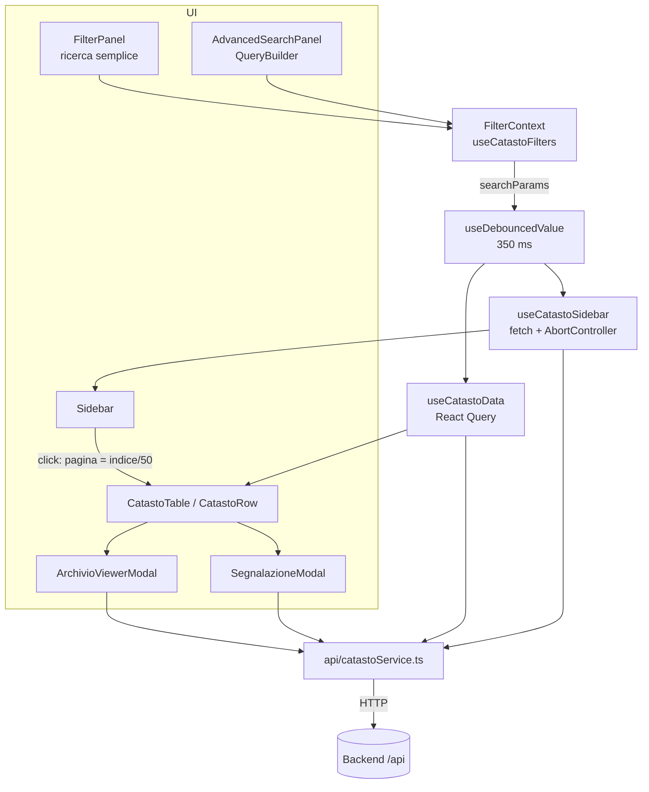
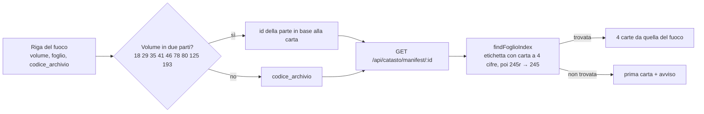

# Frontend — Catasto Fiorentino 1427

Applicazione **React 18 + TypeScript** costruita con **Vite 6**, stile **Tailwind CSS v4**, dati via **TanStack Query 5** e routing con **React Router 7**. Interfaccia interamente in italiano, tema chiaro e scuro, obiettivo di accessibilità WCAG 2.1 AA.

> Vedi anche: [Backend e API](backend.md) · [Architettura](architettura.md) · [Casi d'uso](casi-d-uso.md)

---

## Indice

1. [Pagine](#pagine)
2. [Struttura del codice](#struttura-del-codice)
3. [Stato e flusso dei dati](#stato-e-flusso-dei-dati)
4. [Funzionalità](#funzionalità)
5. [Tema e stile](#tema-e-stile)
6. [Configurazione, build e deploy](#configurazione-build-e-deploy)
7. [Test](#test)
8. [Limiti noti](#limiti-noti)

---

## Pagine

| Percorso | Componente | Contenuto |
|---|---|---|
| `/` | `pages/HomePage.tsx` | Applicazione principale: indice laterale, ricerca semplice/avanzata, esempi pronti, tabella e statistiche, paginazione, visore, segnalazioni, export, confronto |
| `/banco` | `pages/BancoPage.tsx` | Banco di lavoro: query come frase, colonne a scelta, grafici sui risultati, raccolte, tabella densa (lazy) |
| `/informazioni` | `pages/InfoPage.tsx` | Descrizione del progetto e crediti (caricata in lazy) |
| `/glossario` | `pages/GlossarioPage.tsx` | Termini del catasto con le definizioni, un'ancora per voce (lazy) |
| `/contatti` | `pages/ContattiPage.tsx` | Indirizzi email e link al repository (lazy) |
| `/mappa` | `pages/MappaPage.tsx` | Segnaposto "in fase di sviluppo", non collegato dal menu (lazy) |

`FilterProvider` avvolge il router: i filtri restano impostati anche passando da una pagina all'altra. `CompareProvider` (la selezione dei fuochi) e la vista di confronto stanno in `App.tsx` sopra le route: la selezione fatta in Consultazione vale anche nel Banco di lavoro.

---

## Struttura del codice

```
frontend-catasto/
├── index.html                 # lang="it", carica public/theme-init.js prima del paint
├── public/theme-init.js       # applica il tema salvato (file separato: la CSP vieta script inline)
├── nginx.conf                 # SPA + proxy /api → backend:3005
├── security-headers.conf      # CSP e header di sicurezza
├── vercel.json                # alternativa di deploy statico
└── src/
    ├── main.tsx · App.tsx     # bootstrap, route, lazy loading
    ├── providers/Providers.tsx# QueryClient (retry 1, niente refetch al focus)
    ├── context/FilterContext.tsx
    ├── api/
    │   ├── client.ts          # apiRequest, apiDownload, base URL, messaggi d'errore per l'utente
    │   └── catastoService.ts  # tutte le chiamate al backend
    ├── hooks/
    │   ├── useCatastoFilters.ts   # stato dei filtri, AST, ordinamento, link condivisi
    │   ├── useCatastoData.ts      # tabella paginata + parenti della riga aperta
    │   ├── useCatastoSidebar.ts   # indice a caricamento progressivo
    │   ├── useDebouncedValue.ts · useDarkMode.ts · useMediaQuery.ts · useModal.ts
    ├── components/
    │   ├── layout/            # Header, Footer, Sidebar (lista virtualizzata)
    │   └── common/            # CustomAutocomplete, CustomNumberInput, Spinner
    ├── features/
    │   ├── catasto/
    │   │   ├── components/    # FilterPanel, AdvancedSearchPanel, QueryBuilder,
    │   │   │                  # CatastoTable, CatastoRow, Pagination, ArchivioViewerModal,
    │   │   │                  # ExportMenu
    │   │   └── lib/           # logica pura, testata
    │   │       ├── simple-filters.ts   # filtri semplici → parametri di query
    │   │       ├── query-ast-utils.ts  # pruneAst: toglie condizioni incomplete
    │   │       ├── query-describe.ts   # AST → frase leggibile (describeQuery di @catasto/shared)
    │   │       ├── download.ts         # salvataggio di un Blob come file
    │   │       ├── query-share.ts      # AST ⇄ link #q=…
    │   │       ├── saved-queries.ts    # query salvate in localStorage
    │   │       ├── archivio.ts         # volumi in due parti, ricerca della carta, URL IIIF
    │   │       └── segnatura.ts        # parser della segnatura (da @catasto/shared)
    │   └── segnalazioni/
    │       ├── components/SegnalazioneModal.tsx
    │       └── api/create-segnalazione.ts
    └── pages/
```

Regole e tipi comuni (campi interrogabili, operatori, limiti dell'AST, parser della segnatura) arrivano da `@catasto/shared`, che Vite importa direttamente dal sorgente (`packages/shared/src`).

---

## Stato e flusso dei dati



- **`useCatastoFilters`** contiene i filtri semplici, l'ordinamento, la modalità avanzata, l'AST in modifica e l'AST "potato" (`queryAst`, senza condizioni incomplete). Produce un unico oggetto `searchParams`.
- **Debounce**: l'intero `searchParams` è ritardato di 350 ms, quindi digitazione, menu e ordinamenti generano una sola richiesta.
- **Modalità esclusive**: in ricerca avanzata l'AST *sostituisce* i filtri semplici (non li combina).
- **Tabella** (`useCatastoData`): chiave React Query `["catastoData", search, page]`, 50 righe per pagina, `keepPreviousData` durante il cambio pagina. Una sola riga aperta alla volta; i parenti si caricano solo quando la riga viene aperta (cache 10 min).
- **Indice** (`useCatastoSidebar`): blocchi da 1000 voci con scroll infinito; ogni nuova ricerca annulla la precedente.
- **URL**: l'unico stato nell'URL sono i frammenti `#q=` (ricerca condivisa) e `#confronta=` (confronto condiviso), letti una volta all'avvio e poi rimossi.

### Chiamate al backend

| Funzione | Endpoint | Quando |
|---|---|---|
| `fetchFuochi(search, "table")` | `GET /api/catasto` o `POST /api/catasto/query` | ricerca semplice / avanzata |
| `fetchFuochi(search, "sidebar")` | `GET /api/catasto/sidebar` o `POST /api/catasto/query` (`view: "sidebar"`) | indice |
| `fetchParenti(id)` | `GET /api/parenti/:id` | apertura di una riga |
| `fetchFilterOptions(geo)` | `GET /api/filters?serie=&quartiere=&piviere=` | avvio e cambio di livello geografico |
| `fetchManifest(id)` | `GET /api/catasto/manifest/:id` | apertura del visore |
| `createSegnalazione(body)` | `POST /api/segnalazioni` | invio di una segnalazione |
| `fetchFuochiByIds(ids)` | `GET /api/catasto/fuochi?ids=` | selezione del confronto |
| `fetchStats(search)` | `GET /api/catasto/stats` o `POST /api/catasto/query/stats` | scheda **Statistiche** aperta |
| `downloadExport(search, opzioni)` | `GET /api/catasto/export` o `POST /api/catasto/query/export` | pulsante **Esporta** |

`api/client.ts` usa `VITE_API_URL`; se manca, in produzione chiama la stessa origine (`/api`, proxato da nginx), in sviluppo `http://localhost:3005`. Gli errori 4xx mostrano il messaggio del backend, gli altri un testo generico in italiano.

---

## Funzionalità

### Ricerca semplice (`FilterPanel`)

- Sempre visibili: **Cerca Persona**, **Cerca Località**, **Volume**, pulsante **Aggiorna**.
- Pannello **Altri filtri** (con contatore dei filtri attivi):
  - attributi a scelta con autocompletamento: Mestiere, Rapporto, Bestiame, Immigrazione, Particolarità parente, Casa;
  - geografia a cascata **Serie → Quartiere → Piviere → Popolo** (cambiare un livello azzera quelli sotto e restringe le opzioni);
  - intervalli min/max in fiorini: Fortune, Credito, Credito ai Monti, Imponibile, Deduzioni.
- **Azzera filtri** ripristina filtri, ordinamento e AST.
- `CustomAutocomplete` è un combobox ARIA completo (frecce, Home/End, Invio, Esc, Canc), mostra al massimo 100 voci per volta.

### Ricerca avanzata (`AdvancedSearchPanel`, `QueryBuilder`)

- Gruppi **Tutte** (AND) / **Almeno una** (OR), con **Escludi** (NOT) e annidamento fino a 5 livelli.
- Ogni condizione: campo → operatore compatibile col tipo → valore (testo, numero, intervallo, scelta singola o multipla).
- **Anteprima** in linguaggio naturale, ad esempio: *Mostra i fuochi dove Mestiere è uguale a "Lanaiolo" e (Fortune maggiore di 1000 oppure Casa è uguale a "Propria")*.
- **Filtri salvati**: in `localStorage` (`catasto.savedQueries.v1`, max 50, nome max 60 caratteri); stesso nome = sovrascrittura. Restano sul dispositivo; le voci con una struttura non valida vengono scartate.
- **Condividi link**: copia `https://…/#q=<base64url del JSON dell'AST>` (max 2000 caratteri). Il frammento `#` non arriva ai log dei server. Chi apre il link entra direttamente in ricerca avanzata; un link con una query malformata viene ignorato.

### Indice laterale (`Sidebar`)

Elenco virtualizzato (nome + mestiere) dei fuochi della ricerca corrente. Cliccando una voce la tabella passa alla pagina corrispondente (`indice / 50 + 1`). Aperto di default su desktop, a sovrapposizione su mobile.

### Tabella e scheda del fuoco (`CatastoTable`, `CatastoRow`)

- Desktop (≥ 1024 px): tabella con colonne **Capofamiglia**, **Località**, **Dati sintetici**, **Riferimenti**, ordinabili (tranne Riferimenti) con `aria-sort`. Mobile: schede.
- **Riferimenti**:
  - **Campione** "Vol. X c. Y": apre il visore se il volume è digitalizzato;
  - **Portata**: compare quando la redazione ha pubblicato la segnatura; apre il visore se anche quel volume è digitalizzato.
- **Riga aperta**:
  - *Dettagli economici*: credito, credito ai monti, fortune, deduzioni, imponibile in fiorini; bestiame, immigrazione, rapporto di mestiere, particolarità;
  - *Composizione familiare*: parentela, sesso, età, stato civile, particolarità di ogni membro;
  - azioni **Segnala un errore** e, se manca la portata, **contribuisci** con la segnatura.

### Glossario e aiuto contestuale (`features/glossary`, `features/tour`, `features/examples`)

- **Glossario come dato unico**: `src/i18n/glossary.ts` (termine, definizione breve e, se serve, estesa, in italiano e inglese). Le definizioni riprendono il glossario di `docs/architettura.md` e vanno riviste dagli autori prima di aggiungere voci: un termine senza definizione verificata non entra. `FIELD_TERMS` dice, per **ogni** campo di `FIELD_REGISTRY`, quale voce lo spiega (`null` = nessun termine tecnico o nessuna definizione verificata); un test fallisce se un campo nuovo non ha una decisione.
- **Suggerimenti** (`GlossaryTerm`): pulsante "i" accanto alle etichette nella tabella (Capofamiglia → fuoco, Riferimenti → campione), nella scheda del fuoco (dati economici), nei filtri (volume, serie, quartiere, piviere, popolo, intervalli in fiorini), nel QueryBuilder (campo scelto) e nella tabella delle statistiche. Si apre al passaggio del mouse, al focus e al tocco; Esc lo chiude e restituisce il focus; la definizione è sempre collegata con `aria-describedby`; il riquadro (in un portal, così la tabella non lo taglia) contiene il link **Approfondisci** alla voce del glossario. Sta accanto ai controlli, mai dentro un altro pulsante o un `<label>`.
- **Pagina `/glossario`**: tutte le voci in ordine alfabetico, ciascuna con l'ancora `#termine-<id>` (portata in vista e messa a fuoco all'arrivo) e un indice iniziale. Collegata dal footer.
- **Percorso guidato** (`GuidedTour`): cinque passi (ricerca, scheda del fuoco, visore, segnalazione, confronto/export/statistiche) in una finestra modale. Si apre da sola alla prima visita della home, ma non sopra un link condiviso; chiuderla in qualunque modo (Salta, Esc, Ho capito) la segna come vista in `localStorage` (`catasto.tour.v1`); il pulsante **Guida** nell'header la riapre.
- **Esempi pronti** nella home, visibili finché non c'è alcun filtro: "I fuochi più ricchi di San Giovanni", "Immigrati dal contado", "Imponibile di almeno 1000 fiorini", "Fuochi con un parente di 80 anni o più". Un clic carica la query nella ricerca avanzata (come un link `#q=`), con l'ordinamento dell'esempio. Le opzioni (quartiere, immigrazione) si cercano per etichetta fra quelle di `/api/filters`: un esempio la cui opzione non esiste non compare.

### Selezione e confronto tra fuochi (`features/compare`)

- Casella **Seleziona** piccola e senza testo su ogni riga e scheda, in Consultazione e nel Banco: si scelgono fino a `SELECTION_MAX_FUOCHI` (500) fuochi, anche da pagine o ricerche diverse. La riga selezionata ha il fondo appena tinto e un filetto a sinistra.
- **Barra della selezione** in basso, su una riga sola e con il solo filo in alto: «N fuochi selezionati: Nome ×, Nome ×, e altri N · Aggiungi a una raccolta · Esporta i selezionati · Deseleziona · Confronta affiancati». **Confronta affiancati** è attivo da 2 a 5 fuochi (`COMPARE_MIN_FUOCHI`/`COMPARE_MAX_FUOCHI`); **Esporta i selezionati** scarica un CSV con il filtro `ids`; **Aggiungi a una raccolta** apre un piccolo pannello con le raccolte esistenti e il nome di una nuova. Uno spaziatore evita che la barra copra il fondo della pagina.
- **Vista di confronto** (finestra modale con `useModal`: Esc, focus intrappolato e restituito): su desktop una tabella con una colonna per fuoco e intestazioni di riga e di colonna; su mobile schede affiancate da scorrere. Righe: mestiere, rapporto di mestiere, località, casa; fortune, credito, credito ai monti, imponibile e deduzioni con la differenza dal primo fuoco scritta in parole e con ▲/▼ (mai solo un colore; con un dato assente nessuna differenza); membri registrati, età e stato civile dei parenti; riferimento al campione con **Apri la carta** nel visore.
- **Stato**: la selezione (id) sta in `sessionStorage` (`catasto.compare.v1`) e vale per la sessione, insieme a una copia delle righe scelte dalla tabella (`catasto.compare.rows.v1`). I fuochi senza copia (link condiviso, raccolta messa nella selezione) si chiedono una volta a `GET /api/catasto/fuochi?ids=` in blocchi di 50 e diventano copie; a vista aperta gli stessi fuochi si ricaricano nella lingua attiva. Se l'endpoint non risponde (per esempio un'anteprima del frontend collegata a un backend non ancora aggiornato) bastano le copie, e l'errore compare solo per i fuochi che non hanno né l'una né l'altra fonte.
- **Link condiviso** `#confronta=12,345,678` (pulsante **Copia il link** della vista): riapre la stessa selezione, e il confronto se i fuochi sono da 2 a 5. Id non validi o ripetuti vengono scartati senza errori; quelli inesistenti vengono tolti dopo la risposta del server, con un avviso nella barra e nella live region. Al caricamento il parametro viene tolto dal fragment lasciando il resto (es. `#q=`).

### Banco di lavoro (`pages/BancoPage.tsx`, `features/banco`)

- **Query**: lo stesso AST della ricerca avanzata della Consultazione (`FilterContext`), quindi stessi risultati per la stessa query. Si legge come una frase («Fuochi dove serie è Città e mestiere è lanaiolo», da `describeNode`), con «+ condizione», «Modifica come gruppi E/O» (apre `QueryBuilder`), «Salva la query» (`saved-queries.ts`) e «Copia il link» (`#q=`). Modificarla qui porta anche la Consultazione in ricerca avanzata.
- **Tabella densa** (`BancoTable`): righe di 32 px, cifre tabellari a destra con il separatore delle migliaia, righe alterne appena tinte, ordinamento dalle intestazioni (le colonne che il backend sa ordinare); in fondo **media** e **mediana** di tutti i risultati, dalle statistiche (le bocche dalla distribuzione dei membri). 25, 50 (default), 100 o 200 righe per pagina. Il riferimento «Vol., c.» apre `ArchivioViewerModal`. I dati arrivano dalla vista `banco` (`fetchFuochi(search, "banco", …)`), che aggiunge bocche ed età media.
- **Colonne** (`columns.ts`, `ColumnsMenu`): l'elenco viene da `FIELD_REGISTRY` più quattro colonne derivate (campione, quartiere » popolo, bocche, età media); i campi dei parenti restano filtri. Ogni colonna si accende o spegne e si trascina; le frecce ↑↓ fanno lo stesso da tastiera. La scelta sta in `localStorage` (`catasto.banco.colonne.v1`), ripulita alla lettura (chiavi ignote fuori, colonne nuove in coda); «ripristina» torna alla partenza. Il capofamiglia non si spegne.
- **Grafici** (`BancoCharts`, `charts.ts`): imponibile per fasce, fuochi per numero di bocche e mestieri più frequenti, da `GET /api/catasto/stats` su tutta la query. La voce che contiene la riga attiva (sotto il mouse o il focus) è nel secondo colore e detta a parole; ogni grafico ha la sua tabella dei dati.
- **Raccolte** (`collections.ts`, `CollectionsPanel`): insiemi di fuochi scelti a mano, in `localStorage` (`catasto.raccolte.v1`, al massimo 50). Si aprono nel Banco (ricerca con il filtro `ids`), si mettono nella selezione per confrontarli o esportarli, si condividono con un link `/banco#raccolta=<nome>:<id,…>` che all'apertura salva la raccolta sul dispositivo. Le modifiche passano da un evento `catasto:raccolte`, così barra e pagina restano allineate anche senza `localStorage`.
- **Telefono**: un avviso dice che la pagina è pensata per il computer; resta usabile, con la tabella che scorre di lato.

### Statistiche (`StatsPanel`)

- Schede **Tabella** / **Statistiche** sopra i risultati (pattern ARIA tabs, `components/common/Tabs.tsx`: frecce, Home, Fine). Le statistiche si caricano solo con la scheda aperta (`useCatastoStats`, chiave `["catastoStats", lang, ricerca senza ordinamento]`, 60 s) e seguono i filtri come la tabella. Un clic nell'indice laterale riporta alla tabella.
- Un `404` dall'endpoint (backend non ancora aggiornato) mostra "Statistiche non ancora disponibili" invece dell'errore generico; gli altri errori restano con **Riprova**. `apiRequest` lancia `ApiError` con lo status HTTP.
- Contenuto: fuochi, parenti e membri medi per fuoco; tabella delle misure economiche (presenti, assenti, somma, media, mediana, quartili, minimo, massimo) con una spiegazione delle misure per chi studia; barre per mestiere, quartiere, serie, numero di membri e stato civile; piramide delle età per sesso.
- Grafici in HTML, senza librerie: una serie = un colore (`--chart-1`), la piramide usa `--chart-1` e `--chart-2` con legenda e intestazioni dei due lati. La coppia di colori è validata (lightness, croma, separazione per daltonismo e contrasto) sia sul tema chiaro sia sullo scuro. Ogni barra ha accanto valore e quota; "Altro" e "Non indicato" hanno una trama a righe, non solo un colore; ogni grafico ha la sua **tabella dei dati** in un `<details>`. Le misure non calcolabili mostrano "—" con un testo per i lettori di schermo.

### Export (`ExportMenu`)

- Pulsante **Esporta** accanto al numero di risultati: apre un pannello (Esc o clic fuori lo chiudono) con formato **CSV** o **Excel (XLSX)**, separatore del CSV (punto e virgola per Excel in italiano, predefinito in italiano; virgola per R, Python ed Excel in inglese) e **Includi i parenti**.
- L'export contiene tutte le pagine della ricerca mostrata in tabella (la stessa `search`, semplice o avanzata), nello stesso ordine. CSV con i parenti = due file scaricati uno dopo l'altro (fuochi e parenti); XLSX = un file con i fogli Info, Fuochi e Parenti.
- Il file arriva con `fetch` e viene salvato con un URL temporaneo (`lib/download.ts`): così un `400` (per esempio oltre il tetto di righe del server) diventa un messaggio nel pannello, non una pagina di errore. Lo stato ("Preparazione del file…", file scaricati) è in una live region.

### Visore delle carte (`ArchivioViewerModal`)



- Immagini IIIF a 1600 px, a piena risoluzione sopra il 120% di zoom; le carte vicine sono precaricate.
- Zoom 20–500% (rotella, pulsanti, tasti `+`/`-`), trascinamento, pinch e swipe su touch, frecce per cambiare carta, **Adatta** per ripristinare.
- Link al **sito originale** dell'Archivio digitale e pulsante **Segnala segnatura**.
- `useModal` gestisce Esc, focus trap, ripristino del focus, blocco dello scroll e modali sovrapposte.

### Segnalazioni (`SegnalazioneModal`)

| Tipo | Campi | Note |
|---|---|---|
| **Dato errato** | campo errato (obbligatorio), valore corretto | il valore attuale viene allegato automaticamente |
| **Segnatura della portata** | segnatura (obbligatoria) | prefisso implicito `ASFi, Catasto`; casella "altro fondo" per toglierlo |
| **Altro** | valore proposto o note | |
| *tutti* | note (max 2000), email facoltativa | campo nascosto `website` come honeypot |

Dopo l'invio compare la conferma "verificata dalla redazione": nulla viene pubblicato senza moderazione.

---

## Tema e stile

- Token di colore definiti in `src/index.css` (`:root` e `.dark`) ed esposti a Tailwind v4 con `@theme`; variante `dark` basata sulla classe `.dark` su `<html>`.
- `useDarkMode` legge `localStorage.theme`, altrimenti `prefers-color-scheme`; `public/theme-init.js` applica la classe prima del primo paint per evitare lampeggi.
- Carattere: **Source Serif 4** per tutta l'interfaccia.
- `prefers-reduced-motion` è rispettato globalmente.

---

## Configurazione, build e deploy

| Comando (in `frontend-catasto/`) | Effetto |
|---|---|
| `npm run dev` | server Vite su `http://localhost:5173` |
| `npm run build` | bundle in `dist/` |
| `npm run preview` | serve la build |
| `npm run lint` | ESLint, zero warning ammessi |
| `npm test` | Vitest (ambiente node; jsdom nei test di componenti e hook) |
| `npm run lint` | ESLint, con la configurazione condivisa `eslint.config.base.mjs` della root |

**Variabili**: solo `VITE_API_URL` (facoltativa, letta a build time).

**nginx** (immagine Docker): SPA fallback su `index.html`, `/assets/` con cache immutabile di un anno, `/api` proxato a `http://backend:3005` con `X-Forwarded-For` impostato all'IP del client, gzip, body max 128 kB.

**Header di sicurezza** (`security-headers.conf`): CSP `default-src 'self'; script-src 'self'; img-src 'self' data: https:; connect-src 'self'; frame-ancestors 'none'…`, `X-Frame-Options: DENY`, `nosniff`, `Referrer-Policy`, `Permissions-Policy`, COOP. HSTS va configurato sul terminatore TLS.

**Vercel** (`vercel.json`): stesse intestazioni con `connect-src 'self' https:`; non c'è proxy per `/api`, quindi va impostato `VITE_API_URL` verso il backend.

---

## Test

Test unitari sulla logica pura in `features/catasto/lib/`:

- `archivio.test.ts`: scelta della parte del volume, ricerca della carta, URL IIIF;
- `segnatura.test.ts`: parsing delle segnature della portata;
- `simple-filters.test.ts`: conversione dei filtri in parametri.
- `formato.test.ts`: fiorini, età e località con dati assenti;
- `query-ast-validate.test.ts`: validazione strutturale dei link condivisi, limiti di profondità, `pruneAst` tollerante;
- `saved-queries.test.ts`: generazione degli id anche fuori da HTTPS.

Test di componenti e hook con Testing Library, in jsdom (dichiarato in testa al file con `// @vitest-environment jsdom`; `src/test/setup.ts` fissa la lingua italiana e smonta il DOM dopo ogni test, `src/test/render.tsx` fornisce i provider dell'app):

- `CatastoRow.test.tsx`: la riga non è focalizzabile, si apre dal pulsante con `aria-expanded`/`aria-controls`, il visore non espande la riga, i valori assenti non diventano 0;
- `Pagination.test.tsx`: comandi disabilitati ai bordi e durante il caricamento, cambio pagina solo su Invio;
- `useCatastoFilters.test.tsx`: cascata geografica, ordinamento, AST eseguibile, apertura da link `#q=`;
- `glossary.test.ts`: una decisione nel glossario per ogni campo del registry, voci complete in IT/EN;
- `GlossaryTerm.test.tsx`: descrizione sempre collegata, apertura al focus, Esc con focus restituito, tocco senza propagare il clic alla riga;
- `GuidedTour.test.tsx`: apertura alla prima visita, percorso completo, Salta ed Esc ricordati, riapertura dal pulsante;
- `GlossarioPage.test.tsx`: un'ancora per ogni voce e l'indice;
- `example-queries.test.ts`: esempi risolti per etichetta (anche id raggruppati), esempi senza opzione nascosti;
- `compare-selection.test.ts` e `compare-format.test.ts`: serializzazione e parsing del link `#confronta=`, id non validi, limite di cinque, `sessionStorage` alterato, differenze con dati assenti;
- `Compare.test.tsx`: caselle e barra, apertura da due fuochi, colonne e differenze, link con id inesistenti, limite di cinque, Esc e Svuota;
- `StatsPanel.test.tsx`: barre di "Altro" e "Non indicato", raggruppamento dei fuochi numerosi, tabella economica con valori non calcolabili, tabelle dei dati, errore con Riprova;
- `Tabs.test.tsx`: una sola scheda tabulabile, frecce, Home e Fine;
- `ExportMenu.test.tsx`: apertura e chiusura con Esc, due file per CSV con i parenti, un file per XLSX, messaggio del server oltre il tetto.

`api/client.test.ts` verifica il nome del file da `Content-Disposition` e gli errori di `apiDownload`.

---

## Limiti noti

I problemi emersi dalla revisione di settembre 2026 sono stati corretti (storico in [revisione-codice.md](revisione-codice.md)). Restano aperti due miglioramenti di accessibilità:

- le righe della tabella sono focalizzabili e contengono pulsanti (elementi interattivi annidati);
- alcune icone accanto a un'etichetta visibile non hanno `aria-hidden`.

## Lingua (italiano / inglese)

Il pulsante **EN/IT** nell'header cambia la lingua del sito; la scelta resta in `localStorage` (`lang`) e, alla prima visita, segue la lingua del browser (italiano se il browser è italiano, altrimenti inglese).

- Nucleo in `src/i18n/`: `LanguageProvider` (in `Providers`), `useLanguage()`, `useT(messages)`; fuori da React `translate()` e `getLang()`.
- Ogni componente tiene i testi in un `X.messages.ts` accanto al codice, con `defineMessages({ it, en })`: TypeScript segnala le chiavi inglesi mancanti.
- Le etichette dei campi e degli operatori del registry (`@catasto/shared`, che resta in italiano) si mostrano con `fieldLabel()` / `operatorLabel()`.
- I valori delle tabelle di lookup (mestieri, casa, bestiame, ...) li traduce il backend: `apiRequest` aggiunge `?lang=en` e al cambio lingua la cache di TanStack Query viene invalidata. Luoghi e nomi di persona non si traducono. Vedi `docs/backend.md`, sezione Traduzioni.
