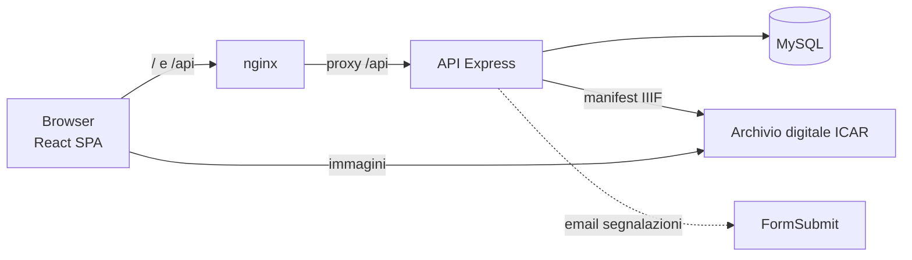

<div align="center">
  <h1>📜 Catasto Fiorentino 1427/30</h1>
  <h3>Archivio digitale e sistema di esplorazione</h3>
  <p>Un portale per consultare, interrogare e verificare sulla fonte i dati del catasto della Repubblica di Firenze del 1427/30.</p>
  <p>🇮🇹 <strong>Italiano</strong> · 🇬🇧 <a href="README.en.md">English</a></p>

  <div style="display: flex; justify-content: center; gap: 10px; margin-top: 20px; margin-bottom: 20px;">
    
    
    
    
    
    
  </div>

  
</div>

---

| Campo | Valore |
|---|---|
| Identificativo | `CAT-README` |
| Versione | 2.0 |
| Data | 2026-10-29 |
| Stato | Approvato |
| Classificazione | Pubblico |
| Responsabili | Antonio Orfitelli, Pasquale Ruotolo |
| Lingua | Italiano (testo di riferimento) · [English](README.en.md) |
| Standard applicato | [CAT-DOC-00 Standard documentale](docs/standard-documentale.md) |

## 1. Panoramica

**Catasto Fiorentino 1427/30** rende consultabile, interrogabile e verificabile sulla fonte il censimento fiscale della Repubblica di Firenze del 1427/30 (la barra indica l'arco della campagna di rilevazione, 1427–1430). Per ogni **fuoco** (nucleo familiare censito, intestato al capofamiglia) il portale mostra i dati economici in fiorini, la composizione familiare e la collocazione territoriale, e apre la **carta originale** del campione digitalizzata dall'Archivio di Stato di Firenze.

### 1.1 Fonte e provenienza dei dati

| Livello (ISAD(G)) | Descrizione |
|---|---|
| Istituto conservatore | Archivio di Stato di Firenze (ASFi) |
| Fondo | Catasto |
| Serie archivistiche | *Campioni* (registri ufficiali redatti dagli ufficiali del catasto) e *portate* (dichiarazioni dei contribuenti) |
| Unità e componenti | Volume del campione e carta (recto/verso) indicati per ogni fuoco |

| Provenienza | Contenuto |
|---|---|
| Dato della fonte | Circa 61.000 fuochi e 270.000 parenti della ricerca Herlihy–Klapisch-Zuber, digitalizzati da [ACRH](https://journals.openedition.org/acrh/7458) |
| Dato contribuito | Segnatura della portata (forma `ASFi, Catasto, …`), proposta dagli utenti e pubblicata solo dopo la verifica della redazione |
| Dato derivato | Statistiche, traduzioni dei valori, ordinamenti calcolati dal portale |
| Immagini | Servizio IIIF dell'Archivio digitale ICAR / ASFi |

I dati assenti nella fonte restano assenti: il portale non li stima né li ricostruisce.

### 1.2 Destinatari

- **studiosi e ricercatori**, che costruiscono query precise e verificano il dato sulla fonte;
- **studenti**, che esplorano il catasto senza una formazione archivistica;
- **redazione**, che modera le segnalazioni degli utenti e pubblica le segnature verificate.

## 2. Funzionalità

| | Funzionalità | Descrizione |
|---|---|---|
| 🔎 | **Ricerca semplice** | Per persona ("Nuto di Nardo"), località e volume; filtri su mestiere, bestiame, immigrazione, casa e particolarità; geografia a cascata serie territoriale → quartiere → piviere → popolo; intervalli in fiorini su fortune, credito, credito ai Monti, imponibile e deduzioni |
| 🧩 | **Ricerca avanzata** | Query composte con gruppi AND/OR, esclusione e annidamento, anteprima in italiano, 20 campi interrogabili, compresi età e particolarità dei parenti |
| 🔗 | **Query salvate e condivise** | Salvataggio sul dispositivo e link condivisibili (`#q=…`) che riaprono la stessa ricerca |
| 👪 | **Scheda del fuoco** | Dati economici, mestiere, località e composizione familiare (parentela, età, stato civile) |
| 🖼️ | **Visore delle carte** | Apre il volume IIIF sulla carta del fuoco (campione e, quando nota, portata), con zoom, trascinamento e gesti touch |
| 📊 | **Statistiche** | Totali, medie, mediane e quartili dei dati economici (con i valori assenti a parte), distribuzioni per mestiere, quartiere e serie territoriale, piramide delle età, sulla stessa ricerca della tabella |
| 📥 | **Export** | Tutte le righe della ricerca in CSV (UTF-8 con BOM) o Excel, con i parenti in formato lungo e i metadati della query |
| ⚖️ | **Confronto** | Da 2 a 5 fuochi affiancati, anche da ricerche diverse, con le differenze economiche e un link condivisibile (`#confronta=…`) |
| 📖 | **Glossario e guida** | Suggerimenti accanto ai termini tecnici, pagina del glossario, percorso guidato alla prima visita, ricerche d'esempio |
| ✍️ | **Segnalazioni** | Dato errato, segnatura della portata o altro, con moderazione della redazione tramite link firmati via email o API |
| 🌓 | **Tema chiaro e scuro** | Con obiettivo di accessibilità WCAG 2.1 AA |

## 3. Architettura in breve



È un monorepo con npm workspaces:

| Workspace | Contenuto |
|---|---|
| [`frontend-catasto/`](frontend-catasto) | React 18, Vite 6, Tailwind v4, TanStack Query, React Router 7 |
| [`backend-catasto/`](backend-catasto) | Node 20, Express 4, mysql2, zod, helmet, rate limiting |
| [`packages/shared/`](packages/shared) | `@catasto/shared`: tipi, registro dei campi interrogabili, limiti delle query, parser delle segnature |

## 4. Avvio rapido

Servono **Node.js ≥ 20** e **MySQL 8**. Il dump `Catasto.sql` non è nel repository e va richiesto ai gestori del progetto.

```bash
git clone https://github.com/AntonioOrf/Catasto.git && cd Catasto
npm install
mysql -u root -p -e "CREATE DATABASE catasto CHARACTER SET utf8mb4"
mysql -u root -p catasto < init/Catasto.sql            # dump dei dati
# crea backend-catasto/.env con DB_HOST, DB_USER, DB_PASSWORD, DB_NAME (vedi la guida)
npm run db:migrate -w catasto-backend                  # tabelle applicative
npm run dev                                            # frontend :5173, API :3005
```

Per la produzione con Docker (porta `1427`) segui la [guida all'installazione](docs/guides.md).

## 5. Documentazione

Tutti i documenti seguono lo [standard documentale CAT-DOC-00](docs/standard-documentale.md) e sono disponibili in italiano (testo di riferimento) e in inglese.

| ID | Documento | English | Contenuto |
|---|---|---|---|
| CAT-DOC-00 | [Standard documentale](docs/standard-documentale.md) | (bilingue) | Struttura dei documenti, convenzioni storiche e archivistiche, terminologia |
| CAT-DOC-01 | [Installazione e deployment](docs/guides.md) | [EN](docs/en/installation.md) | Sviluppo locale, Docker Compose, migrazioni, aggiornamenti, risoluzione dei problemi |
| CAT-DOC-02 | [Architettura e modello dati](docs/architettura.md) | [EN](docs/en/architecture.md) | Componenti, diagramma ER, glossario, pipeline di deploy, sicurezza |
| CAT-DOC-03 | [Backend e API](docs/backend.md) | [EN](docs/en/backend.md) | Endpoint con esempi, formato delle query avanzate, segnalazioni e moderazione, variabili d'ambiente |
| CAT-DOC-04 | [Frontend](docs/frontend.md) | [EN](docs/en/frontend.md) | Pagine, componenti, flusso dei dati, visore, segnalazioni, build |
| CAT-DOC-05 | [Casi d'uso](docs/casi-d-uso.md) | [EN](docs/en/use-cases.md) | Otto scenari reali con diagrammi di sequenza, di stato e di flusso |
| CAT-DOC-06 | [Revisione del codice](docs/revisione-codice.md) | [EN](docs/en/code-review.md) | Problemi noti con priorità, stato dei test |
| — | [Product brief](frontend-catasto/PRODUCT.md) | — | Utenti, principi e vincoli del prodotto |

## 6. Contribuire

1. Crea un ramo dal `main`.
2. Prima di aprire la PR esegui i controlli della CI: `npm run build`, `npm run lint`, `npx tsc --noEmit` in `backend-catasto/` e `frontend-catasto/`, `npm test` e, con un MySQL di prova, `npm run test:integration -w catasto-backend` (vedi [Backend](docs/backend.md)).
3. Se aggiungi tabelle, crea una nuova migrazione numerata in `backend-catasto/migrations/`.
4. Se aggiungi un campo interrogabile, basta dichiararlo in `packages/shared/src/fields.ts`: frontend e backend lo usano entrambi.
5. Se modifichi un documento, aggiorna nello stesso commit la traduzione inglese, la versione e il registro delle modifiche (vedi [CAT-DOC-00](docs/standard-documentale.md)).

A ogni merge su `main` la CI pubblica automaticamente le immagini Docker.

## 7. Riferimenti e fonti

- Herlihy, David, e Christiane Klapisch-Zuber. *Les Toscans et leurs familles. Une étude du catasto florentin de 1427*. Paris: Presses de la Fondation nationale des sciences politiques – Éditions de l'EHESS, 1978.
- Dati digitalizzati: ACRH, <https://journals.openedition.org/acrh/7458>.
- Immagini: Archivio di Stato di Firenze, Archivio digitale ICAR, servizio IIIF.

## 8. Autori e licenza

Progetto di **Antonio Orfitelli** e **Pasquale Ruotolo**. Codice rilasciato con [licenza MIT](LICENSE). I dati del catasto e le immagini d'archivio restano soggetti ai termini delle rispettive fonti.

## 9. Registro delle modifiche

| Versione | Data | Autore | Descrizione |
|---|---|---|---|
| 1.x | — | Antonio Orfitelli, Pasquale Ruotolo | Versioni precedenti, senza registro |
| 2.0 | 2026-10-29 | Pasquale Ruotolo | Riscrittura secondo CAT-DOC-00, sezione sulla fonte, traduzione inglese |
